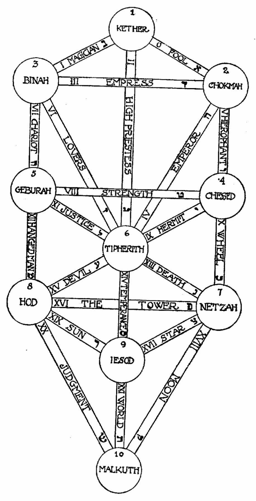

The Tarot is a pack of cards of unknown origin, which has been in circulation throughout Europe for at least five centuries, and perhaps much longer. In the tap-rooms of village inns here and there on the Continent it is still shuffled and dealt in quaint old games long since forgotten by the rest of the world. Fortune-tellers also hold it in high esteem, from Gypsies who read the cards for a shilling, to professors of occult arts whose fees are in keeping with their elaborate establishments and expensive advertising.

Gambling and cartomancy, however, are but husks hiding the kernel of the Tarot's true meaning. What makes it so interesting and valuable to occultists is the fact that it is a book, written in the language of numerical and pictorial symbolism. It teaches the principles of that hidden wisdom, older than history, which the sages of each generation have handed down to those coming after them who were duly and truly prepared to receive it. This doctrine was taught in the temple-schools of India, Persia, and Egypt; has been dramatized in the mysteries of Greece, in the Roman Catholic Mass, and in the rituals of Freemasonry; is veiled by innumerable sacred allegories and parables, concealed in creeds, and obscured by the dogmas of theologians; and it will always be, through all changes in its manner of presentation, the living spirit of truth behind the letter of exoteric religion and philosophy.

The particular version given in the Tarot is of Jewish origin, though some of the designs reflect the influence of Christian ideas. The whole pack is constructed according to a plan derived from the Kabbalah, and each card represents a definite proposition of this ancient Hebrew theosophical system, which tradition traces to Abraham.

The pack is divided into two main groups of cards. The larger portion comprises fifty-six Keys, arranged in four suits. In each suit are ten spot-cards, numbered from Ace to Ten, and four court-cards: a King, a Queen, a Knight, and a Page. These are the minor trumps, or lesser arcana. The other keys, termed greater arcana, or major trumps, form a sequence of twenty-two emblematic pictures, each having its own special title, which are numbered from Zero to Twenty-one.

As their name suggests, the minor trumps represent elementary doctrines more or less openly stated in various Kabbalistic books. To the greater mysteries of Hebrew occultism these teachings bear a relation similar to that borne by the comparatively simple principles of arithmetic to the abstruse calculations of higher mathematics.

The names of the four suits are as follows: wands, staves, or sceptres (clubs); cups, or chalices (hearts); swords, or pikes (spades); coins, or pentacles (diamonds). Each suit represents one of the four ideal worlds, or planes of manifestation, into which, according to the Kabbalah, the universe is divided. Each also corresponds to one of the four elements of ancient physics, is related to one of the four living creatures mentioned in Ezekiel and Revelation, and symbolizes the occult meaning of a letter of the sacred name, Yahveh (Jehovah), commonly known as the Tetragrammaton, because in Hebrew it is spelled with four letters—Yod, Heh, Vau, Heh.

According to the Zohar, the first letter of this name signifies divine royalty. Eliphas Levi says it represents the rod of Moses, and Papus tells us it is the sign of the active principle of all things. This divine essence is air, the breath of life, termed **Prana** in Sanskrit, **Pneuma** in Greek, **Ruach** in Hebrew, and **Spiritus** in Latin. The highest terrestrial manifestation of this principle is man, the ruler of the earth, and among the living creatures the man-faced cherub is its emblem. Azilut, the archetypal world, is the sphere of this Pure Spirit. It is the world of original causes, in which the impulses originate that determine what happens on the other planes. The essential idea, therefore, implied by the letter Yod, by air, by the man, and by Azilut is dominion. And authority and sovereignty are suggested by the staff, whether it be the wand of the magus or the sceptre of royalty.

From the Kabbalistic standpoint, creation is a limitation of the infinite possibilities of the archetypal world to some definite, special end. Hence we are told that creation took place with the letter Heh, which has exactly half the numerical value of the archetypal Yod. This letter is sometimes called the Mother, and is said to be the sign of the universal substance. (Students of Hindu philosophy will note the similarity of these meanings of Yod and Heh to the doctrine of Purusha and Prakriti). The universal substance is termed water. It is a condensation of the divine essence, or air. One of its emblems is the eagle, because clouds resemble great birds. The universal substance is held to be the receptacle of the divine essence; and the sphere of substance—Briah, the creative world—is also supposed to receive and circumscribe the impulses originating in the archetypal world. This notion of receptivity is the essential idea behind the symbolism of the cup. Vau, the third letter of the name, means "hook," or "nail," and so denotes the link, or affinity, between the first two letters. The bond of union between essence and substance is, of course, motion, or active force. The sphere of this activity is the formative world, Yetzirah. The corresponding element is fire, the universal radiant energy that is the root of all forces. This fire is what we have to tame in practical occultism. Hence it is represented by the lion. In the Tarot it is symbolized by the sword.

The final Heh of the sacred name is held to be the synthesis of the other three letters, to which it stands in a relation similar to that existing between a grain of wheat and the ear of which that grain is a part. That is to say, all the potentialities of the other three letters are concentrated in the final Heh. And because all these potentialities are involved in the divine essence represented by the Yod, we are told that the final Heh is a Yod in germ. It corresponds to the outermost of the four worlds, Assiah, the plane of physical phenomena. Every physical condition is a synthesis of divine essence, universal substance, and active force. Each phenomenon is a seed, whence a whole crop of new phenomena may be developed. The possibilities of the archetypal world are made known by the actualities of the material plane, and the simplest thing has almost limitless capacity for unfoldment. Hence the most important fact about the material world is its exhaustless fecundity and reproductive power. Of this the element earth, which stands for manifested substance, embodying the divine essence, is a type. The bull is also an emblem of reproductive power. That the suit of coins properly symbolizes all these ideas the reader will see for himself after a moment's reflection.

We must also note the connection between the living creatures and the four cardinal signs of the zodiac. The man is the Aquarius, or water bearer, an airy sign. The eagle stands for Scorpio, a watery sign. The lion is Leo, the house of the sun, or abode of radiant force. The bull is Taurus, an earthy sign. My friend, Frank C. Higgins, F. R. N. S., whose researches in comparative symbology have brought to light a wealth of interesting and valuable information, has found a curious connection between the cardinal signs and the Tetragrammaton. Aquarius is the eleventh sign, Scorpio is the eighth, Leo is the fifth, and Taurus is the second. Thus the sum of the numbers of the signs is 26, and this is also the sum of the values of the letters Yod, Heh, Vau, Heh.

Let us now consider the significance of the court-cards. Kabbalists say the human constitution is composed of four principles, as follows: spirit, soul, astral body, and physical body. This Hebrew classification is merely more general than that adopted by Hindu teachers. The spirit combines **Atma** and **Buddhi;** the soul includes **Manas** and **Kama;** the astral body is both **Prana** and **Linga Sharira**; the physical body is **Rupa**. Each principle has its abode, as it were, in one of the four worlds, though its influence extends to all the other planes. In the minor trumps, therefore, each is represented by four court-cards of the same denomination, one for each suit. The Kings are emblems of the spirit, the sovereign principle, and they are related to the suit of wands. The Queens designate the soul, which, as the receptacle of the vital essence of the spirit, is symbolized by the cups. The Knights, typifying the astral body, are men-at-arms, and so correspond to the swords. The Pages, denoting the physical body, are connected with pentacles, or coins.

The spot-cards summarize the Kabbalistic doctrine of emanation. According to this teaching, the limitless Absolute is the source of all. From it proceed ten emanations called Sephiroth. Each Sephirah corresponds to one of the numbers of the primitive decade. In the accompanying diagram, known as the "Tree of the Sephiroth," the ten stages of emanation are represented by the circles.

Their Hebrew names are: 1. Kether; 2. Chokmah; 3. Binah; 4. Chesed; 5. Geburah; 6. Tipherith; 7. Netzah; 8. Hod; 9. Iesod; 10. Malkuth. In English they may be termed as follows: 1. Crown, or Primal Will; 2. Wisdom; 3. Understanding, or Intellect; 4. Mercy, or Beneficence; 5. Strength, or Justice; 6. Beauty; 7. Victory; 8. Splendor, or Eternity; 9. Basis, Foundation, or Fecundity; 10. Kingdom, or Realization.

The Sephiroth are different aspects or attributes in the manifestation of one and the same Being, the Supreme Spirit, which is designated by the name Ain Suph, meaning "No Limit." This is the transcendent One, free from every qualification, that is called Aum in Sanskrit. Of this One it is written: "The Absolute is described as 'not this,' 'not that,' and so on, by negatives only." It is identical with what is termed the "Divine Darkness" in the Mystical Theology of Dionysius.

Though this One cannot be defined, we are justified in thinking of it as being like its highest manifestations. The highest expression of Being that we know is life, and the essence of life is intelligence. So we say that the Absolute is Pure Consciousness, and affirm that God is the Knower who knows Himself. That the Kabbalah teaches this doctrine is shown by the fact that the names of the Sephiroth all suggest the working of mind. Each Sephirah, moreover, is said to be the seat of a special mode of intelligence, as follows:

| 1. Primal Will | Hidden Intelligence |
| --- | --- |
| 2. Wisdom | Illuminating Intelligence |
| 3. Understanding | Sanctifying Intelligence |
| 4. Mercy | Measuring Intelligence |
| 5. Strength | Radical Intelligence |
| 6. Beauty | Intelligence of Mediating Influence |
| 7. Victory | Occult Intelligence |
| 8. Splendor | Perfect Intelligence |
| 9. Foundation | Purified Intelligence |
| 10. Kingdom | Resplendent Intelligence |

Four Sephiroth are androgyne, and these form the middle pillar of the Sephirotic Tree. Three are masculine, forming the right-hand pillar, or Pillar of Mercy. The other three are feminine, constituting the left-hand pillar, or Pillar of Strength.

The Zohar says: "Wisdom, the second Sephirah, and the beginning of development, when it proceeded from the Holy Aged (Kether), emanated in male and female, for Wisdom expanded, and Understanding, the third Sephirah, proceeded from it, and thus were obtained male and female, viz. Wisdom the father and Understanding the mother, from whose union the other pairs of Sephiroth successively emanated." (Zohar. iii, 290.)

From Wisdom came forth the masculine Mercy, and the feminine Understanding brought forth Strength. The androgyne potency, Beauty, emanated from the union of Mercy and Strength. Beauty produced Victory and Eternity, male and female, and from these proceeded the third androgyne potency, Foundation. The last Sephirah, the Kingdom, emanated from Foundation, and is said to encircle, that is, to include, the other nine. It also is androgyne.

In the Tarot each Sephirah is represented by four spot-cards, of the same denomination but of different suits, because the Kabbalah says all the Sephiroth are manifested in each of the four worlds. This gives us an unvarying rule for determining the exact significance of any spot-card. **The suit defines the plane of manifestation, and the value of the card shows what Sephirah is symbolized.**

In the minor trumps, then, we have an ingenious mnemonic system that enables us to remember the basic principles of the Kabbalah with a minimum of mental effort. But were this all the Tarot had to offer us it would scarcely merit the high praise it has received from many eminent occultists. Not until we have studied the major trumps shall we fully realize that this pack of cards is probably one of the most extraordinary productions of the human mind. It is the message of the greater arcana that justifies Eliphas Levi's assertion: "A prisoner devoid of books, had he only a Tarot of which he knew how to make use, could, in a few years, acquire a universal science, and converse with an unequaled doctrine and inexhaustible eloquence."

Each major trump illustrates the occult meaning of a Hebrew letter. So far as I have been able to learn, the true attribution of these pictures to the Hebrew alphabet first passed into writing in the rituals of the Hermetic Order of the Golden Dawn. Until that society was organized the secret seems to have been reserved for members of the inner school of European occultists. Eliphas Levi published an incorrect version of the correspondences; but whether he did so because he did not know the true arrangement, or whether what he had to say in this connection was merely one of the many mystifications he was so fond of, is a question I shall not attempt to decide.

His error consisted in putting the Zero card between those numbered Twenty and Twenty-one, with the result that in his attribution all the trumps but the last one are assigned to the wrong letters. Yet his prestige among occultists is so great that many who should never have been deceived by his arrangement have accepted it without question, and have wasted their time in trying to interpret the Tarot from this mistaken point of view.

More critical students have seen that there can be but one logical position for Zero in a series of consecutive numbers. It must come first, for we think of nothing as being prior to something, of the unmanifest as preceding the manifest, of the potential (which is no-thing) as coming before the actual. Zero is also used to indicate the origin, or point of departure, as in the marking of a steam-gauge or a thermometer. It has this meaning in the Tarot. The card so numbered is the initial symbolic statement from which all the other degrees of this hieroglyphic scale are developed.

This trump, the Fool, corresponds to Aleph, the first letter of the Hebrew alphabet. The rest of the greater arcana, in the regular order of their numbers, are assigned to the remaining letters.

In this arrangement the eighth trump corresponds to Teth, and the eleventh symbolizes the esoteric meaning of Lamed. In most Tarot packs VIII is Justice and XI is Strength. Yet the Sepher Yetzirah attributes Leo, the fifth sign of the Zodiac, to Teth, and says that Lamed represents Libra. On this account the Hermetic Order of the Golden Dawn transposed the positions of these trumps, for the principal figure in Strength is a lion, symbol of Leo, and the woman holding the sword and scales has been the emblem of Libra, as well as of justice, for centuries. Aleister Crowley, once a member of the Golden Dawn, follows the same plan in his explanations of the Tarot. A. E. Waite has gone a step farther (in the right direction, I think), and has not only changed the positions of these cards, but has also reversed their numbers, making Strength VIII and Justice XI. I shall follow his plan in the present work.

The complete attribution of the major trumps to the Hebrew alphabet is as follows:

| 0 | The Fool | Aleph | XI | Justice | Lamed |
| --- | --- | --- | --- | --- | --- |
| I | The Magician | Beth | XII | The Hanged Man | Mem |
| II | The High Priestess | Gimel | XIII | Death | Nun |
| III | The Empress | Daleth | XIV | Temperance | Samekh |
| IV | The Emperor | Heh | XV | The Devil | Ayin |
| V | The Hierophant | Vau | XVI | The Tower | Peh |
| VI | The Lovers | Zain | XVII | The Star | Tzaddi |
| VII | The Chariot | Cheth | XVIII | The Moon | Quoph |
| VIII | Strength | Teth | XIX | The Sun | Resh |
| IX | The Hermit | Yod | XX | The Judgment | Shin |
| X | The Wheel of Fortune | Kaph | XXI | The World | Tau |

By establishing a connection between the cards and letters we have provided ourselves with many clues to the meaning of the pictures. Every Hebrew letter has a name denoting a material object, and all the objects represented by the letters have a definite symbolic significance. Furthermore, the Sepher Yetzirah classifies the letters as follows: three mother letters—Aleph, Mem, and Shin—representing the elements Air, Water, and Fire; seven double letters—Beth, Gimel, Daleth, Kaph, Peh, Resh, and Tau—to which are assigned the seven heavenly bodies of ancient astronomy (corresponding to the seven chakras or centers of Prana in the human body); and twelve simple letters—Heh, Vau, Zain, Cheth, Teth, Yod, Lamed, Nun, Samekh, Ayin, Tzaddi, and Quoph—indicating the signs of the zodiac (which also have their correspondences in the human organism). Each double letter also stands for a pair of opposites. Beth, for example, is the sign of Life and Death, and Daleth is related to Knowledge and Ignorance. Each simple letter also denotes a faculty or action of man. Thus Heh represents Sight, and Lamed is associated with Work. Several other attributions are given, which we shall consider in our detailed study of the letters.

Each letter also indicates one of the twenty-two paths of emanation uniting the Sephiroth. In his translation of the Sepher Yetzirah, Isadore Kalisch explains that these paths are "powers, effects, kinds, forms, degrees, or stages" of emanation. Each has a name including the word "intelligence," modified by an adjective or a phrase showing the particular kind of intelligence ascribed to each degree. In the diagram of the Sephirotic Tree the paths have been given their proper letters, and each bears also the number and title of the corresponding Tarot trump.

It will now be clear that our interpretation is not going to be based on mere guess-work or fantastic revery. From our study of the letters and their implicits we shall be able to form a pretty definite idea of what the pictures ought to mean before we try to analyze them. The titles and numbers, too, will give us considerable additional information.

When we do turn our attention to the pictures, moreover, we shall not be led astray by their apparent meaning. With the help of standard authorities, we shall determine the significance of each element in the designs, and thus we shall, at last, come to know exactly what is represented by each of the greater arcana.

Even then we shall have learned only the A B C of the Tarot. For the Keys may be combined in so many different ways, and the symbolism implies so much, that we may study the cards every day for a lifetime and always find something new in them. Let it be understood, then, that I do not undertake to tell you all about the Tarot, but am simply trying to make the principles of its construction and the fundamental meaning of its emblems as clear as possible, so that you may use it to deepen your understanding and add to your knowledge.

No interpretation can take the place of the Tarot itself. You must provide yourself with a pack of the cards if you really want to learn the secret they veil. The best pack now available, and the one upon which I have based the symbolic analyses given in the following chapters, is that drawn by Pamela Coleman Smith under the supervision of A. E. Waite. It may be procured from the publishers of THE WORD.
