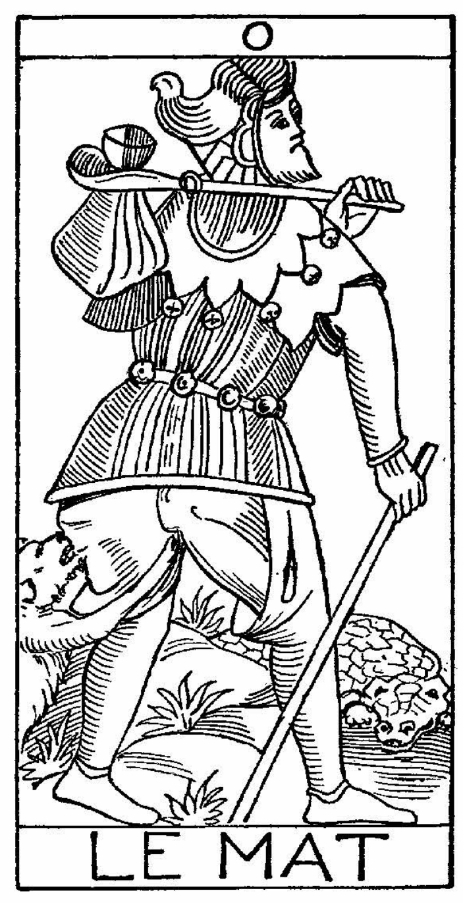
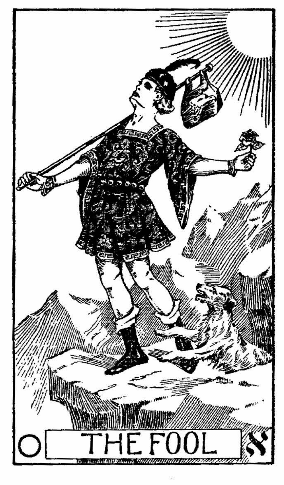

As the first letter of the Hebrew alphabet, Aleph suggests beginning, or primary manifestation. The letter A, in fact, has this meaning all over the world. As Furlong says in Faiths of Man: "A stands commonly for the first of all existences, the Maha-deva, or Supreme. It represents the agent of creation, even when typified by the bull. It is shrouded in the complicated Sanskrit A called the 'Supreme'—Vishnu or Krishna." Students of the Bhagavad-Gita will remember Krishna's words, "Among letters I am the vowel A." In Revelation Christ is called the Alpha. Le Plongeon also states that among the Maya Indians this letter indicated the Deity, or universal generative power.

The sound of A is a simple expulsion of air, set vibrating by the vocal chords, unmodified by tongue, teeth, or lips—the simplest sound in human speech. Its simplicity makes it a perfect vocal symbol of the Supreme, for what is simple is "without fold or doubling; unmixed; unalloyed," and these are characteristics that all philosophers apply to the first manifestation of the Spirit.

As the simplest, it is necessarily the fundamental sound in language. Sanskrit grammarians realized this long ago, and taught that all other letters are modifications of A. On this account they regarded it as the basis of communication, and as the root of thought itself, since all clear thinking must be put into words. As the basis of thought and speech, then, this letter properly denotes That whence all ideas and words proceed—the all-pervading Consciousness that is the Causeless Cause of all.

The letter-name, Aieph, means "ox" or "bull." In Egypt, the bull, Apis, typified Osiris. The Assyrians dedicated the same animal to Marduk. The Persians associated it with Mithra. Among the Greeks it was sacred to Dionysos, the god of youth and virility, identified by mythologists with the Iacchos of the Eleusinian mysteries.

All these were sun-gods. The priesthoods of the ancient world knew what modern scientists have demonstrated—that solar force is the cause of all terrestrial motion, including the minute molecular changes in nerve-tissue that enable us to think. And in countless allegories and parables they set forth the doctrine that the advance of man, and the evolution of life in sub-human and super-human worlds, is the work of sun-power specialized in living organisms.

In the Orient oxen pull the plow and thresh the grain. So they have come to symbolize agriculture, which, of all human pursuits, is probably the most important. Farmers lay the foundation on which the whole structure of civilization is raised. Because it furnishes the motive-power directed and guided by man in tilling the soil and harvesting the crop, the ox typifies the power we use to modify our environment, to provide us with means to sustain life, and to bring natural conditions into harmony with our aims.

According to Kabbalists (whose doctrine on this point agrees with the tenets of Hindu philosophy), the only power used by man—the only power there is, indeed—is Consciousness. They hold that the power to know, as the root of all existence, is the fundamental energy whence all forces, both psychic and physical, are derived. For them the only reasonable explanation of creation is that it is the result of the self-knowledge and self-contemplation of the Supreme Spirit.

Consciousness, then, is the essential reality of that which we know as the vital principle in living organisms. This principle is the life of plants and animals, as well as of men. In Hebrew it is called Ruach, and, as I explained in Chapter I, this word has the same meaning as Prana, Pneuma, or Spiritus. All these words mean "breath;" they all designate the vital principle; and they are all names for a universal energy which is the essence of any particular force we may be able to distinguish.

The primary manifestation of this invisible energy is light, and for our world the great source of light is the sun. From the day-star the waves of cosmic force radiate into space, and those that reach this globe are the cause of all that happens here. Hence, when the Sepher Yetzirah says that Aleph is the sign of Ruach, we may expect that any pictorial representation of the occult ideas connected with this letter will suggest the descent of Spirit into terrestrial manifestation as the radiant force of the sun.

When Kabbalists declare that Aleph stands for the path uniting the first two Sephiroth, they imply that Ruach originates in the Primal Will and expresses itself as Wisdom. Will has been defined as the power of self-direction. Spirit is able to direct itself. Spirit is limitless life. Hence the Primal Will cannot be anything else but the Will-to-live, and the constant urge of this Will must be toward growth, development, and expansion. Its manifestation must be an eternal progress—never at rest, and always pushing forward.

The path we are now considering is called "Fiery Intelligence." It originates in the Hidden Intelligence of the first Sephirah, and completes itself in the Illuminating Intelligence of the second. If these terms mean anything at all, they convey the idea that the first manifestation of the Spirit is a radiant force, inherently intelligent, that takes form in positive, actual knowledge. These terms exactly describe solar force, which does all the work in the world, and, in our brains, finds expression in the mental processes that have brought the human race from savagery to civilization.

In saying that Spirit manifests itself as solar force we only tell what it does. What Consciousness is in itself we cannot say. It defies definition. Reflection shows us that it cannot be any particular thing. It is really no-thing, for it is absolutely free, and all things are limited.

Zero, therefore, is its appropriate mathematical symbol. For the true meaning of Zero is "absence of quantity," which is quite different from "non-being." The Zero-sign is a circle, which, the world over, is an emblem of eternity, perfection, and changelessness. It is also a common symbol of solar force.

The mathematical properties of Zero show that it is far from representing "that which is not." It cannot be added to, nor subtracted from, nor can we multiply or divide it. But in combination with other figures it stands for multiplication by ten. Thus 1, by joining it to 0, becomes 10; 2 becomes 20, and so on. Hence this figure is the sign of a power, free from every qualification, which works in combination with definite forms to produce a ten-fold increase. I have no doubt that there is a connection between the meaning of Zero and the Kabbalistic doctrine of ten-fold emanation from a limitless, indefinable Absolute.

That Spirit cannot be any of the things it brings into existence, though it is the essential reality of all things, is a truth that the wise have recognized in all ages. In the Mundaka Upanishad we read: "That which is invisible, impalpable, without kindred, without color; that which has neither eyes nor ears, neither hands nor feet; which is imperishable, manifested in infinite variety, present everywhere, and wholly supersensible—that is the changeless principle that the wise behold as the origin of all things." Many centuries later Jacob Boehme wrote: "It may fitly be compared to Nothing, for it is deeper than any Thing, and is as nothing with respect to all things, inasmuch as it is not comprehensible by any of them." The same thought is elaborated in the Mystical Theology of Dionysius (accepted to this day as an orthodox manual by the Roman Catholic Church) when, after showing that Spirit cannot be any material thing, the author goes on to say: "God is neither soul nor intellect, nor has He imagination, nor opinion or reason; He has neither speech nor understanding, and is neither declared nor understood."

Dionysius means that Spirit transcends all its creations.

He seeks also to remind us that the knowledge of the Cosmic Mind is perfect, embracing past, present, and future in a timeless Now. God does not imagine, because imagination is a mental approximation to something not actually perceived. He has no opinion about anything, for opinions are always tinged with uncertainty, and He is absolutely sure about everything. Moreover, since He knows all, He does not reason, for reasoning is only a method for finding out the unknown.

But if you say that a man has neither imagination, opinion, or reason, you practically call him an idiot. And if you assume that Spirit is a big man, living in some remote corner of space, you are mentally creating a foolish deity. The God of the ignorant is a fool, and the God of the wise is foolishness to the ignorant. As Paul says, "The natural man discerneth not the things of the Spirit of God, for they are foolishness unto him." Hence the Zero card of the Tarot, which corresponds to Aleph and represents the primary expression of Spirit, is called the Fool. To the initiated its title means "That which is folly to the profane."

The card on the left hand page is a reproduction of the old Tarot given by Court de Gebelin, in Le Monde Primitif. The other is a reconstruction from my own design and descriptions.

Another reason for the title is that the picture symbolizes the cause of the world, and, judging from appearances only, creation seems to be a colossal folly. Why, indeed, should God create? Why should the Absolute descend into the limitations of the Relative? Why should the Perfect assume the disguise of imperfection? More than one writer has expressed the opinion that if an intelligent being created this world, it must have been in a period of temporary insanity. Misery, poverty, failure, injustice, suffering, disease, and death surround us. On the surface there is little to show that the conditions of existence were fashioned by Wisdom. To thousands life is only a grim joke, of which we are the victims, while the Creator is the Jester. That this is a mistaken notion, based on superficial observation, does not change the fact that it is the opinion of many people.

A third reason for the title appears when we remember that the Fool, corresponding to Aleph, represents the primary expression of the Originating Will. This first manifestation cannot be conditioned by experience, simply because nothing has preceded it. The simple unity whence all things proceed cannot act from precedent of any sort. So the title suggests a principle whose activity does not depend on experience.

Mr. Waite's excellent revision of the symbolism develops all the ideas we have been considering. The same doctrine is also set forth in the rather repulsive picture of the Fool commonly found in older packs. Perhaps it may be well to show how this is, lest the surface difference between the two versions should lead some to believe the new design has been made to fit a theory.

Papus describes the Fool as follows:

"A careless-looking man, wearing a fool's cap, with torn clothes and a bundle upon his shoulder, goes quietly on his way, paying no attention to a dog which bites his leg. He does not look where he is going, so walks toward a precipice, where a crocodile is waiting to devour him."

He is careless-looking because Spirit cannot be supposed to have cares or worries of any kind. His torn clothes expose the posterior part of his body, for only the inferior manifestations of Spirit are revealed to our limited perceptions.

The dog bites this uncovered part because dogs represent intellectual sagacity, as opposed to spiritual understanding, and intellect can assimilate the lesser mysteries only. The bundle contains supplies, and represents the latent possibilities of the traveler. He goes quietly, because Spirit works without noise or bluster. He pays not the least attention to the biting dog because the progress of Spirit cannot be checked by the attacks of intellectual doubt. He goes toward a precipice, for Spirit descends from its original purity and freedom into all the limitations and vicissitudes of existence when it becomes manifest. The waiting crocodile is an Egyptian solar symbol, for like the sun, it spends its days on land and its nights in the water. When the Fool has been devoured by the beast Spirit will have become specialized as radiant force. The traveler's fantastic dress reminds us not only of the fool's motley of apparent contradictoriness and unreason which disguises all the instituted mysteries, but also calls attention to the fact that the Causeless Cause veils its original simplicity in infinite variety of manifestation. Thus we see, from this brief analysis that even the old version gives a true symbolic account of the secret doctrine, though it is not so complete a story, perhaps, as the one told by Mr. Waite's design.

In the latter the first thing we notice is a white sun, rising above and behind the wayfarer. It is white to show that it is not the material sun, but a symbol of the pure radiance whence all things proceed. That, in Mr. Waite's opinion, this radiance is inherently mental we learn from his remark that the sun "knows where the traveler is going."

The time is morning, to suggest beginning, inception, and like ideas. The position of the day-star reminds us of Swedenborg's assertion that the spiritual sun is always seen in the East at an angle of forty-five degrees above the horizon. This means that the cosmic energy is always increasing in power, without the possibility of exhaustion.

The traveler faces West. This shows that his journey is over the sun's course. The West is the door of darkness through which the sun enters into the mysterious Beyond.

Hence it is the portal of the Future, the gate that leads to that which is now the Unknown. The emphasis here is upon the truth that Spirit is ever pressing onward toward the realization of potentialities which, at any given time, are as yet unexpressed.

To show that he is a spiritual principle he stands on a mountain-top. Peaks are sacred to the Deity in all parts of the world. They imply eminence, supremacy, perfection, reminding us that the first manifestation of the Originating Will is highest in power, pre-eminent, and foremost, transcending all conditions.

Some versions of the Tarot make the Fool a bearded ancient, because the initiating activity of the universe must be older than anything it brings into existence. But Mr. Waite seems to take the view that the cosmic energy, being eternal, is forever young. It is always at the height of its power. It always has infinite possibilities. So it is represented in the revised Tarot by a fair-haired youth.

His yellow hair symbolizes the solar force. It is bound by a green wreath, from which rises a red feather. Green is the color of immortality. The wreath, encircling the traveler's head, denotes the victory of intelligence. The red feather stands for emotion or desire, for it is an emblem of the Egyptian goddess, Maat, the personification of the universal feminine principle (also known as Prakriti, Maya, Isis, Eve, and Mary) that is the source of love and desire. Rising from the wreath, the feather denotes purified desire, springing from immortal intelligence. As the wreath binds the Fool's hair, so does intelligence, expressed in pure aspiration, bind, or control, solar force.

The vestments of the youth deserve particular attention. His inner robe is white, the color of pure light. It corresponds to what Hindu philosophers call Sattva (literally, "illumination material"), the quality of wisdom, truth, and purity. The outer garment is black, the color of Tamas, which is the quality of darkness, inertia, ignorance, and impurity. The lining of the outer robe is red, the color of Rajas, denoting activity, passion, fire. Note that when the black garment is taken off the red lining goes with it. Ignorance and passion go together. To be rid of one is to be free from the other.

The embroidery on the black robe is a design based on vegetable growth. The laws of plant-life are clues to universal laws of evolution. Not for nothing does the Bible say that Adam was a gardener, and tell us that the Kingdom of Heaven is like a grain of mustard-seed, or like yeast, which is a one-celled plant. It will be remembered, too, that the blind man healed by Jesus, beheld men as trees walking, when his eyes began to be opened. This embroidery on the outer garment is intended to show that even in the region of darkness, or sense-illusion, we may find clues that will lead us at last to the perception of reality. In the most tangled web of error there are always golden strands of truth.

A girdle set with twelve jewels encircles the Fool's waist. The jewels are the twelve signs of the zodiac, and so the girdle represents the year. A year is a complete unit of time. This girdle of time has to be removed before the black robe of illusion can be taken off. One of the principal sources of error in our thought about Spirit is our tendency to think of it as being limited by time. Most of the errors of human life are the result of our thinking of ourselves as being subject to temporal conditions, when the truth is that we are eternal beings. In Europe today we see a terrible proof of this. The great war is the fruit of the materialistic philosophy of the nineteenth century, which leads to the conclusion that a human life is less than a clock-tick in the immensity of eternity.

The black wand in the traveler's right hand is a product of art. Its color shows that it has been fashioned from materials taken from the plane of sense-life. It represents applied science, based on mathematics, for the rod is a symbol of measurement. It also stands for the mode of consciousness commonly termed the objective mind, because it is through objective sensation, observation, and reasoning that we discover the facts and laws which we use in applied science.

The wand supports a wallet containing the latent possibilities of manifestation, because all these possibilities depend upon the action of the objective mind for their realization. The wallet is decorated with an eagle's head, to show that these possibilities are contained in the universal substance, or water, which we have already associated with the eagle.

The rose in his left hand is the emblem of the Virgin Mary and of Venus. Hence it represents the feminine principle. In human consciousness this is the subjective mind. The rose is white, to show that the subjective mind of Spirit is unsullied by illusion. It is a double rose, to show that the principle it represents has already been cultivated and developed to a certain extent.

In this picture the dog is also white, to show that he symbolizes purified intellect. He does not bite the traveler, but bounds along beside him as his companion and friend. In these days antagonism between intellectual knowledge and spiritual perception is growing less and less.

The abyss at the Fool's feet is in contrast to the height on which he stands. It represents what Lao-Tze, the Chinese sage, called the "Mother Deep" in the Tao-Teh-King. At its bottom is the plain, which, as the scene of labor, constructive activity, struggle, competition, and a multiplicity of manifestations, is the polar opposite of the perfection, singleness, and simplicity suggested by the mountain-top.

The Fool is on the verge of descending, because this picture shows Spirit as we think of it prior to self-expression. He is unafraid, for he knows nothing can harm him. No matter how far into the depths he plunges he will surely rise again. His purpose in descending is to find a path leading to the loftier height beyond.

Toward this he looks with a confident glance. He is expectant and eager, for he knows himself and his power. He is absorbed in his vision of the future, and has no doubt of realizing his dream. For whatever height of expression Spirit may reach at any given time, it can always surpass itself. Eternal progress, eternal improvement in forms of manifestation, is the law of life. Each height gained is but a foothill whence we glimpse a loftier peak. Yet there is no element of discouragement or futility in this. For we are able to reach that eminence ahead.

The Fool smiles. Spirit, the Hindus tell us, is Bliss Absolute. It is the essence of happiness and joy. A truly spiritual man is never long-faced and sanctimonious. Jesus went to feasts. His daily companions were simple fishermen, and publicans and sinners, not straight-laced, solemn-visaged Pharisees. The chief reason for living the spiritual life is that it is a never-failing source of joy. All men want to be happy, and they try this, that, and the other thing in their vain endeavors to satisfy their desire. Thousands have testified that there is but one way, and that is to live, day by day, the life of the Spirit, because the essence of that life is perfect bliss.

Now, the suggestions of this picture correspond to eternal verities, and what we have to learn from it is true here and now. It was true in the past. It will be true in the future. For us, however, its greatest value is that we can affirm its meaning in the present tense.

One Spirit animates the whole universe. From atom to man everything has its roots in life. Nothing is dead, and because all things are produced from living substance, everything is a mode of mind, or consciousness.

For this world the great center of spiritual energy is the sun. Solar force is inherently mental. It knows itself and its manifestations. It knows itself in men, in animals, in plants, and even in bodies composed of inorganic matter. When oxygen and hydrogen, for example, combine to form water, it is the Spirit, knowing itself as oxygen and hydrogen, that produces the result.

Solar force, however, is not the Spirit, but only the primary form in which the Originating Will finds manifestation on the material plane. The pure spiritual energy transcends everything. It is all-pervading. There is no place where it is not, hence it is always present in human life. We do not have to get it. We need not search for it outside of ourselves. It is here in our midst always. What we have to do is to learn how to use it to produce the best results.

We are its instruments of expression. All the power there is centers in each human personality. It is not there in part, but as a whole, because Spirit is indivisible. From this truth there are many important deductions, which will be considered in later chapters.

The spiritual energy is a positive force, not a mere metaphysical abstraction. It is Life itself—the life-giver, or vital force of every organism. It is the energy that keeps going all the functions of our bodies. Of these, the function of the brain, which specializes the potential consciousness of Spirit into definite personal mental states, is the most important. Mental states determine all other conditions. When we have learned to master our thoughts, everything else will be under our control.

In the action of the universal energy upon our bodies, and in their reaction to it, all human pursuits are grounded. The One Life assumes all these various forms you call your environment. It also assumes that special form you recognize as your self. When your environment arouses various sensations, feelings, emotions, or ideas in your personal consciousness, the mental states are the product of the relation between the general manifestation of the One Reality and your self, its particular expression. All that you feel or do is the result of that relation.

What is the inevitable conclusion? This personality, this little "self" labeled with a name, is not the real Thinker, not the real Actor. Pure Spirit is the Knower and Performer of all actions. Each personality is but one of its ways of expressing itself.

Until Spirit has brought the personal consciousness to a certain stage of development the man says, "I am the actor and knower. I think this, I feel these emotions, I do this work." Out of his ignorance comes suffering, which lasts until he reaches a higher stage of development.

He does not gain this broader outlook until Spirit brings him to it. Of himself he can do nothing to bring himself closer to the truth that makes men free. Is this fatalism?

Not by any means. The real Ego in each personality is identical with the Supreme Spirit. Being present in every personal life, it experiences whatever suffering is felt by anyone. It knows all the heart-aches and uncertainties that beset us. And it labors unceasingly to transmute this suffering into joy. Not because it must, but because its nature is Love. For we read in the Gita: "O son of Pritha, there is nothing for me to do in these three worlds—nothing unattained that is possible to attain; still I am present in action. If for once I do not ceaselessly remain in action, all men will follow my way, O son of Pritha. If I do not perform action these creatures will be lost and I shall become the author of confusion, and shall have slain all these creatures."

Spirit is absolutely free. It is the reality at the core of every personal life. Therefore we are all essentially free. This is the great truth on which all religions are founded. Opposed to it is the great illusion that we are subject to unnumbered laws and conditions of the external world.

To say that we are not subject to conditions is utter folly to all who have not reached the stage of development in which Spirit expresses its knowledge of itself and its freedom through a personal center. So the wisdom of God is foolishness with men, and to the carnally-minded He is a Fool.

I have only sketched the general significance of this first major trump, but I think I have said enough to put the student on the track of its meaning. I hope, too, that this analysis has demonstrated that the doctrine is really implied by the meaning of the letter and the significance of the elements entering into the design.

In a sense all the trumps that follow are deductions from the premises stated in the symbolism of the Fool. If we accept the doctrines of this Key, logic will force us to accept the conclusions represented by the rest of the cards. And thus we shall find ourselves developing, as we go along, an orderly sequence of statements which will at last provide us with a complete philosophy.
