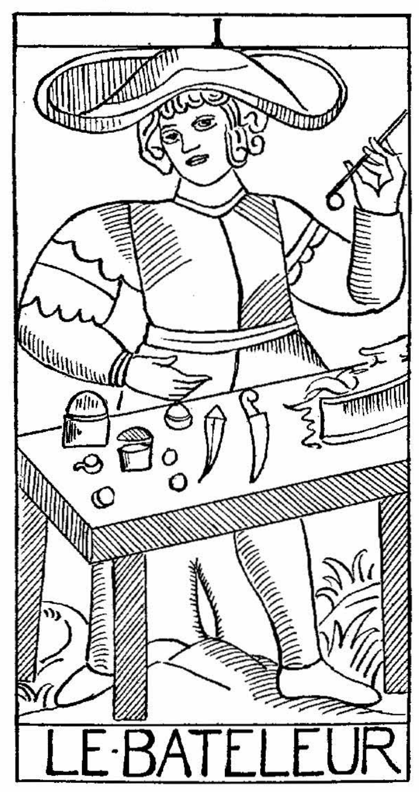
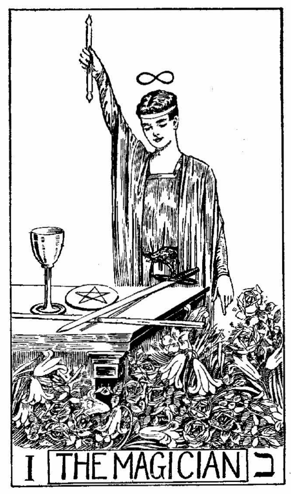

The original form of the letter Beth was probably a crude picture of an arrow-head. It is unmistakable in the Phœnician alphabet, and the form used on the Mesha Stone is but slightly different. In modern Hebrew, of course, all resemblance to the early hieroglyphic has been lost, as the square letters employed today are of comparatively recent invention.

Perhaps the first idea that will be suggested to most people by an arrow-head is sharpness. Then, since every Hebrew letter stands for a kind of consciousness, Beth must be a sign of mental acuteness, or penetration. It represents the sort of intelligence that manifests itself in quick perception, accurate observation, keen discernment, sagacity, and the like.

An arrow-head, moreover, is a point, denoting position. In logic "position" means affirmation or assertion, as when we speak of "the proof of a position." The same word signifies "place," or "locality," and from this a third meaning—arrangement, implying order—is derived. Beth, then, represents affirmative mental activity, limiting its operation to a definite locality, and exercising itself in establishing order.

Hence Beth also suggests initiative, direction, control, the concentration of energy in a particular field, and its specialization in definite forms. This idea of concentration is inseparable from the original form of the letter. The word "concentrate" is derived from the Greek **kentron**, an arrow-point. The same Greek word also means the point around which a circle is described, which shows that it implies the very notions of definite locality, order, that we have just been considering.

Because Beth denotes affirmative mentation, finding outlet in positive mental states, and specializing the Universal Intelligence in particular ways that realize definite aims within a limited field, it is a sign of Volition. To Will, according to the Kabbalah, all other modes of manifestation are subordinate. Hence the Sepher Yetzirah says Beth stands for the direction Above, to show that it corresponds to what Hindu teachers call the "superior nature" of Spirit.

The implicits of the letter-name are closely related to those connected with the hieroglyphic. Beth means "house," suggesting inclosure, limitation to a special field, definite locality, and so on. As a house is the dwelling of its owner, so is the kind of mental action related to Beth the abode of Spirit, because it centers the Cosmic Mind in a particular, local expression.

Houses, moreover, represent architecture, the art to which we owe many of the fundamental discoveries in geometry. (Here we may note that a point, or **kentron**, is the beginning of all geometrical matter). The connection between geometry and architecture is especially emphasized in the written work of Freemasonry. To demonstrate the close correspondence between these Masonic ideas and the Kabbalistic doctrines illustrated by the Tarot card we are now studying, let me quote a passage from George Simons' "Standard Masonic Monitor," which says:

"By geometry we may curiously trace Nature through her various windings to her most concealed recesses; by it we discover the power, wisdom, and goodness of the Grand Artificer of the Universe, and view with delight the proportions which compose this vast machine; by it we discover how the planets move in their respective orbits, and demonstrate their various revolutions; by it we account for the return of the seasons, and the variety of scenes which each season displays to the discerning eye. Numberless worlds are around us, all framed by the same Divine Artist, which roll through the vast expanse, and are all conducted by the same unerring law of Nature.

"A survey of Nature, and the observation of her beautiful proportions, first determined man to imitate the divine plan and study symmetry and order. This gave rise to societies and birth to every useful art. The architect began to design, and the plans which he laid down, being improved by time and experience, have produced works which are the admiration of every age."

The mental activity formulated in geometry is one that examines and investigates, engages in research, collects facts, and classifies them. It analyzes phenomena, to find the laws they represent. It puts questions to nature, finds the answers by patient investigation combined with inductive reasoning, and applies the knowledge so acquired in practical ways that are an improvement upon natural conditions.

The result of all this work is Understanding. The Kabbalists call our attention to this when they make the path corresponding to Beth originate in Kether, the Primal Will, and complete itself in Binah. For Binah is the Hebrew term for Understanding.

The student who is really in search of more light should not fail to observe that Kether is an androgyne Sephirah, while Binah is feminine. The results of the mental activity attributed to Beth are feminine, or reproductive. At the same time, the activity itself is masculine, for its main characteristic is initiative and so the Tarot picture that symbolizes it is a figure of a man.

The name of the path joining Kether and Binah is Intelligence of Transparency. That which admits the free passage of light is transparent. A transparent mode of consciousness, therefore, must be one that gives unobstructed passage to the light of the Universal Mind. Thousands of years ago the wise learned that this light passes most readily into the sphere of personal consciousness when, by an act of will, the mind is concentrated upon a single idea, to the exclusion of all other impressions. Pantanjali, in his Yoga aphorisms, compares the mind that has been brought to this one-pointed state to a transparent jewel.

The Sephirah Binah, in which Intelligence of Transparency completes itself, is the seat of Sanctifying Intelligence. Thus the Kabbalah teaches that Understanding is what sanctifies us. To sanctify is to make free from sin. The Bible says that sin is the transgression of the law, or action contrary to the established order of nature. The only way to be free is to arrive at understanding of the natural order. And concentration is the only method that will bring us to understanding.

The mental activity symbolized by Beth is not creative, but constructive. It adds nothing new to nature, but simply combines what already exists in novel ways. Hence the Sepher Yetzirah tells us that Beth is the sign of Life and Death. For all construction involves destruction. The forms that are owe their existence to earlier forms that have passed away.

Beth also corresponds to the planet Mercury, and therefore indicates the spiritual principle personified in Egypt as Thoth and in Greece as Hermes. In Hebrew Theosophy the same principle is represented by the angel Raphael, one of the Seven Spirits of God. His name means "healing of God," he is described as the instructor of man, and in the apocryphal Book of Tobit he shows Tobit how to exorcise a demon. In like manner Thoth-Hermes-Mercury is the founder of the Hermetic art which, in its development as modern chemistry, as well as in its older version, alchemy, is primarily concerned with the healing of disease and the perfection of life. Thoth was the oracle of the gods, the measurer of time, and the inventor of numbers and writing. Thus he is closely related to the other meanings of the letter Beth.

The Tarot trump corresponding to Beth bears the number 1. As its geometrical correspondence is the point, this number denotes all the ideas we deduced from the hieroglyphic form of the letter, such as location, concentration (which is "one-pointedness"), and the like.

The number 1, besides denoting unity, singleness, and individuality, implies solitude, seclusion, or privacy. Hence it is the mathematical sign of magic, the Hidden Science, kept from the multitude because only the few can grasp it. The Emerald Table of Hermes, one of the earliest magical documents, begins with the affirmation, "All things are from One." The very heart of magical philosophy and practice is this doctrine of the essential unity of all things. It is repeated again and again in the Bible, which begins by saying "In the beginning, God;" throws more light on the question by declaring that God is One; and completes the revelation in the sentence, "God is Spirit." Who knows the meaning of these three statements knows the essence of all scriptures. But by "knowledge" I do not mean intellectual assent. The only way anyone really knows the truth of these three statements is by following the ancient way that makes of the mind a transparent jewel through which the light of Divine Wisdom, shining into the house of the soul, perfects the understanding.

To return to the number 1, we find these meanings assigned to it in Sepharial's "Kabbalah of Numbers": "Manifestation, assertion, positive and active principle; Logos, the manifestation of the Infinite and Unmanifest; Ego, self-assertion, positivism, egotism, separateness, self-hood, isolation; distinction, self-reliance, dignity, and rulership." The Logos is Christ, Adam-Kadmon, or Thoth. The close relation between the other implicits and those connected with Beth is obvious.

The title of the card is The Magician. The central figure is one of the magi, skilled in the art of producing effects by mastery of the secret forces of Nature. The foundation of his art is the Hermetic axiom that all things are from one, that all forces are manifestations of a single energy that, in its essence, is pure Consciousness. This energy, we have seen, comes into the world as the light and heat of the sun. The Magician, therefore, symbolizes the kind of consciousness that enables us to control the various manifestations of the solar force, and direct them so as to bring about definite, pre-arranged results.

The symbolism of the picture bears out all the implicits of the letter, number, and name. The central figure is the personification of intense concentration. His glance is fixed on the table before him. On this are spread the implements of his art. His right hand, holding a wand, is raised heavenward. The extended forefinger of his left hand points to the earth. Over his head is the lemniscate symbol of Spirit. His tunic is white, girdled with a blue serpent biting its tail. The outer garment is red. He stands alone in a garden, in which roses and lilies are growing.

Old Tarot.

The wand in his right hand is what Eliphas Levi calls "the Verendum of the magus." It is a material agency that enables the adept to concentrate the cosmic energy. It is not a natural product, but something modified by art. The magician has made it himself, and it bears witness to his knowledge and skill. Occult students who understand the Yogi teaching about **Ojas,** which is transmuted, by constant practice of continence and purity, from the nerve-currents that ordinarily energize the reproductive organism, will see the meaning and force of the wand-symbol.

New Tarot.

Others not so far advanced will have no difficulty in grasping the main idea that by a definite process, combining science and art, and employing a physical instrument represented by the wand, power may be concentrated, or drawn down into the limited field of personal consciousness from the exhaustless, all-pervading Source of all energy. This invisible Source, in every part of the world, is represented by the sky, toward which the Magician raises his wand. It will not escape the attentive reader that here is also some intimation of the spiritualization of a material agency, in that the wand is **raised** from earth toward heaven.

The left hand, pointing downward, communicates the power drawn from above to the earth, which represents the visible, material plane. The pointing finger denotes attention. We point in just this way to single out a particular person in a crowd, or one object among many. Aim, purpose, concentration, and all the rest of the ideas that we have found related to Beth, are therefore suggested by the Magician's left hand.

The figure eight, placed horizontally over the adept's head, confirms our attribution of this picture to Thoth, for it is known that the ancients considered this number an emblem of Hermes, the reformer, pathfinder, regenerator, and awakener of sleeping minds. In his "Pictorial Key to the Tarot," Mr. Waite reminds us that "Christian Gnosticism speaks of rebirth in Christ as a change 'unto the Ogdoad." He also says: "The mystic number is termed Jerusalem above, the Land flowing with Milk and Honey, the Holy Spirit, and the Land of the Lord. According to Martinism, 8 is the number of Christ."

Now what Christian mystics mean by rebirth in Christ—symbolically termed entry into Jerusalem (lit. "possession of peace"), the capital of the Land flowing with Milk and Honey—is, I take it, exactly what the Hindu Yogis are talking about when they speak of Samadhi, the superconscious state of the illuminated seer. This state is attained as the result of a definite system of exercises, by which the coiled-up energy in the sacral plexus (which is the nerve-center that energizes the reproductive system) is made to rise through a fine canal in the spinal cord. As the current of force rises—and it must be remembered that this is a physical force transformed in the body from solar force stored up in food—it energizes other great nerve-centers, causes physiological changes in the body of the Yogi, and unleashes latent psychic powers. When it reaches the brain Samadhi is attained, and the Yogi is completely free from illusion, and gains absolute control over all conditions of environment, so that he can perform works of power that the ignorant call miracles.

The relation of all this to the sign of the Holy Spirit is that this symbol is a crude picture of a cross-section of the spinal cord. "If we take the figure eight horizontally (∞) there are two parts, and these two parts are connected in the middle. Suppose you add eight after eight, piled one on top of the other, that will represent the spinal cord. The left is the Ida, and the right the Pingala, and that hollow canal which runs through the center of the spinal cord is the Sushumna." (Vivekananda, "Raja Yoga," Chapter iv.). It is by controlling the Ida and Pingala nerve-currents, and by sending the current of coiled-up energy through the Sushumna that the Yogi reaches his goal. All his practice is based on concentration; it is all directed to the mastery of solar force; and it begins by exercises having for their especial object the transmutation of nervous-energy which, in ordinary men, is given no outlet save in the reproduction of the species.

The Magician's white tunic, like that of the Fool, symbolizes Sattva, or light, and the red robe denotes Rajas, or activity. The Magician has no black garment, for he represents definite, accurate knowledge, unmixed with illusion. But the garden in which he stands corresponds to the Fool's black robe, which, you will remember, was embroidered in a floral design.

The Magician wears the red of action, for he typifies a kind of consciousness that generally seeks to express itself in practical endeavors for the betterment of conditions. The reader will observe, however, that the red robe is unfastened, and may be slipped on or off at will. The Magician can engage in action, or refrain from it, as he chooses.

The table is a limited area, symbolizing what psychologists call the "field of attention." It also suggests arrangement, classification, regulation, or placing in order, for all these words imply what is meant by tabulation. The table is the Magician's work-bench. Like an architect's trestle-board, it helps him to make his plans and work out methods for arranging his materials.

To classify facts, to discover the laws behind facts by inductive reasoning, and to apply those laws in new ways, the phenomena we seek to understand must be brought within a comparatively narrow field of consciousness. This field is elevated, so to speak, above the general sensory awareness which is the foundation for all our mental processes. This is the truth implied by the symbolism of the table.

The implements are the familiar suit-emblems of the minor trumps. Besides the meanings given in Chapter 1, we may note that these four objects, being symbols of the occult elements, also represent the four orders of elemental spirits. The wand corresponds to the sylphs, the cup to the undines, the sword to the salamanders, and the pentacle to the gnomes. These elemental spirits are subject to the control of the trained will, which can produce many remarkable results through their agency. For more light on this subject see Eliphas Levi, Paracelsus, and that curious occult volume, "The Count de Gabalis."

The suit-emblems also denote the four things required to maintain physical existence; air (wand), water (cup), solar force (sword), and food (pentacle). The body is built from these elements and sustained by them. Intelligent use of these life-essentials is the basis of right action, and intelligent use is primarily orderly and systematic.

Students of Hindu philosophy will recognize the correspondence between the four emblems and the four Tattvas derived from the primordial **Akasha**. The wand denotes Vayu, the subtle principle of touch. Vayu has the property of locomotion, so the staff of the pilgrim correctly represents it. Apas, the gustiferous ether, is contractile, and therefore corresponds to the cup. The sword, as an emblem of radiant energy, is related to Tejas, the principle of sight, since light enables us to see. Tejas is expansive, so that the sword, which is the means relied upon, even in this enlightened age, to expand the limits of a nation's territory, is a true symbol of this Tattva. The pentacle denotes Prithivi, the principle of smell, for smelling is due to the impingement of microscopic particles of the thing smelt upon the nerve-terminals in the nose. Cohesion is the property of Prithivi, and this also is implied by the magic pentacle or talisman.

Because it is primarily an inclosure, the garden typifies definite locality. The word "garden," in fact, comes from the Anglo-Saxon **geard,** akin to the Old High German **gart,** an inclosure, the Icelandic **garthr,** yard, or house, and the Greek **chortos,** an inclosure. Thus the garden in this picture refers directly to the letter Beth.

It also implies horticulture, which, as a branch of agriculture, is a specialization of the general activity represented by the Fool, since the latter is related to agriculture through its correspondence to the letter Aleph. Here, once more, as in the embroidered black garment of the Fool, is an intimation that the laws of growth and evolution on every plane are exemplified in the laws of plant life.

The garden is the field of the Magician's labors, the object of his regard, and the reciprocal principle that responds to his initiative. It is the Non-Ego, the "inferior nature" of Spirit. Hindu teachers, who call it Prakriti, say it is the root of matter in every form. Prakriti is the "mysterious power, difficult to cross over." It has limitless reproductiveness, which is symbolized by the fertile soil.

As the root of matter, it is the universal feminine principle. This is declared in the Bhagavad-Gita. "My great Prakriti," says Krishna, "is the womb into which I cast the seed; from that is the birth of all creatures." The inferior nature is invariably personified as a woman. It is Maya, or Maia (the mother of Hermes), Isis, Astarte, Venus, Bona Dea, Mother Nature, Diana, Sophia, Mary. The many names distinguish various aspects of a single principle. In the Bible it is Eve, also the Bride of the Canticles, who is compared to an inclosed garden. Again, it is the Virgin; and the two women of Revelation—one clothed with the sun, and the other riding on a beast—symbolize its contrasting modes of manifestation.

Toward this feminine principle the Magician directs the current of force that he draws down from above. This reminds us that the path connected with Beth completes itself in the feminine Sephirah, Binah or Understanding.

Plato called Understanding **dianoia**. It is the field of discursive reasoning. It passes from premises to conclusions by deduction. Because it is elaborative, reproductive, and invariably starts with premises furnished it by inductive reasoning, it is feminine in character.

The roses and lilies are primarily sex-emblems, the former feminine and the latter masculine. The rose is a symbol of Venus, Mary, or Prakriti. The lily is the especial flower of Christ. Both flowers grow in the garden because the activities of the inferior nature bring forth reproductions in its own likeness and in the likeness of the superior nature, just as the children of the same mother may be both boys and girls.

The sex-opposition here indicated is only a particular manifestation of a universal law of opposites. The practical application of this law is perhaps the greatest secret of the sages. It is taught in the aphorisms of Patanjali, in the Tao-Teh-King, in the Gita, in the Hermetic books, in the Bible, and in countless other volumes. Great emphasis is given to it in the Kabbalah; and the Tarot, based on Hebrew Theosophy, calls attention to it again and again.

In the Fool this opposition is indicated by the black wand and the white rose, and by the contrast between the mountain-top and the abyss. In the Magician, besides the antithesis of rose and lily, there is the contrast between the masculine magus and the feminine garden. The sword and wand on the table are also masculine, and the cup and pentacle feminine.

We shall also find, as we progress, that each major trump is in some way the antithesis of the card preceding it. Go through the list of titles in Chapter 1, and this will be clear. Observe the difference in the setting of the first two pictures. Note that the Fool suggests inexperience, but the Magician has had thorough training and instruction. The Fool looks up and beyond. The Magician looks down, and the objects of his regard are in his immediate vicinity.

We have seen that the Fool represents undifferentiated consciousness. Then, since the Magician is the antithesis of the Fool, we may expect that he stands for highly differentiated consciousness, and that is exactly what all the implicits of the letter, the number, the title and the symbolism have suggested.

The Magician is the personal Purusha, the Onlooker, the Ego. He is the phase of mental activity called the supraliminal consciousness, or objective mind. This it is that expresses itself in attention, observation, and inductive reasoning. It is the dominant member of the mental dualism, the primary expression of human consciousness. We respond to impressions from our environment long before we have any personal realization of an inner life.

The objective mind begins all trains of mental action. It has the power of initiative. It gets its experience through sensation, but its power comes from the Universal Mind. It classifies the various sense-impressions, reasons from the particulars observed to the general truth behind, and so discovers principles which it applies to bring its environment under its control.

It is the seat of will. Concentration is an act of intense volition. Concentration is the secret of all magical practices, whether the magic be white or black. In great measure the marvels of magic are produced by suggestion and auto-suggestion. All these suggestions are framed by the objective mind. It formulates the affirmations and denials used by healers, and it also invents the horrible incantations of black magicians. So it is rightly associated by Kabbalists with Life and Death. For its work may be either constructive or destructive.

We must not forget that the act of concentrating the attention is just as much a physical action as eating or walking. It brings about definite structural changes in the nerve-centers. A real force is concentrated, not merely a vague abstraction called "the mind" for want of a more definite name. An adept is one who has changed his body into an instrument for transforming solar energy into a psycho-physical force that can be applied in many unusual ways.

This force is designated by Eliphas Levi as "Astral Light," but he means something different from what theosophical writers usually understand by this term. In fact he seems to have been not altogether happy in his choice. He speaks correctly, however, when he says that this force is the Great Magical Agent. But it seems to me he is wrong when he calls it the substance from which all things are made. The Hindus come closer to the truth, it seems, when they say that **Akasha** is the substance and **Prana** the energy, which, working in **Akasha**, produces all things.

It is this Prana that the Magician is drawing down from above. It is also this same energy that makes the plants grow in the garden. The objective mind in man is the mediator between the infinite cosmic energy and its special manifestations. This is the central doctrine of the picture now before us.

That this picture can be interpreted in other ways that are equally true, though all of them start from this root-idea of concentration, it is no doubt hardly necessary to say. It would take many more pages than I have at my disposal to set down all the material that I have collected in connection with this one trump. Let me repeat that there is no end to what one may learn from the Tarot. All that I can do is to help you to make a right beginning, and give you some hints as to what you may expect to find out for yourselves later on.
