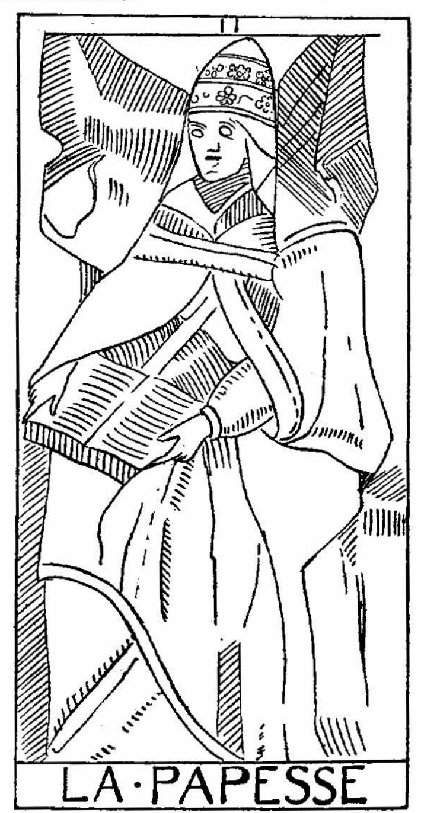
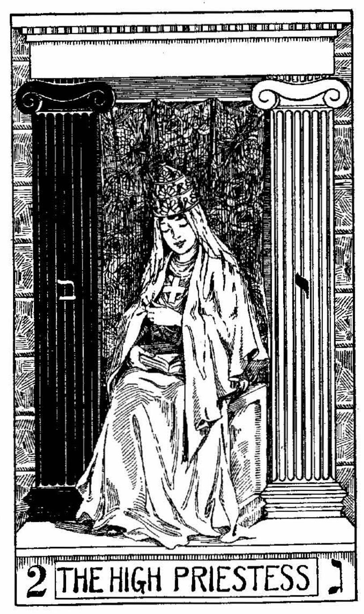

The earliest sign for the letter Gimel was probably a conventionalized picture of a bow. As a bow is used for shooting arrows, the first idea it suggests is propulsive force. Furthermore, since we have learned that the letter Beth was originally in the form of an arrow-head, it becomes evident that Gimel, the bow, as the propulsive force behind the arrow, stands for something that incites the objective mind, represented by Beth, to express itself in concentrated attention.

Bows have no force of their own. Before they will drive arrows they must be bent. This bending is a gradual increase in tension, an accumulation of energy by degrees. The bow acts as a sort of storage-battery for the muscular force of the archer's arms. At the instant of letting the arrow fly, this energy is suddenly released, in a sort of explosion. We should remember also that bows were probably invented after arrows. Very likely some prehistoric hunter, observing the elasticity of branches, realized that he could use that force to send his darts farther and faster than he was able to throw them by hand. He must have had the darts first; or he would never have thought of the bow. Thus, in a sense, the bow is derived from the arrow; and this makes it an emblem of secondary existence; evolution, and the like.

Again, the bow, like the crescent, cup, sistrum, wheat-ear, oval, is a feminine symbol. It stands for the Great Mother, which the Hindus call Prakriti, the sakti, or power, of the Supreme Purusha. As the power by which all work is done, Prakriti is the propulsive force behind manifestation. At the same time, she is secondary and subordinate, and is termed the "inferior nature." In his translation of the Bhagavad-Gita, Chatterji says that Prakriti would not work if Purusha did not look on. One of the Upanishads declares: "The One Being did not enjoy happiness when alone. He was desirious of a second. He divided himself into two. Hence were husband and wife produced."

A similar thought is conveyed by the Mosaic account of creation. We read that Eve was fashioned from Adam's rib. A rib is curved, like a bow. What is more, ribs protect the vital organs in the trunk, and we shall learn presently that the mode of personal consciousness which is the microcosmic manifestation of Prakriti is primarily concerned with preserving life and controlling the functions of the interior organs.

The bow is also a symbol of Artemis, the twin-sister of Apollo. She was a moon-goddess, identified with Hekate, mistress of night, magic, mystery, and the underworld. The fact that all the secret powers of nature were supposed to be at her command establishes her correspondence to Prakriti. Moreover, Prakriti is said to be co-eternal with Purusha, though subordinate to him, just as Artemis is the twin of Apollo. Much the same idea of co-eternality is implied by the Biblical statement that Eve, instead of being a separate creation, was formed from the body of Adam, so that she was really created at the same time as her husband, though she remained latent, or did not become a separate entity, until later.

Of course neither Prakriti nor Artemis is directly related to Gimel in Kabbalistic literature; but just as the English "bread," the German "brot," and the French "pain" all mean the same thing, so, it seems to me, do Eve, Prakriti, Artemis, Hekate, and other feminine deities, all personify a single principle. Nor should we lose sight of the fact that the Tarot is of comparatively recent invention, and bears internal evidence of having been designed by someone who was not only a master of the Kabbalah, but was also familiar with classic mythology, and perhaps with Hindu thought.

Getting back to Gimel, we find that its name means "camel." Whoever knows what a camel is, associates it with travel. One camel suggests a whole caravan. Thus it implies, among other ideas, the following: combination, association, agreement; intercourse, communication; commerce; reciprocal activity; polarity (as of the terminals of a caravan-route); periodicity; contrast; alternation. From these suggestions the reader should endeavor to work out other implicits, with the aid of a dictionary or a thesaurus.

Now, to convince ourselves that we have been on the right track in our interpretations of the hieroglyphic and letter-name, let us see what the Sepher Yetzirah has to say about the occult meaning of Gimel.

First of all, it tells us that Gimel corresponds to the moon. This shows that it stands for all that the Greeks personified by Artemis. The lunar crescent, moreover, is like a bow, so that it corresponds to the hieroglyphic. Again, the waxing moon is like a caravan coming into sight, the full moon is like its rest at a city, the waning moon suggests its gradual disappearance in the distance, and the dark of the moon corresponds to the time the camels are out of sight. The moon also suggests the same notions of periodicity, alternation, and the like, that are associated with the letter-name.

In the next place, as the antithesis of Beth, which corresponds to the direction above, Gimel is the sign of the direction below. "That which is below," in Hindu philosophy is Prakriti, the inferior nature. Similarly, the Bible speaks of Eve as being subject to Adam, and Greek mythology connected Artemis with the underworld. Furthermore, the personal expression of the inferior nature is a mode of consciousness for which "depths" is the most appropriate metaphor.

Gimel is also the sign of the pair of opposites, peace and strife. This attribute is related to the hieroglyphic as well as to the letter-name. Relaxed and unstrung, the bow is an emblem of peace; tense and strung, it signifies war. Commerce, likewise, is usually the real cause of both war and peace. Again, though moonlight is peaceful, white, and virginal, the superstitions of many countries attribute insanity and violence to it.

The path assigned to Gimel is Uniting Intelligence. Thus we know that it is a mode of consciousness that joins ideas together. Its main characteristic is associative activity.

Uniting Intelligence joins Kether, the Primal Will, to Tipherith, or Beauty. This calls our attention to the doctrine that the constant aim of the Primal Will, as manifested in the activity of Prakriti, is toward the realization of symmetry, order, harmony, and perfection. Thus an ancient clavicle of Solomon, translated by Eliphas Levi, says that the empire of the spirits of Tipherith is one of universal harmony, and declares that these spirits correspond to judgment. Students of Hinduism will recall the doctrine that Buddhi, the principle of judgment, is the highest manifestation of Prakriti.

Kether is the seat of Hidden Intelligence, and to Tipherith is assigned Intelligence of the Mediating Influence. Uniting Intelligence, then, is rooted in the potential consciousness of the Primal Will, and finds expression in awareness, or knowledge of the power which, flowing into the universe through creative activity, harmonizes and reconciles all oppositions, and makes for the realization of Beauty.

Uniting Intelligence is also known as Inductive Intelligence of Unity. "Inductive," as here used, does not refer to inductive reasoning, but has the older, more general sense of "leading inward." Thus it denotes a mode of consciousness that leads us inward to the one which is the Reality behind the many-ness of the external world. This one is the Mediating Influence.

Uniting Influence is described as "the substance of glory, manifesting truth to every spirit." "Glory" means the presence of the Divine Being, or Supreme Purusha. Uniting Intelligence, as the mental manifestation of Prakriti, is indeed the substance, or foundation, of the Divine Presence in our personal consciousness. And as the highest mode of Prakriti is Buddhi, the principle of judgment, it is, of course, that which manifests truth to every personal spirit.

The Tarot trump corresponding to Gimel bears the number Two. Of this number Eliphas Levi says:

"The duad is the number of the Elohim, or forces which constitute the equilibrium of universal balance. It is also in a special manner the number of woman, wife of man and mother of society. The idea of the supreme unity reflects itself in the duad. The figures of the duad are the Son, who is the splendor of the Father, and the Word, which is the form of thought; it is speech fecundated by Spirit, woman reflecting man, water mirroring the sky. It is also the manifested light. By mistaking this light for the unity itself, we come to the black duad—shadow, matter, unintelligence, hell itself. The good duad is harmonious and equilibrated; its highest expression is the incarnation, the unconfused combination of divinity and humanity, God revealed in man that man may rise to the divine life. The physical expression of the duad is the firmament which separates the waters from the waters; it is the point of fixation which rules the movements of matter. It was represented at the gate of Solomon's temple by the pillars Jakin and Bohas.

"The duad is unity reproducing itself to create, and this is why the sacred allegories picture Eve issuing from the very breast of Adam. It is also the number of the Gnosis and the generative number of society and law. One is the cause, two the logos. Unity can only be manifested by means of the duad, for unity itself and the idea of unity already make two. Divinity, which is one in its essence, has two essential conditions as the fundamental basis of its being; these are necessity and liberty. Revelation is the duad—every logos is two-fold and supposes two. The ancients, in their symbols and magical operations, multiplied the signs of the duad, that its law, which is that of equilibrium, might not be forgotten. In their evocations they invariably constructed two altars and immolated two victims, a white and a black one; the operator, holding the sword in one hand and the rod in the other, should have one foot shod and the other bare. But the final hieratic secret of the duad cannot be made known; the reason, according to Hermes Trismegistus, being the stupidity of the vulgar, who would give all the immoral attributes of blind fatality to the sacred necessities of science."

Two is also the number of memory, since every recollection duplicates the original experience. Memory is what incites us to study our environment. Memory is the foundation of the sciences and arts, and of all philosophies and religions. This is what the ancients meant by calling Mnemosyne the mother of the Muses.

Memory also makes possible all human intercourse, travel, commerce, and progress. Every desire, too, is the fruit of a remembered sensation. On this account memory is the cause of strife and the foundation of peace.

It is evident, then, that the ideas implied by Gimel and those that are suggested by the number two have a close relationship in thought. Reflection will enable the reader to discover many other correspondences which I lack space to touch upon, for we must now turn our attention to the title of the trump that illustrates the secret meaning of this letter and number.

Occasionally this is called "Pope Joan," but the name has no warrants in occult tradition or in the symbolism of the picture. Translated literally, the French title, "La Papesse," is, of course, "The Female Pope"; but the real meaning is more nearly represented in English by the appellation, "The High Priestess."

A priest is an "elder," and so a priestess is a "feminine elder." The High Priestess, therefore, is the "superior feminine elder." Thus the title of this trump implies that it represents the primordial feminine principle—Prakriti, Eve, Artemis.

The High Priestesses of the ancient world were mediums. They uttered the sacred oracles, while in a trance, which was often induced by the magicians or priests. As the oracles were also consulted before declaring war or making peace, we see that there is a definite link between the title and one of the Kabbalistic attributions of Gimel.

Again, the Pythia was the mouth-piece of Apollo, and this shows us that the High Priestess stands for a state of consciousness that formulates the inherent intelligence of the Universal Radiance (Apollo) into definite revelations of truth or wisdom. And as man comes to know more and more of truth, he sees ever more clearly that all things are from one, which is the Mediating Influence pervading all creation. Thus the High Priestess, as the medium for communicating Divine Wisdom to man, corresponds to the Kabbalistic path of Uniting Intelligence.

The symbolism of this trump corresponds in every particular to all the ideas we have thus far considered. The High Priestess is within a temple, seated on a cubic stone between the pillars of a door-way. The pillars are alike in form, but opposite in color. The white pillar bears the letter Yod, the black one the letter Beth. Her triple crown is surmounted by a crescent, and from it there depends a veil. Her draperies fall in flowing lines that suggest water, and their color is blue. On her breast is a solar cross. In her lap, half-concealed by her mantle, she holds an open book, in which she reads intently. Behind her, between the pillars, hangs a veil embroidered with pine-cones and roses, or palms and pomegranates, or with geometrical designs having similar significance.

The first point to be noted is that she is the antithesis of the Magician, not only in sex, but in environment. He stands out-doors. She sits within a temple. He is absorbed in a problem of arrangement that is primarily concerned with the future. She is reading a record of the past. Thus she faces, mentally, in the direction opposite to that toward which he looks. He has foresight, and, in consequence, initiative. She is influenced by memory, and follows precedent.

She sits on a cubic stone, because the cube represents matter, and all that she signifies is a development of the potentialities of matter. She is Prakriti, the root of matter, of which Hindu sages say that it has no consciousness of its own, though it seems to have it, because matter has the property of reflecting consciousness.

The pillars are Jakin and Bohas. Jakin, the white pillar, means "I will establish," and represents manifestation, affirmation, or actuality. It corresponds to the word Yes. Bohas, the black pillar, means "Strength," and represents the unmanifest, negative, or potential. Its word is No. Being alike in form and opposite in color, the pillars also symbolize the two great laws governing the association of ideas—similarity and contrast.

Old Tarot.

The triple crown shows that the High Priestess' influence pervades the three worlds below the archetypal—the spheres of creation, formation, and material forms. The crown is surmounted by a crescent to indicate her correspondence to Hekate and Artemis. She is the Reflector, the Sophia, the Mirror, described, in "The Perfect Way," as follows:

"As Living Substance, God is One. As Life and Substance, God is Twain. He is the Life, and She is the Substance. And to speak to Her, is to speak of Woman in her supremest mode. She is not 'Nature'; Nature is the manifestation of the qualities and properties with which, under suffusion of the Life and Spirits of God, Substance is endowed. She is not Matter; but is the potential essence of Matter. She is not Space; but is the within of space, its fourth and original dimension, that from which all proceed, the containing element of Deity, and of which space is the manifestation. As original Substance, the substance of all other substances, She underlies that whereof all things are made; and, like life and mind, is interior, mystical, spiritual, and discernible only when manifested in operation. In the Unmanifest, She is the Great Deep, or Ocean, of Infinitude, the Principium or Arche, the heavenly Sophia, or Wisdom, Who encircles and embraces all things; of Whom are dimension and form and appearance; whose veil is the astral fluid, and Who is, Herself, the substance of all souls." (Perfect Way. Lect. II:34.)

New Tarot.

As we have said, her draperies suggest water, and their color is that of the ocean under a clear sky. It is a reflected hue. This idea of reflection is also conveyed by the symbol of the solar cross—the image of the Spiritual Sun on the breast of the Great Deep. Blue is also the canonical color of the Virgin Mary's robe, and it was likewise the color of the robe of Isis.

The High Priestess' book is the Akashic Record, the Book of Consciences, or the Memory of Nature. It contains all the wisdom of the past, and all that has ever happened is recorded in its pages. We can read this book, after gaining the right to do so by observing certain rules for training, and by this means we may recover deposits of knowledge that have long been lost to the external world.

The veil between the pillars is Maya, the tapestry of sense-illusion. And because all that we experience through the senses combines opposite polarities—as acid and base in the inorganic world, or male and female among organisms—the veil is embroidered with a design combining palms, pine-cones, or other male symbols, with pomegranates, roses, or other female emblems. It is the veil of the sanctuary, and we must pass beyond it to discover the One Reality. The High Priestess weaves it, for our whole awareness of the external world as a coherent whole is a development of memory and the association of ideas.

The temple in which she sits is what Echartshausen, in his "Cloud upon the Sanctuary," calls "the Interior Church." He says: "In our sanctuary all the hidden mysteries are preserved intact; they have never been profaned by the uninitiated or soiled by the impure. This sanctuary is invisible, as is a force which is known only through its action." Note the implicit of virginity suggested by these words of the German adept.

The same thought—that the primordial feminine principle is forever pure and undefiled—is emphasized in the Greek notions of Artemis, and in the Latin doctrine of the Virgin Mary. The secret meaning to be taken from these doctrines is, I think, that the primordial root of matter, Prakriti, being infinite, must always be an exhaustless source from which pure substance and energy may be drawn. I find difficulty in putting this idea into words, but my readers, perhaps, will be able to get the meaning if they will think of Prakriti as a limitless ocean of substance, compared to which all existing creation is like an atom within a drop of water. Whatever impurity may be supposed to exist is within this atom, but the ocean itself is pure, and absolutely inexhaustible. The fault of this analogy, of course, is that the impurity within the atom would defile the ocean, though ever so little. But we shall find, in later chapters, that the philosophy presented in the Tarot denies the reality of the seeming evils that appear to defile the Great Mother, so that the final answer of the doctrines to those who doubt the "immaculateness of the Blessed Virgin" (to use theological language) is the declaration of Paul, "To the pure all things are pure." This, of course, is a corollary of the beatitude that says the pure in heart shall see God. For Prakriti, the root of the matter that enters into the composition of all things, is ever the mirror of the divine Self to all those who have eyes to see.

The High Priestess, then, is the antithesis, and at the same time, the counterpart of the Magician. He is Purusha, the Universal Objective Mind. She is Prakriti, the Universal Subjective Mind, reflecting Purusha to himself.

Personal subjective minds, though seeming to be distinct expressions of the Universal Subjective Mind, are not really separate. The facts of clairvoyance, clairaudiance, and telepathy demonstrate that each personal subjective mind is, as it were, a bay in the great ocean of Prakriti. It is no more true that my subjective mind is a separate entity than it is true that the sun rises and sets, that the moon changes from a crescent to a disc and back to a crescent, that the train I am on stands still while the telegraph poles rush past. The subjective phenomena that occur within the field of my personality are the workings of a universal principle. This is the ancient doctrine, though some of the terms are in the dialect of latter-day science. And the one thing the ancient wisdom seeks ever to impress on its students is the illusory character of the impressions that make it appear that one person is separate, in reality, from another. The highest wisdom is this: "I and my Father (the Source of All) are One," with its corollary, "Of myself (personally) I can do nothing." Happy is he who knows and understands this doctrine!

The subjective mind, as the seat of the various psychic powers, corresponds to Artemis, the goddess of mystery and magic. Controlling every function of every organ in the body, and being constantly concerned with the preservation and protection of life, it is rightly symbolized by the rib from which the Lord formed Eve.

All its peculiarities are symbolized by the picture of the High Priestess. Without exception, its operations are manifestations of memory. For example, it is the seat of instinct, and psychologists tell us that our instincts are inherited memories. It is the seat of the emotions, passions, and desires—all springing from memories of sense-experience. Its reasoning is always deductive, and deduction invariably harks back to a remembered premise. When we say it is constantly amenable to suggestion we mean that it will remember and act upon any statement that is properly impressed upon it.

Even its intuitive and prophetic powers are based on memory. Nobody ever has an intuition or a revelation until after he has collected facts by patient observation, and tried, by inductive reasoning, to find out what they mean. The mathematician solving his problem in a dream, the physicist to whom the long-sought law comes, like a flash of light, while he is out walking, or the religious genius, who, like Moses on Horeb, or Paul on the road to Damascus, catches a glimpse of the Dazzling Light—all these owe their illumination to previous study that sometimes covers half a lifetime.

Yoga is an elaborate system for training the subjective mind—or, as Eckhartshausen would say, for "opening the inner sensorium." It begins with moral practices, which purify the inner consciousness, and impress upon it the suggestion that it is free from illusions and false desires. Then come various physical practices, the primary object of which is to inhibit muscular activity, and make the body perfectly still, in which condition, as every hypnotist knows, the subjective mind is especially sensitive to impression. When the moral and physical training has gone far enough the aspirant begins to practice Pratyahara, or introspection, which is really a prolonged, attentive study of what is going on in the inner consciousness. Increased in its intentness, Pratyahara becomes Dharana, or concentration, in which a single impression is held upon the subjective mirror. Dharana prolonged is Dhyana, or meditation, and this merges into Samadhi, or illumination. Samadhi comes when the mirror of the subjective mind, cleansed and polished by the earlier practices, and turned steadily, by concentration and meditation, toward Purusha, reflects the full glory of the real Self into the field of personal consciousness, and floods the Temple with light.

Yogis develop extraordinary powers because they get control of Prakriti when they learn to master their bodies and minds. But the most valuable thing they attain is the consciousness that Kabbalists call "Intelligence of the Mediating Influence." This direct awareness of the Divine Presence is the highest goal of human endeavor, and toward it all men are pressing, in intention, if not always in fact.

It comes to us in just one way—through the working of subjective mind. Therefore is the Redeemer, in every sacred story born of a Virgin. For this awareness of the Divine Presence is the true Christ and Savior—the Mediating Influence between God and man.
