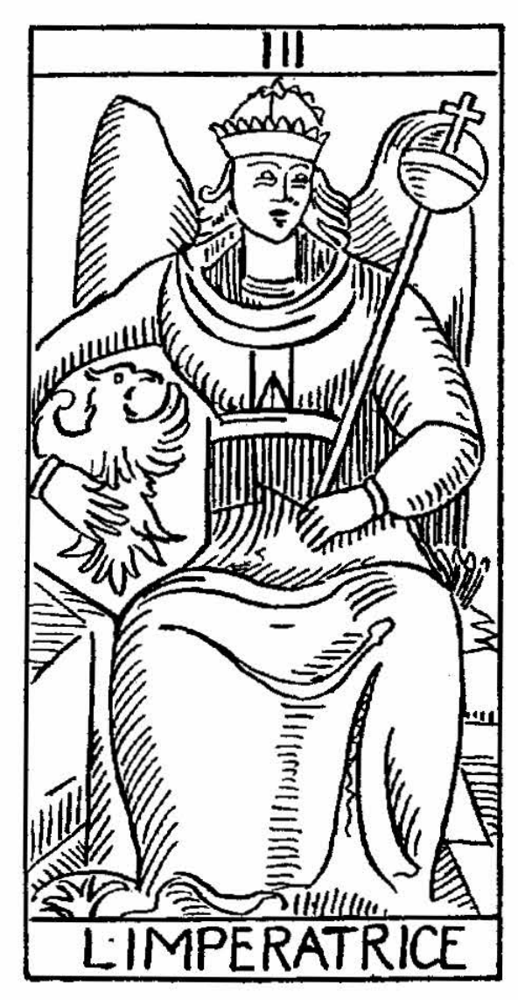
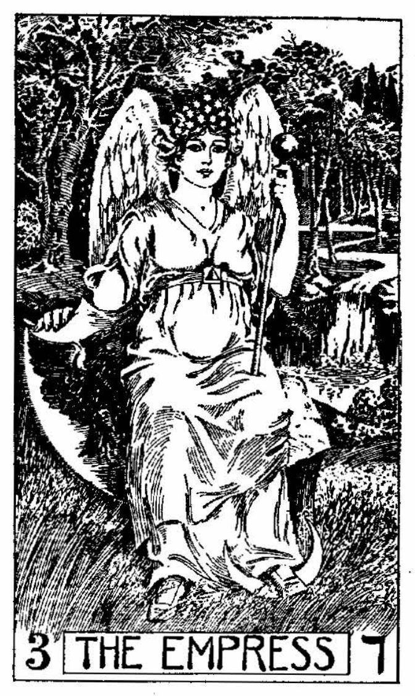

The modern "square Hebrew" is generally conceded to be a developement from the Aramaic script brought from Babylon after the Exile. It probably began to be used about the first century B. C., and its letters bear little resemblance to the ancient Semitic forms. Furthermore, though medieval Kabbalists worked out many fanciful correspondences from these square letters, they furnish no reliable clues to the ancient occult meaning of the alphabet.

Daleth for example, was originally a triangle—a form that survives to this day as the Delta of the Greek alphabet. As now written, the Greek letter directly contradicts its occult meaning, for it is a triangle with the apex upward, a symbol that has always represented spirit, fire, and the universal masculine principle. On early Greek coins, however, Delta usually stands for the Great Mother. Furthermore, Knight, Inman, Forlong, and other writers on phallic worship cite passages from Greek authors to show that this letter was a sign of feminine power.

The Greeks borrowed their alphabet from the Phoenicians, and if we examine a table of the Phoenician characters we shall see at once why Delta is a feminine letter. Its ancient form was a triangle having the apex turned downward; an ideograph that the inventors of the alphabet, free from false modesty, derived from a source that will be recognized by all students of phallicism. It denotes matter, water, and the universal feminine principle. Hence Papus is correct when he says: "The hieroglyphic meaning of Daleth is the womb. It suggests an object giving plentiful nourishment, the source of future growth."

Closely related to these implicits are those of the letter-name, which means "door"—not the opening, or doorway, but the leaf, or the flap of a tent. It gives entrance, admits, receives. It also gives exit, bars, sends out. Similarly, the womb is like a door, opening to let in the life-germ, closing to retain and protect it during gestation, and opening again to permit the passage of the new organism into the world.

An eminent teacher once said, referring to the works of Knight, Higgins, Inman, and other writers on phallic worship: "All are based on truth as far as the facts are concerned; all are erroneous and unjust in their ultimate conclusions and deductions." The reason they are mistaken in their opinions is that they ignore the Hermetic doctrine of correspondences—"As below, so above." The sages, like God, pronounce creation good, in all its parts, as well as in its totality. Pure in heart themselves, they recognize the essential divinity of all things; and they know that the great law manifested in physiological reproduction operates also on the superphysical planes. Jesus taught the very same thing, using a slightly different veil of symbolism, when he said the kingdom of heaven is like a grain of mustard-seed, or like the leaven a woman hid in three measures of meal. We have also seen that the Bhagavad-Gita calls Prakriti—the root of all matter, and the Great Mother whence all forms proceed—"my great womb."

If, then, Daleth represents the womb, it is a symbol of Prakriti; and since, in Chapter IV, we decided that Prakriti may properly be designated as Universal Subjective Mind, we may expect that our study of Daleth and the Tarot key corresponding to it will add to our knowledge about the ancient doctrine as to the nature and operations of the subjective mind.

Hindu teachers declare that Buddhi, the principle of judgment, is the highest mode of Prakriti. Buddhi is what enables us to find truth. It is therefore the principle of all human enlightenment. That Kabbalists inherit many points of doctrine from India, through Egypt, is well understood by all who have devoted any considerable attention to the sources of the Ancient Wisdom. We shall continually be finding proofs of this in our Tarot studies, and one such bit of evidence is the fact that the Sepher Yetzirah assigns the letter Daleth to the path of Illuminating Intelligence. Taken in connection with the feminine characteristics of Daleth, this attribution shows that the sages of Israel, like those of India, saw in the Universal Subjective Mind that power to mirror the I am to Himself, which is the true source of all increase in wisdom.

The path of Illuminating Intelligence joins Wisdom (Chokmah) to Understanding (Binah). This implies, first of all, that the light-giving consciousness is a direct expression of Divine Wisdom itself. The irresistible inference is that the perfect knowledge which must be ascribed to the Supreme Spirit is communicable, and passes into the sphere of human consciousness through the agency of Subjective Mind. Of this process the outcome is the manifestation, in human minds, of God's perfect Understanding, or self-knowledge.

Another suggestion that will bear rich fruit for those who ponder it well comes from the fact that Kabbalists regard Wisdom as masculine and Understanding as feminine. Hence Daleth, as the sign of the path joining these two, necessarily denotes a combination of male and female potencies. More than this, since Wisdom is the second Sephirah and Understanding the third, Daleth stands for a combination in which Wisdom is the originating and active principle, to which Understanding responds. Thus we may expect that the Tarot trump assigned to Daleth will show us the union of male and female powers, having their source in the male, and their form of expression in the female.

In this connection we may note that Wisdom is sometimes called the root of fire, and Understanding the root of water. Fire is energy, or life, and water is substance, or matter. Therefore Daleth, indicating that which joins the root of life to the root of matter, must denote the primary combination of Purusha with Prakriti, or the first aspect of the union of Universal Objective Mind with Universal Subjective Mind.

Because the place of the sun's rising is the "womb of light," or the door through which illumination enters daily into the world, the direction East is assigned to Daleth in the Sepher Yetzirah. In Masonic lodges the Master sits in the East, so that for Masons—who inherit their symbolism from the ancient mysteries—this direction is the Throne of the Master, that is to say, the seat of the ruling principle in the lodge. All properly instructed Masons know that the lodge symbolizes both macrocosm and microcosm.

In the microcosm the East, or the Throne of the Master, is the "heart," or emotional nature, for, as the Bhagavad-Gita tells us, Purusha is the Ego seated in the hearts of men. Is it mere coincidence that Leo, the throne of the sun, and central sign of the eastern triad in the zodiac, rules the heart? Out of the heart, says the proverb, are the issues of life. It is the subjective mind, whence proceed all our desires and aspirations.

It will be remembered, however, that the ancients supposed the reins, or kidneys to be the seat of the emotions, affections, and passions. Probably this is one of the reasons why Kabbalists make Daleth correspond to Venus, who rules the reins, and is the goddess of love and passion. Like Isis, Ishtar, Demeter, Aphrodite, and Ceres (all these being personifications of a single principle, distinguishable from each other only as having been the products of human thought at separate periods, in different countries, and as having this or that aspect of the one principle more or less emphasized in each personification), Venus is a type of the Great Mother, or Prakriti, the Universal Subjective Mind.

"In the Macrocosm She is that Beginning or Wisdom wherein God makes the heavens and the earth; the substantial waters upon whose face He, the Energizing Will, moves at every fresh act of creation, and the ark or womb from which all creatures proceed. And it is through the 'gathering together,' or coagulation, of her 'waters,' that the 'dry land' of the earth or body, which is Matter, appears. For She is that spiritual substance which, polarizing interiorly, is—in the innermost—God, and coagulating exteriorly, becomes—in the outermost—Matter. And She, again, it is, who as the soul of humanity, regaining full intuition of God, overwhelms the earth with a flood of Her waters, destroying the evil and renewing the good, and bearing unharmed on Her bosom the elect few who have suffered Her to build them up in the true image of God. Thus to these is She 'Mother of the Living." (The Perfect Way. Lecture II; 37.)

"In mystical science She appears as Sodium, or salt, whose ray is the spectrum, as the place of Venus among the planets, is the third, whose light is the brightest, and whose color is the yellow. Among the metals copper is dedicated to Venus. For of copper the crystals are the deep sea-blue. And, inasmuch as She, **as love, is the enlightener, and as salt the purifier**, and the pure in heart see God, so is its sulphate a balm for ailing eyes." (Ibid. Lecture II, 34.)

That part of the preceding sentence printed in heavier type brings out its agreement with Kabbalistic doctrine, which, in associating Venus with Daleth, makes her personify the Illuminating Intelligence, which, by joining Wisdom to Understanding, unites the primordial Illuminating Intelligence of Chokmah to Sanctifying Intelligence of Binah. Thus, for Kabbalists, Venus does indeed signify purification, or sanctification, resulting from the outpouring of the pure radiance of the Supreme Wisdom.

The Sepher Yetzirah also says that Daleth, as a double letter, stands for the pair of opposites, knowledge and ignorance. This seems to be an echo of the Hindu doctrine that Prakriti is both Vidya, the illuminating consciousness that enlightens the liberated, and Avidya, the darkness that surrounds those who are in bondage. A similar contrast makes Eve the agency of Adam's fall, and at the same time promises that her seed shall overcome the serpent of illusion. In the story of Abraham, likewise, there are two women; and the Bride, in Revelation, is set over against the Woman of Babylon. What is meant, I believe, is that the deductions of the subjective mind, and the impulses emerging from it, are constructive and illuminating when it reflects the real Self, or Purusha, but destructive and leading to error when it mirrors the illusory, phenomenal world.

Chatterji expresses a similar opinion in his commentary on the Bhagavad-Gita, when he says:

"The bondage of the ego is neither essential nor accidental, but false, being due to ignorance or illusion. The ego thus bound is liberated by the realization that in truth it is not subject to such bondage. The thinking principle (Prakriti) is the cause of bondage as well as of liberation. When operating in relation to objects it is bondage; when not operating in relation to objects by reason of its perception of their falsehood and the reality of the ego alone, it is liberation."

Through the door of the subjective mind the ego enters into the illusions of existence. Through the same door, going in the other direction, the ego returns to its original freedom. For Buddhi, the highest manifestation of the subjective mind, is the principle of judgment which enables us to realize the falsity of our apparent bondage. Nevertheless, Buddhi also causes all our mistakes, by making the operations of Prakriti seem to be real in themselves, whereas they are, in truth, real only as they reflect Purusha.

There is the number of the trump assigned to Daleth. As we have already seen, this number is represented in geometry by the primitive character for Daleth; and it is also the number of Venus among the planets, and of yellow, the color of sodium, in the spectrum.

Eliphas Levi calls the triad the number of creation, and asserts that it is the universal dogma and the basis of magical doctrine. He says: "Three is the key of numbers, for it is the first numeral synthesis; it is the triangle of geometry, the first complete and enclosed figure, the generator of an indefinite number of similar or dissimilar triangles."

The following observations are condensed from Mackey's Encyclopaedia of Freemasonry:

"Everywhere among the ancients the number Three was deemed the most sacred of numbers. Even the Chinese say that numbers begin at One and are made perfect at Three, and hence they denote the multiplicity of any object by repeating the character which stands for it three times. Plato made Three the image of the Supreme Being, because it includes within itself the properties of the first two numbers, and because, as Aristotle says, it contains within itself a beginning, a middle, and an end. The Pythagoreans called it perfect harmony. Throughout the whole system of the Druids constant reference is made to its influence. They even composed their sacred poetry in triads."

Three, or its multiples, is the typical number of endogenous plants without branches, and with parallel viens, such as the grasses, the lily, the palm, etc. All these plants are used again and again in the symbolism of the Sacred Science, and they always refer to occult truths that have a close connection with the number Three. Among grasses, wheat is the most valuable to man, as one of his principal articles of diet. The wheat-ear is the especial emblem of Ceres, the Roman goddess corresponding to the Greek Demeter. Thus, in the very structure of wheat, there is a correspondence between the Great Mother, or Prakriti, and the number Three.

In the Tarot, Three and its multiples are particularly significant. There are 78 cards in all, or 3 times 26. 26 is the number of the Tetragrammaton, and when properly disposed, the Tarot sets forth the Kabbalistic doctrine as to the self-manifestation of Yod-Heh-Vau-Heh on three great planes—the Intellectual, the Moral, and the Material. In the major trumps, the numbers printed on the cards add up to 231; and by reducing this (adding its integers) we get 6, which is the extension of 3 (0 plus 1 plus 2 plus 3). Thus the whole doctrine of the major trumps may be considered as an extension, or development, of the ideas represented by the Empress, as the reader will see for himself by the time he has completed his study of the cards.

The most significant designs of the major trumps are those bearing the numbers Three, Six, Nine, Twelve, Fifteen, Eighteen and Twenty-one, or the Empress, the Lovers, the Hermit, the Hanged Man, the Devil, the Moon, and the World. Now, if we think of Three as One multiplied by Three, of Six as Two multiplied by Three, of Nine as Three multiplied by itself, and so on, we shall find ourselves in possession of an important clue to the meaning of these seven trumps. For then we shall see that the Empress really denotes the increase, augmentation, or amplification of the powers represented by the Magician, who symbolizes the number One. In like manner, the Lovers, or Six, will be presented to our minds as a development of implicits connected with the High Priestess, through the agency of the Empress. The same rule holds good for all the rest of the cards in this group of seven, and the reader will profit by working out the other meanings for himself.

It should also be noted that each of these seven trumps is a synthesis of the doctrine presented by the three cards preceding it. Each, moreover, suggests a premise that is developed in the symbolism of the three cards that follow it in the series. Thus the number Three is significant in the correspondences of the trumps to each other, as well as in the actual numbering of the pictures.

As the generator of numbers, Three is active, in contrast to the passive Two. Its activity, however, is the reflection and extension of One through the agency of Two. One is the Magician, or Purusha, the Universal Objective Mind; Two is the High Priestess, or Prakriti, the Universal Subjective Mind. In the Tarot, then, Three stands for the active response of Subjective Mind to Objective Mind. In humanity this response is the generation of mental states or forms, for which the general term is Conception. This term, borrowed by psychologists from physiology, represents a distinctly feminine function, which is, however, initiated by a masculine principle.

Precisely this is what is implied by the title of the trump we are now considering: the Empress. For an empress is a wife and mother, bearing children as the result of her union with her lord. Yet, though her motherhood is a response to the virile power of her spouse, his sovereignty depends upon her motherhood. Until Purusha wills, Prakriti generates nothing; but until She has brought forth a universe of creatures, Purusha is not manifest as the lord of creatures, for it is because She brings forth that He has something to rule. This is why the Empress precedes the Emperor in the series of major trumps. She is the High Priestess transformed as the result of her union with the Magician. As the result of that union she becomes Genetrix, or Procreatrix, and when her work is accomplished the Magician becomes the Emperor, governing her progeny.

Mr. Waite's picture of the Empress differs considerably from those found in older Tarots. A diadem of twelve stars takes the place of the conventional crown, and the woman is clad in loose, flowing robes. The scene is a fertile garden, which emphasizes the antithesis to the High Priestess, who sits indoors. In the background is a grove, and a stream that ends in a waterfall. A field of wheat ripens in the foreground. These changes are in harmony with the occult meanings of Daleth and the number Three, so they are included in the revised version of the trump on page (81). The rest of Mr. Waite's alterations, however, do not strike me as being so happy. Except for the points mentioned, therefore, I have been careful to follow the traditional design, which shows the Empress as a winged figure, holding in her left hand a sceptre tipped with a globe surmounted by a cross, in her right hand a shield blazoned with an eagle, and having her left foot upon a crescent moon.

As a whole the picture conveys emphatic suggestions of fecundity and reproductive activity. The woman's figure is distinctly matronly, and her dress is a hint that she herself exemplifies the same fruitfulness that is implied by the luxuriant vegetation and ripening grain.

Her crown of stars has a number of meanings. In one sense it symbolizes the year, with its twelve signs, or months. In another sense it is the spiritual Israel, divided into twelve tribes—the perfected humanity that is, in very truth, the crown and chief adornment of the Great Mother. Again—and this will lead to many important conclusions if it be reflected upon—the crown is the human body. Articles explaining the location of twelve centers in the body, corresponding to the signs, have already been published in The Word. It may also be well to call attention to the fact that the body has twelve openings, as Mr. Pryse, I believe, has noted in his interpretation of the Apocalypse The suggestion behind all these correspondences is that a perfected humanity is the highest expression of Prakriti. Such a race must necessarily be composed of individuals whose bodies are perfectly tuned instruments of the Supreme Purusha. Paul refers to this when he speaks of the incorruptible spiritual body. The same thing is veiled under such blinds as the Philosopher's Stone and the Elixir of Life in the works of those alchemists who understood the true nature of the Hermetic Art.

In their immediate and material significance the waterfall and pool behind the Empress are phallic emblems. In a higher sense they represent the truth that all fruitfulness is a result of the descent of pure, primitive substance into relatively grosser forms. It should also be remembered that the water has come from a height not shown in this scene, and that its descent, like all other motions of matter on this globe, is a transformation of solar force. The great general truth symbolized here is that all growth and development is the working of the One Spirit in the universal substance.

The same idea is conveyed by the growing trees and the ripening wheat. The material from which their forms are built comes from earth and water, but the growing power is solar force concentrated in the seed.

The Empress is winged, to show that she represents a principle not limited to terrestrial conditions, though shown at work in those conditions in this picture. The laws of reproduction are universal, and act on every plane. What happens here is a key to what occurs everywhere else. Consequently, if we apply our knowledge of this principle to carry out specific purposes here, we are really subjecting the universal process to our voluntary control and direction.

The triangle enclosed within a square on the Empress' breast has the same fundamental meaning as the solar cross of the High Priestess. The virgin's cross, however, is not enclosed by another figure, and represents the free, potential state of the cosmic energy. In the present instance, the triangle, symbolizing fire, is enclosed in the square of matter. It denotes the materialization of spirit that is the central conception of the whole card.

The eagle on the shield denotes water, or substance, as has been explained in Chapter I. It is also the sign of the first Heh, in Yod-Heh, Vau-Heh, and is connected with the creative world, Briah. The Empress holds the shield in her right hand to show that creation, or the response of substance to impulses coming from the archetypal world, is the positive, or primary, characteristic of Prakriti.

The sceptre, tipped by a globe surmounted by a cross, also represents the combination of spirit and substance. It is an ancient Egyptian sign of eternal generation. She holds it in her left hand to show that although the controlling and directive power it symbolizes is shared by her, she is merely its passive agency.

The moon at her feet is not shown in some of the very old Tarots, but it was included in Eliphas Levi's suggestions for a rectified pack, and has been quite generally adopted. Certainly it belongs to the Empress if it is to be used anywhere in the major trumps, and I am at a loss to understand why Mr. Waite departed so far from tradition as to put the lunar crescent at the feet of the High Priestess. Its meaning, of course, is that all generation is established upon the laws of cyclicity, periodicity, and alternation, symbolized the world over by the moon.

In the broad sense, then, all the symbols of this trump relate to generative and reproductive activity; and the Empress is Prakriti, considered as the active generatrix, the Great Mother of all living. In the more particular sense that I aim to emphasize throughout this work, she is the subjective mind, considered as the principle that gives definite form to ideas—not in the thought-world only, but also in the visible, material plane. This doctrine may be condensed to a single sentence: All things are mental products, and the subjective mind is the formative agency in their production.

Her activity is the basis of every change man effects in his environment. From her all works of art are brought forth. She builds up the plans for the cathedral in the architect's brain. She fashions the tools of the builders. She is the mother of cities as well as the mother of ideas.

Another meaning behind the emblems of this card is that thoughts are not only things, but creatures also. They are begotten, not made. We do not manufacture them, any more than we build trees. Thoughts are born.

Mental reproduction, like the physiological process, is the work of two. It is a consequence of the union and reciprocal activity of an active principle and a passive one. The first initiates the process and the second responds. The first is occult, being hidden from the profane by the outward seeming of the second. But of herself the second can do nothing, and all her work depends on the original impulse of the first.

At the same time, these two are co-eternal modes of a single reality that transcends them both. One Spirit finds expression in both modes of human consciousness. And these two are not referred to as "primary" and "secondary" with regard to their existence in time, but rather with regard to the order of their relationship in human thought.

Objective mind initiates the thought process in the act of attention. A detailed representation of this beginning is given in the symbolism of the Magician. Without objective concentration there can be no development of new ideas from the subjective field. Fortunately for human progress, there is a great deal of unintentional, or involuntary, objective concentration. Otherwise we should not be far beyond the Bushman in civilization. The great thing, though, is the fact that certain lines of deliberate, willed concentration will carry us farther and faster than the average person progresses. Edison is a conspicuous example. He is far beyond most living men in his particular field. Yet, when asked the secret of his success, he said, "I simply watch what happens under given conditions." In exactly the same way all magical powers are brought forth from their latency. A magician is one who uses natural laws unrecognized by most people. He finds out about these laws by limiting his attention in various ways. But it should be noted that there is more or less danger in this work. Just as an experimenter in physics or chemistry is never certain that he may not blow himself up, so is the experimenter in the higher physics and chemistry of magic never quite certain what will happen, unless he has the advice and guidance of a master who has been over the ground. That is why it is so dangerous to try to develop magical powers without a teacher. "But where shall I find a teacher?" is the question so many ask. Not in a book, you may be sure, though some books will prepare you to meet a competent teacher. Your teacher will appear when you are ready for him. In the meantime, study to acquire knowledge, and work to perfect yourself in the ethical groundwork that is indispensable, but do not attempt experiments of whose outcome you cannot be certain.

Subjective mind responds to attention in memory, which holds the seeds of thought as the womb holds the seeds of life or the earth the seeds of plants. Let those who seek development remember this, and devote themselves to impressing upon the subjective tablets the great statements of truth recorded in the ancient writings. Let them speak little, that the seeds of truth may have time to ripen.

Above all let them remember that subjective mind always reproduces what we put into it. It originates nothing, but multiplies everything. If we plant roses and lilies, and trees good for fruit and shade, and corn to sustain our lives, we shall reap a harvest in kind. If we plant fear, hate, and doubt, we reap disease, war, and poverty. If we sow faith, love, and exact knowledge, we get rich returns of health, peace, and prosperity.

This great law is the foundation of all religious and magical practices. Prayer and incantation have for their common object the impression upon the subjective mind of the idea that human personality has at its command, and is able to direct, forces that shape and determine the character of its environment. All ritual serves merely to deepen the conviction expressed in the following affirmation:

"I am one with the Intelligent Life that creates, preserves, and transforms all things, and my personality is the instrument of that Life's free self-expression."

Let this statement, or one that embodies the same thought, be firmly impressed on the subjective mind. It is the seed of a generative process that will eventually take form in a deep understanding of life and its laws. This understanding will be more than mere intellectual apprehension. It will take form in actions, and those actions will sanctify and purify the whole personality. Such understanding and purification is the only road to the attainment of the high and holy magical power that is truly called the Sanctum Regnum.
