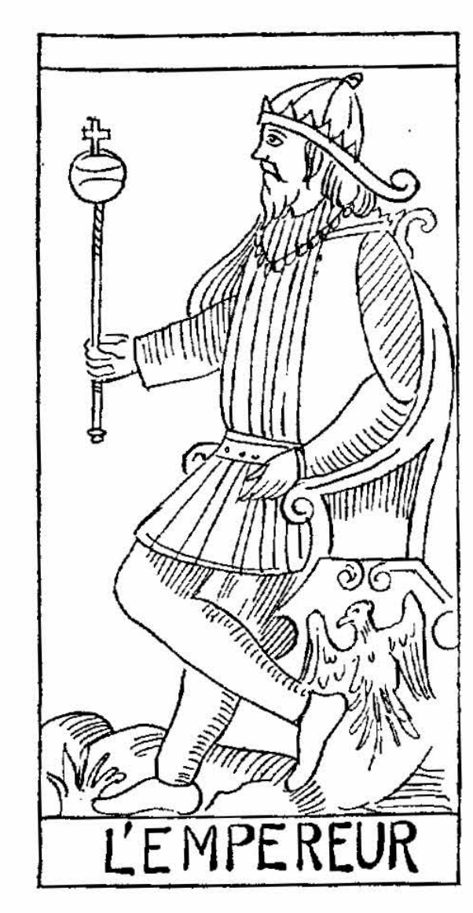
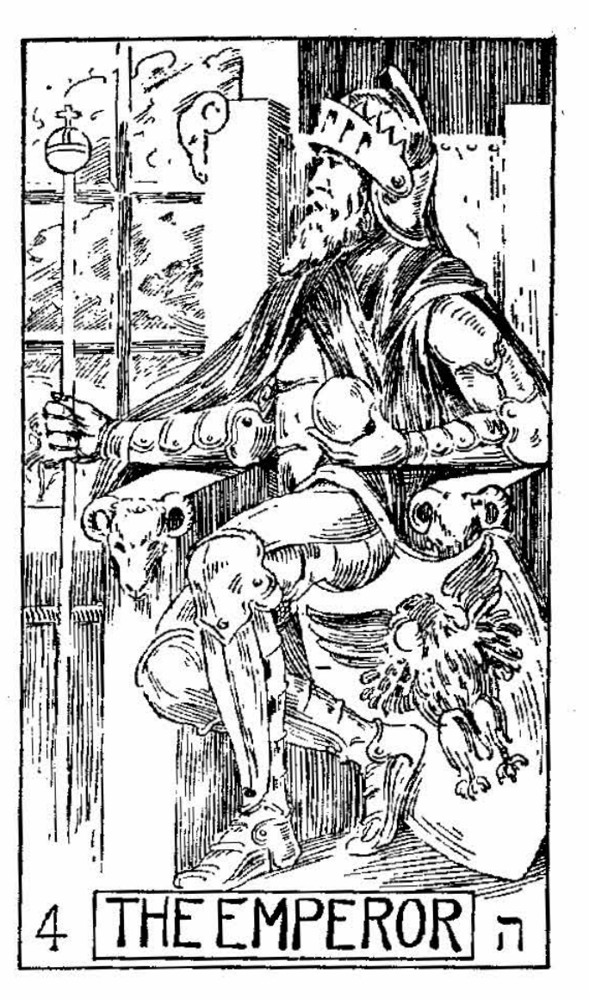
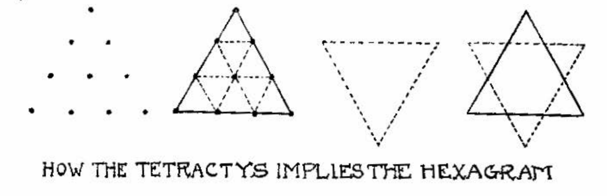
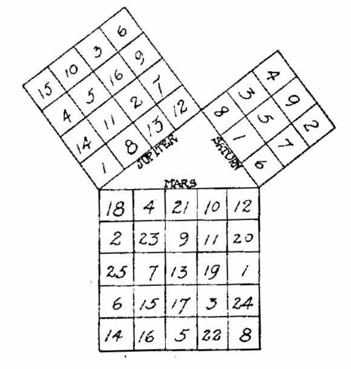

When the Zohar calls Heh the "mother," and says creation took place therewith, it refers exclusively to the second letter of the name Yahveh. A Heh is also the final letter of that word; but it indicates a group of ideas quite distinct from those assigned to the second letter.

This conflict of meanings is reason for supposing that the two Hehs in the Tetragrammaton are merely arbitrary symbols, like the "x" that stands for an unknown quantity, or the "n" that is the sign for an indefinite number. A book older than the Zohar, the Sepher Yetzirah, offers further support to this opinion by setting forth the occult significance of Heh in decidedly masculine terms; and the Tarot, as a development of the Sepher Yetzirah, represents the letter by a male figure, the Emperor.

In early Semitic alphabets, the character for Heh bears little resemblance to any object whatsoever. According to Papus, it means aspiration, or breath; but Papus derives his opinion from Kircher and Fabre d'Olivet, who are no longer regarded as competent philological authorities. Taylor, in "The Alphabet," expresses the conclusion of modern scholarship when he says that the primitive sign for Heh was probably a rough picture of the thing indicated by the letter-name, which means "window."

The most obvious thing to be said about a window is that it is a part of a house; yet this commonplace shows that the sign for window must be related to the symbol for house, which is the letter Beth. We may look, then, for some sort of correspondence between the implicits of Heh and Beth; and because Beth, in the Tarot, is the Magician, some likeness to the Magician is to be expected in the symbolism of the Emperor.

Another letter also qualifies the meaning of Heh. A window is not only a part of a house, but windows probably followed doors in the evolution of architecture. The "door" is Daleth, the letter of the Empress, whose name shows her close relationship to the Emperor. The nature of this relationship, and the reasons why the Emperor follows the Empress in the Tarot sequence, were discussed in the preceding chapter.

Our analysis of the letter-name now brings us to another significant commonplace. A window admits light and air. In symbolic language, "light" is intelligence, and "air" is energy. Therefore Heh is a sign of a phase of mental activity which brings about the influx of the intelligence and energy of Spirit into the house of personality.

Some hint of this influx or concentration of spiritual energy, has been given by every major trump that we have studied. The Fool's imminent fall into the abyss, the Magician's uplifted right hand, the High Priestess's book, and the waterfall behind the Empress, all suggest the passage of spiritual force into various special forms of expression. They all imply a change from the general to the particular, suggested by movement toward the center, as it were, from the circumference. This motion may be likened also to the downward arc of the ever-turning wheel of life. Occultists term it involution.

Its complement, evolution, is also implied by the window, because windows afford a means of outlook. Here an outflow of intelligence, from particular states of personal existence into more general conditions of environment, is the idea suggested.

By means of it the personal factor is introduced into the operations of nature. This factor is the personalized intelligence of the Supreme Spirit, or Purusha. This intelligence, finding expression through human beings, enables man to discover the laws of nature, and adapt those laws to his ends. The Knower who discovers natural laws is, however, not any limited personality, but the One Ego, Purusha. Hindu philosophy says nature, or Prakriti, works because Purusha looks on; and when the Bhagavad-Gita calls Purusha the Ego seated in human hearts, it implies that he is the Outlooker, as well as the Onlooker. Precisely this idea lies behind the second meaning of Heh.

The spirit in man is identical with the pure Consciousness that is the Source of all. One I AM expresses itself through countless persons. In doing so it provides for communication between the outer and inner worlds; permitting the influx of impressions from without, and allowing the power within to flow outward into the phenomenal world, where it exercises a supervising and controlling influence. Such, in part, is the doctrine implied by the letter-name, Heh.

Kabbalistic interpretation of the letter emphasizes the outward movement of the personalized consciousness. The Sepher Yetzirah, for example, makes Heh correspond to the sense of sight. This attribution is directly related to the idea that a window affords a means of outlook.

Of all the "gateways of knowledge," sight is the most wonderful. About two million different color-sensations, it is estimated, can be distinguished by a cultured Caucasian. Savages have less delicacy of perception. They are blind to many hues; so that in sorting yarns they will often mix several different colors in a single skein. Browns and purples, in particular, look alike to the uncivilized eye. This lower color-sensibility of uncultured races probably accounts for their characteristic preference for bright reds, yellows, blues, and greens; just as their comparative insensibility to nice distinctions of flavor makes them excessively fond of sweets and spices.

Great, however, as is the difference between the vision of a European and that of a Bushman, the difference between a Bushman's sight-centers and those of even the highest lower animals is greater still. Comparative anatomy has demonstrated that man has the most complex brain-machinery for seeing. In man vision has reached its highest development.

No one will deny that this development has been a dominant influence in human progress. When we call knowledge "enlightenment" we bear witness that we civilize ourselves by seeing. Civilization is the fruit of science, and trained vision leads to scientific discovery. This is just as true of the civilization now being established through the spread of occult science as it is of that which is the product of purely physical investigation. To discover the laws of superphysical planes one must have eyes to see the facts of those planes; hence one of the principal aims of occult training is to develop a higher faculty of sight, now latent in most people, that enables its possessor to see things invisible to the untrained man.

Sight is a constructive sense. The modern world, considered as a human adaptation of natural conditions, has literally been seen into existence. Our cities, our railroads, our great canals, are all materialized visions, and in every stage of their construction, from beginning to end, sight guides the whole operation.

Sight rules the world of art. Painting, sculpture, and all their derivatives, including photography and motion-pictures, address themselves directly to our eyes. Moreover, the progress of literature, in all its branches, and the development of music, has been made possible by the conversion of sounds into visual symbols.

In Plato's day practically all instruction was oral, and the orator was a great force in the affairs of nations. Today we have correspondence schools for almost everything, and editors mould public opinion. Some, indeed, try to persuade us that we write and read too much; yet they themselves contribute to the very condition they deplore. They have to write against writing to get what, in remembrance of bygone ways, we still call a "hearing."

We might go on to show how religions invariably spring from the experience of seers possessing the higher order of vision previously mentioned; how the very propagation of the species is probably more affected by vision than by any other sense; and so multiply examples until this one topic had been expanded into a large book: but we should add nothing to our certainty that sight dominates our lives. Let us, then, turn our thoughts from what it does to some consideration of what it is.

In seeing we are most directly influenced by the radiance which is the motive power in all terrestrial activity. Our eyes transform light into thought. Hindu scientists knew this long ago, and their books tell us that the subtle principle of sight is Tejas, the fire-element.

Tejas is red; its form is triangular; its property is expansion. Among the planets it is represented by Mars. It has more centers of influence in our bodies than any other Tattva. Among them are: the eyes; the optic nerves; the sacral plexus; the prostatic ganglion; the solar plexus, which is the great storage-battery of Tejas in the torso; the stomach; and the duodenum. "Tejas" is also the Sanskrit name for the brain. This Tattva maintains the bodily heat; is active in digestion; and is the sex-force that yoga practice transforms into "Ojas," which Swami Vivekananda defined as "the highest form of energy attained by constant practice of continence and purity."

In the Hindu pantheon, Tejas is personified as Agni, primarily the god of the altar-fire, but later the Supreme God of the Vedas. He also represents lightning (that is, electricity) and solar force. Like the Latin Janus, also a sun-god, Agni has two faces. As the sacrificial fire, he is the mediator between the gods and men. As a rule he rides a ram, and carries a notched banner.

Now, the Bible compares God the Father to a consuming fire; declares the Son, Christ, to be one with the Father, and the mediator between God and men; and compares his countenance to the sun. The symbology of the Roman Catholic Church, moreover, represents Christ as the "Agnus Dei," and more than one writer on comparative religion has been struck by the similarity between "Agnus" and "Agni." Even more remarkable than this likeness of names, however, is the fact that the Agnus Dei is a young ram, carrying a notched banner, which displays a solar cross of equal arms.

This representation of Christ is stamped on a circular wax medal, the circumference of which is divided into twenty-four equal parts, indicated by dots on the face of the medal, near the edge. Such an Agnus Dei is illustrated in Webster's New International Dictionary. The circular shape, and the cross on the banner, show that it is a solar emblem; and the dots around the edge correspond to the twenty-four hours of the day.

Both Agni and Christ, then, are associated with fire, and their common symbol is the ram, which, in astrology, is Aries, the first sign of the zodiac. Aries is the positive sign of the fiery triplicity. Its ruling planet is Mars. In the Sepher Yetzirah it is assigned to Heh. Thus we see that Kabbalists associate Heh, not only with sight, but also with the element, the planet, and the symbolic animal that suggests sight to every properly instructed Hindu.

Each sign of the zodiac represents a part of the body. Aries corresponds to the head. Thus it denotes the controlling power in human personality; for the head governs the whole organism. It contains the sense-organs that give us our experiences, and is the seat of the mental faculties that explain experience and make it a guide for action. All that a man does begins in his head. It decides the whole course of his life. From the raw material of sensation it forms the desires, judgments, and volitions which, taken together, make up the history of the man. We build our lives in our heads, which therefore correspond to the kind of consciousness Kabbalists have in mind when they say that the letter Heh stands for the path of Constituting Intelligence.

To constitute is to make anything what it is; to make up; to frame; to compose. These definitions are all grouped around one central thought. They bring to mind a power able to form the elements of existence into a coherent whole.

This power, says the Kabbalah, "constitutes creation in the darkness of the world." That "darkness" is the primordial substance from which all forms are built. It is the inferior nature of Spirit, the "mysterious illusive power, difficult to cross over." Through it, and in it, the Constituting Intelligence finds expression. By the works of Prakriti, Purusha becomes manifest as the Grand Architect and Master Builder of the universe; but Prakriti is absolutely dependent upon Purusha. The power that sets matter to work is not the power of matter, but of Spirit. Matter is the mother-principle symbolized by the High Priestess and the Empress; it is the great procreatrix; but its generative activity results from its union with the father-principle, which the Tarot personifies, first as the Fool, and then as the Magician. The High Priestess becomes the Empress by her union with the Magician; and by his union with her the Magician becomes the Emperor.

Heh, then, as a symbol of Constituting Intelligence, denotes the executive and realizing power that initiates our thought-processes and controls their results. This is the objective mind, which, in controlling the operations of the subjective mind by suggestion, determines the character of our thought-habits, and thus influences all our actions, and rules our destinies. For what we do is the result of what we think, and our circumstances are the fruit of our deeds.

It will be seen that one main thought lies behind all that is implied by Heh and its Kabbalistic correspondences, and this is the thought which is embodied in such words as "authority," "supremacy," "regulation," "supervision," and the like. The same idea is at the root of the occult meaning of the number Four, concerning which Eliphas Levi writes as follows:

"The triad resumed by unity, and with the conception of unity added to that of the triad, produces the first square and perfect number, source of all numerical combinations, and origin of all forms—the quaternary or tetrad, the tetractys of Pythagoras, whence all is derived. This number produces the cross and square in geometry. All that exists, whether of good or evil, light or darkness, exists and is revealed by the tetrad."

The number Four, that is to say, is the mathematical sign of the Supreme Source of all existence. It represents the One Self, called Purusha by the Hindus, Yahveh by the Hebrews, and recognized by both races as Lord of all.

Occultists agree that Pythagoras knew the secret of the name Yahveh, and symbolized it by the tetractys, a triangular figure composed of ten dots, which is the geometrical basis for many ancient emblems of the Secret Doctrine, including the swastika and the pyramid. The swastika is a solar emblem, like the cross worn by the High Priestess. The pyramid typifies the primal fire, or universal radiant energy. Thus the Pythagorean conception of the number Four reminds us that the "source of all numerical combinations, and origin of all forms" is manifested on earth as the light and heat of the sun.

By joining all the points of the tetractys, a great equilateral triangle may be formed, containing nine smaller triangles. Of these only three have sides which form no part of the sides of the great triangle; and the combined length of the lines composing these three triangles is equal to the length of the sides of the great triangle. These lines, therefore, might be used to form a triangle of equal area to that of the great triangle. Thus the tetractys figure implies two equilateral triangles of equal area; and the length of the lines required to join all the ten dots is exactly the length of the lines required to form a hexagram, or Shield of David, composed of two triangles of the same area as the great triangle of the tetractys. This will be clear from the accompanying figure, where the dotted lines represent what may be called the "involved triangle."

The Shield of David is a Hebrew sign for Yahveh: the cross, implied by the number Four, represents Christ. Between these two symbols, long opposed to each other in the field of exoteric religion, stands the tetractys; based on the Four of the cross, yet showing the Ten, which is a prominent number in the Kabbalah; and implying the hexagram that summarizes the whole secret doctrine of Israel.

In considering the application of the number Four to the Tarot, we must give special attention to Eliphas Levi's conception that it represents the combination of unity with the triad. The Magician is unity, and the Empress is the triad. Hence Four denotes the union of the Magician with the Empress. It is a sign of the reciprocal activity of the two modes of consciousness, and of the dominance, in that activity, of the superior term—Purusha, or objective mind—symbolized by the Magician.

The title of the fourth trump confirms the conclusions we have reached in our study of the letter and number. An Emperor represents (though usually the better word, in these days, would be "misrepresents") the controlling intelligence that constitutes all the conditions of his empire. He is the husband of the Empress, who is Prakriti; hence he must be Purusha. He personifies supervision, oversight, and leadership. He is that aspect of Purusha in which the Supreme Self is manifest as the Ruler of the Universe, the Law-giver, the Sovereign Authority.

Authority and authorship are very closely related. In primitive civilizations the headman of a tribe is literally its father. His right to govern springs from the fact that he is the source of the life of each member of the tribe. Hence the Emperor suggests the intimate relationship of the Sovereign Power to its creatures. The latter are the same, in kind, as their Author. They are God's children, and not his puppets. Moreover, to follow out this line of thought to its logical conclusion brings us, at last, to the conception that all nature, as proceeding from God, must be essentially divine.

The new design is based on the version given in Court de Gebelin's "Monde Primitif," and retains all its essential features. What changes have been made simply emphasize the correspondence to the letter Heh. No essential of the original symbolism, however, has been altered; for if the card had no picture at all, and were distinguished only by its number and title, the implicits of these, as we have endeavored to show, are sufficient to establish its connection with Heh.

The Emperor sits in his palace, near a window, through which he looks out upon a fertile prospect. The window refers to the letter-name. The view it commands is of the same rich valley wherein the Empress has her seat. Thus the picture, as a whole, suggests the immanent Purusha, surveying the field of the phenomenal world from within the house of personality.

As in Mr. Waite's version, the throne is decorated with ram's heads, to call attention to the correspondence to Aries. Some Tarots make the throne a cubic stone; but, as Mr. Waite has pointed out, this departure from the older versions confuses the meaning of the design.

Aries is called "the throne of Mars," in astrology. Hence the Emperor wears the armor of the war-god. It will also be remembered that in mythology Mars is occasionally referred to as the consort of Aphrodite, whom the Tarot typifies as the Empress. He is also the lord and protector of the fields, just as the Emperor may be supposed to be.

The helmet, adorned with twelve triangular points corresponding to the signs of the zodiac, is an emblem of the controlling power which expresses itself throughout the whole cycle of existence, symbolized by the year. It is the masculine counterpart of the crown of twelve stars worn by the Empress.

The scepter and shield are also the same as those of the Empress, and have the same general meaning. Their positions, however, are reversed. This is to show that the power represented by the scepter is the positive expression of the Emperor's activity, while the formative response of substance, of which the shield is an emblem, is the negative, or passive, aspect of his sovereign control of all things.

The globe in his left hand is the conventional symbol of regal authority. It does not appear in the older versions of the design; but both Papus and Waite include it in their Tarots, and we have retained it because it rounds out the meaning of the picture without corrupting the original sense.

We come now to the most curious feature of the symbolism, which might pass unnoticed by a casual observer, though it is obvious enough when attention has been called to it. The Emperor sits in a most unnatural position; his arms are held in a peculiar manner; and his legs are crossed in a way that takes no account of anatomy. The reason for this is that the composition of the design is based upon a right-angled triangle, surmounting a cross. This is no innovation. Eliphas Levi mentions the geometrical basis for the picture of the Emperor, and it may be observed in the oldest Tarots.

The Tarot of Oswald Wirth, reproduced in "The Tarot of the Bohemians," makes the triangle one that has two equal arms, and similar proportions are suggested by Mr. Waite's version. Careful measurements of Court de Gebelin's picture of the Emperor lead, however, to the conclusion that in his day the triangle was one with sides of three, four and five units, respectively.

In his illuminating monograph upon the Masonic Apron, Mr. Frank C. Higgins explains this 3-4-5 triangle as follows:

"In Egypt this was apparently termed 'the triangle of **Hur-Amun**' or Horus-Amon, the Savior Sun God with the ram's head, the type being that of the young Spring Sun, at the moment when the year began, in the sign of Aries. The peculiar shape of this triangle, which is composed of a right angle of three units of measure by four, the hypotenuse of which is exactly five, was likened to the form of an eye, the symbol of the Sun-god, the Sun itself being termed the 'Eye of Heaven.' This figure was the original type of the celebrated Egyptian amulet, the 'Eye of Horus,' which has in course of time descended to our Masonic institutions as the 'All Seeing Eye.'"

We lack space to discuss the extraordinary properties of this triangle; for a book of considerable size would be needed to do justice to this one topic. We must avoid the temptation to digress into an explanation of some of the mysteries represented by this figure, and concentrate our attention on the perfect correspondence between Mr. Higgins's explanation of it, and what we have learned of the letter Heh from the Kabbalistic view-point. Heh suggests Sight, and so does the "All Seeing Eye"; Heh is a sign of the Constituting Intelligence, and the 3-4-5 triangle represents Horus-Amon, the Egyptian personification of the constructive power in nature; Heh is assigned to Aries, and the triangle also indicates the first sign of the zodiac.

The cross formed by the Emperor's legs is placed below the hypotenuse of the triangle. Thus we know it must be one of twenty-five cells, since the hypotenuse has five units. This particular square, with the numbers from one to twenty-five placed in a certain order in its cells, is known as the magic square of Mars.

Now, in symbolism, the part often stands for the whole; and in the present instance we have, in the composition of the Emperor, the triangle and one of the squares used by Euclid in demonstrating his Forty-seventh problem, also known as the Pythagorean proposition. Hence we may assume that the fourth major trump is intended to call our attention to this geometrical proposition, and to the three magic squares to which it gives rise. The accompanying illustration shows the complete geometrical basis of the Emperor, with the magic squares properly numbered.

The square of nine cells corresponds to Saturn; that of sixteen cells to Jupiter; and the one of twenty-five cells, as we have said, to Mars. Hence we may suppose that the Emperor will represent a combination of the ideas represented in mythology by Saturn, or Cronus; his son, Zeus, or Jupiter; and his grandson, Mars, or Ares. As the husband of the Empress he must be Cronus, whose wife, Cybele, is a form of Aphrodite. His globe and scepter, and the eagle on his shield, are attributes of Jupiter. We have already seen that his armor suggests Mars. He is the seed-sower (Saturn), or Source of all; he is the governor and chief (Jupiter); and he is the protector of the fields (Mars), who is also a destroyer and a transformer. In a word, he is Creator, Preserver, and Transformer; and thus he corresponds to the three aspects of Purusha, the Supreme Spirit, which Hindus distinguish from each other as Brahma, Vishnu, and Siva.

What, then, have we learned from this trump? This, that the central fact of human personality, the I AM, is really the Master Principle of the universe, governing all things, originating all things, and making all the transformations that constitute our daily experience. He is the Lord. His sovereignty is that of reason. He knows what all things are, and why, and how they exist. From his omniscience nothing can be hid. Nothing escapes his control. His omnipotence is the essence of all power, and the root of all forces.

From this doctrine it follows that most people suffer because they look in the wrong place for that which will enable them to overcome unfavorable conditions. The only place that we can find the power we seek is within ourselves. For each human being is not merely an effect of the Supreme Cause. Human personality embodies the ability of the Supreme Self to exert conscious direction over whatever happens. Men who grasp this truth, and meditate upon it until, at last, they come to a full realization of its meaning, are the miracle-workers and spiritual leaders of every generation.
