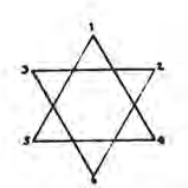
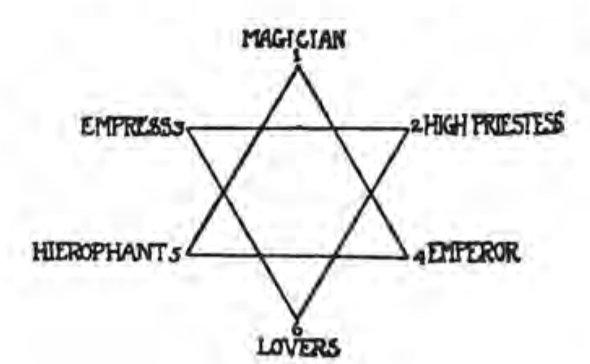

Zain, the seventh letter of the Hebrew alphabet, corresponds to the Greek Zeta and the English "Z." The Hebrew character is probably derived from the Egyptian hieratic letter corresponding to a hieroglyphic, which was a picture of a hissing goose. This bird is a very ancient symbol. It figures in the sacred allegories of India, in the myths of Greece, and in the stories of the Norse gods. To these high sources we may trace its meaning in folk-tales and proverbs. Thus the goose that lays the golden eggs is probably the Bird of Brahma.

In Sanskrit its name is "Hamsa," which is usually translated "swan." Many etymologists, however, suppose this word to be the root of the English noun "goose." Webster compares it with the Latin anser, the Spanish gansa, the Old High German ganazzo, and the German gans. The word "swan," on the other hand, is akin to Teutonic nouns of similar spelling and pronunciation. Perhaps it may be related to "sound," something audible, from the Latin sonus, akin to the Sanskrit svana, sound, or svan, to sound. Thus, even if the Hindu sages thought of a swan when they spoke of the Bird of Life, their name for it is more accurately translated into English as "goose." In ancient statues and paintings of Brahma, moreover, the Hamsa, on whose back the god sits, bears a far closer resemblance to a goose than to a swan. We may ask those who say this is due to primitive draftsmanship to explain why only the bird should be badly drawn in works that, in all other details, frequently exhibit considerable artistic skill. Again, the goose is, as it were, the middle species of a genus in which the duck and the swan are the extremes. It has characteristics of both. Hence it more truly typifies the whole genus than either of the others.

Etymology, archaeology, and zoology, therefore, support the position that the Bird of Brahma was a goose. Folk-lore and mythology also confirm the view that the swan and the goose are interchangeable symbols.

Madame Blavatsky writes: "In the beginnings the 'First Cause' had no name. Later it was pictured in the fancy of the thinkers as an invisible, mysterious Bird that dropped an Egg in Chaos, which Egg became the Universe. Hence Brahma was called Kalahansa, the 'Swan in (Space and) Time.' Becoming the swan of Eternity, Brahma, at the beginning of each Mahamanvantara, lays a Golden Egg which typifies the Great Circle, or O, itself a symbol for the Universe and its spherical bodies."

The Hamsa therefore denotes creative power. The distinctive quality of that power is indicated in Hindu scriptures by passages describing the sacred bird as "a messenger of love," and as being "drunk with love." Thus they confirm St. John's declaration, "God is love." Spirit is love; and Spirit is Brahma, the efficient cause, and the material cause of all earthly existence—the animating, creative force of the world. The material expression of that force is solar energy. Consequently, the goose, as a symbol of Brahma, must also denote the radiant force that does the work of Brahma on earth.

Hindu symbolists therefore picture the chariot of the Asvins as being drawn by geese or swans. The Asvins are children of the sun, twin deities of light and dawn. Their mother was a nymph. As twins born of a mortal mother, and a heavenly father, they resemble the twins of Greek mythology—Castor and Pollux. These were sons of Leda, who, after she was visited by Zeus in the form of a swan, brought forth two eggs, from one of which Castor and Pollux were born.

Frey and Freya, the twins of Norse mythology, also have the goose for their symbol. In general attributes they greatly resemble the Asvins and Castor and Pollux; but instead of being brothers they are brother and sister. Their mother was Nerthus, whom Tacitus identifies with Tellus Mater, the Earth Mother, a form of Ceres, or Demeter (the Empress in the Tarot). Like Demeter, Nerthus was a goddess of marriage. Frey and Freya, therefore, may be considered the masculine and feminine expressions of the "conjugal principle," or love. This is probably the reason why their symbol, the goose, is throughout Northern Europe, a popular emblem of conjugal fidelity.

The goose or swan, then, stands for creative power, manifested through the generative function of the universal feminine principle, and taking two distinct forms. These two are of equal importance. They stand in a relationship so close that we cannot always distinguish the works of one from the operations of the other. Sometimes this relationship is represented as that of twins; often it is compared to that of husband and wife.

Similar notions are suggested by the letter-name, Zain, which means "sword"; for the sword is a symbol for creative force, in the form of radiant energy, or fire. Fire hisses; the goose represents the hissing sound in Egyptian hieroglyphics; and whoever has watched a cavalry company at saber-practice will recall the sharp sibilance of swinging sword-blades, which constitutes the most obvious resemblance between the hieroglyphic and the letter-name.

But the sword is a symbol of war, and warfare seems at first to have little in common with love. Cynics, to be sure, profess that there is no great difference between war and marriage; but this pessimistic opinion need not be taken seriously. We have better reason for affirming a correspondence between the symbols of the sword and the goose. The sword typifies love as well as war, because the essence of both war and love is opposition.

Love itself is full of contradictions. It is at once the most selfish and the most disinterested of our emotions. Like warfare, it incites men to the bitterest antagonism, and betrays them into the expression of the basest passions. On the other hand, it imbues many with a spirit of the most courageous self-sacrifice, and is the channel through which the loftiest motives flow into action. Like warfare, too, it subordinates every other consideration to the attainment of its ends; and from this we have the proverb, "All is fair in love and war." Again, love is like war because its ideal is peace. The clash of arms is not in itself an end, but only a means for establishing ultimate harmony. Of this the ancients gave us a hint when they wrote of the love of Aphrodite and Ares. Finally, love's highest human expression rests upon the opposition of the sexes. Prudish reluctance to admit this truth does not make it any less true; and shutting our eyes to the facts is no way to discover their meaning. Those who have not so blinded themselves have learned that the law of sex is universal. Thus the secret of gender on the planes above the physical has ever been the supreme revelation of the official mysteries. The letter Zain is a symbol of this arcanum, because the sword, as a cutting instrument, typifies division, or section; and this is the essential meaning of "sex."

"The kingdom of heaven is like leaven," said Jesus. The kingdom of heaven is the divine self-government, or the method of God in creation. It is like leaven, a one celled plant which reproduces itself by budding, or emanation; because the creative method proceeds from One, which divides itself into Two. The self-division of the Supreme Spirit is the initial stage of the creative process. Again and again have the masters of the sacred science proclaimed this doctrine.

"The creator felt not delighted in being alone; he wished another, and caused his own self to fall in twain, and thus became husband and wife (Purusha and Prakriti). He approached her, and thus were human beings produced." (Sama Veda.)

Kabbalists think of the Creator as being the Primal Will, seated in Kether, the Supreme Crown, Kether is also called the Most Holy Ancient One, of whom "The Lesser Holy Assembly" declares:

"When the Most Holy Ancient One, the Concealed with all Concealments, desired to be formed forth, He conformed all things under the form of Male and Female; and in such place wherein Male and Female are comprehended.

"And this Wisdom, embracing all things, when it goeth forth and shineth forth from the Most Holy Ancient One, shineth not save under the form of Male and Female." (Chapter VIII.)

Zain, the sword, represents the instrumentality which effects this division into Male and Female, Above and Below, Purusha and Prakriti. That instrumentality is a mode of consciousness.

Its character is revealed in the passage I have quoted from the "Sama Veda" by the phrase "he wished another"; and the "Lesser Holy Assembly" presents the same thought in the words, "When the Most Holy Ancient One desired to be formed forth." Desire for another, then, is the mental state that urges the Supreme Spirit into beginning the creaative process. Because this desire establishes a division between Cause and Effect, Kabbalists call it Disposing Intelligence. They give this name to the Sephirotic path of which Zain is the alphabetical symbol.

To dispose is to place apart, to separate. This, the fundamental meaning of the word, exactly defines the kind of consciousness at work in the original creative process. It implies arrangement, classification, the establishment of orderly relationships; and includes the ideas of adjustment, regulation, and adaptation. All these must be postulated as being inherent tendencies in any power able to begin a creative process.

To dispose, again, means to prepare, especially in the sense of mental influence. Kabbalists, therefore, say that Disposing Intelligence prepares the devout to receive the Holy Spirit, by disposing them to perseverance.

Here is a hint that from the very beginning the Originating Spirit looks forward to that recognition of its indwelling presence which is the culmination of all human experience. The doctrine that illumination is really a work of grace is a deduction from the premise that the I AM is the Disposing Intelligence that determines all forms of manifestation. Spirit gives us light by implanting in our hearts the desire for enlightenment, whereby we are influenced to work perseveringly to attain the goal. Perseverance is persistence in the face of obstacles, discouragement, or opposition. Hence St. Paul, comparing the Great Work to warfare, says, "I have fought a good fight. I have finished my course, I have kept the faith." (II Timothy:4,7.)

Kabbalists, therefore, make the path of Disposing Intelligence originate in Binah, or Understanding, to show that the knowledge of the faithful proceeds directly from the Divine comprehension. Personal exercise of right discrimination is the particular expression of the Supreme Spirit's power to discriminate. When I see a truth it is not I that see, but the power of Binah working through me. As Kepler once remarked, man thinks the thoughts of God after Him.

Binah, the source of Disposing Intelligence, is primarily the completion of the path of Intelligence of Transparency. This proceeds from Kether, the Primal Will, and is represented in the Tarot by the Magician. The other path ending in Binah is that of Illuminating Intelligence, originating in Chokmah, Wisdom, and represented by the Empress. Thus the Kabbalistic significance of Zain is rooted in the meanings of Beth and Daleth, and the Tarot representing these meanings should be a synthesis of the symbolism of the Magician and the Empress.

Because it begins in Binah, the Mother, the Path of Disposing Intelligence is clearly a direct manifestation of the universal feminine principle. Thus the Sephirotic attribution of Zain corresponds exactly to the implicits of the hieroglyphic and the letter-name.

The Woman in God is the basis of His creative work.

She is the Substance—that which stands under, as the foundation. She is the source of the urge for self-expression, even as the subjective mind of man is the seat of the emotions and desires. This "desire for another," mentioned in the Vedas, this "love for the world," recorded in the Bible, this "desire to be formed forth," spoken of by Kabbalistic writers, is from Her. Brahma becoming the Kalahansa that lays the Golden Egg, is no longer He, but She. Prakriti, the power of Purusha, is also "She." Kabbalists tell us that creation took place with the letter Heh, which in this aspect, they call "the Mother." The same idea was expressed by Jesus when he said that the kingdom of heaven is like leaven which a woman took, and hid in three measures of meal.

The Sepher Yetzirah confirms our interpretation of the hieroglyphic origin of Zain. It makes this letter the symbol of Gemini, or Castor and Pollux, the second sign of the Zodiac.

The corresponding Tarot trump bears the number Six; which according to Eliphas Levi, is "the duad exalted, and carried to its supreme power." A number is "exalted" by adding to it the sum of all the numbers preceding it. This is the process I have elsewhere called "extension." Some writers term it "theosophical addition." The extension of Two is Three, and Six is the extension of Three. Six extends to Twenty-one, which, by reduction, equals Three. Six is therefore the highest integer that can be produced from Two by the process of extension. Consequently, as Levi says, it is the duad carried to its supreme power.

The geometrical figures corresponding to Six are the Shield of David or hexagram, and the cube. In Chapter VI, I explained how the hexagram is involved in the equilateral triangle enclosing the ten points of the Tetraktys. To that explanation let me now add another reason for the occult agreement between the "Mogun Dovid" and the Cross.

Both emblems typify the opposition, union, and equilibration of similar but distinct forces or principles. The vertical line of the cross indicates the masculine principle, and the horizontal line stands for the feminine principle. In like manner the upright triangle of the hexagram symbolizes Purusha, and the reversed triangle is the sign of Prakriti.

Long before the hexagram became the Shield of David, it was known and used as a religious emblem by the Hindus, who assigned the upright triangle to Siva, and associated the other triangle with Vishnu. The Egyptians had a similar understanding of the figure. For them the upright triangle symbolized Fire, the transforming and destroying principle, and the other was an emblem of Water, the receptive and preserving principle. Moses undoubtedly received instruction on these matters in the course of his Egyptian temple training; and to the same source we may trace the Pythagorean doctrine that the hexad is a symbol of creation, or generation.

Let a circle be described around a hexagram, and radii be drawn through all the angles of the triangles, and through their points of intersection. This divides the circle into twelve equal parts. Each division represents a tribe of Israel, a sign of the zodiac and a month of the year. Thus the hexagram symbolizes one complete cycle of seasons. It therefore implies the law of periodicity or cyclicity, which, as modern science has amply demonstrated, is at work in all generative activities.

By writing the numbers from One to Six around the points of a hexagram, in the order of the Sephiroth, we get this figure:

Fig. 1

If these be considered the numbers of the major trumps from One to Six, the figure may be arranged as follows:

Fig. 2

The sum of the numbers in the upright triangle is 10, which reduces to 1, or the Magician. He is Purusha; the force that he controls is the primal fire, and the upright triangle is the sign of that force.

The sum of the numbers in the reversed triangle is 11, which reduces to the integer 2, or the High Priestess. She is Prakriti; the substance that she contributes to the generative process is the mystical Water of the Great Deep; and the reversed triangle is the sign of that substance.

In this arrangement of the numbers, just as One is the apex of the masculine triangle, so is Six at the apex of the triangle symbolizing the feminine principle. As the apex, or culminating point, of the triangle of the duad, therefore, Six is indeed the "supreme power of the duad."

The six equal sides of the cube constitute its most obvious correspondence to the hexad. Numbered from One to Six, the sum of the sides is Twenty-one, so that the cube represents not only the hexad itself, but also the ideas associated with its extension or development. Excavations from ancient tombs prove that cubes numbered in this manner have been used for divination and gambling since prehistoric times. During all the thousands of years that dice have been in use, they have usually been so marked that the total of any two opposite sides would be Seven, just as the total of the opposite points of a number hexagram is also Seven. In another chapter, I have mentioned the correspondence between the hexagram and the Divine Name, Yod-Heh-Vau-Heh. Of this name the cube is also a symbol, because it has eight equidistant corners, twelve equal edges, and six equal sides, and 8 and 12 and 6 equal 26, the numerical value of Yahveh. Lack of space forbids a more extended interpretation of the significance of the cube, which is one of the most important symbols we have. Enough has been said, I think, to show that it is related to Six and to the hexagram. In later chapters, I shall have occasion to refer to other aspects of its meaning.

Returning now, to the conception of Six as the highest power of the duad, let us ask what this implies. We know that Two denotes equilibrium, the self-reproduction of unity in creation, and revelation. Six, then, must be a number suggesting the highest development of balance, of generation, and of instruction.

As a symbol for instruction Six is derived from Five, the number of the Hierophant; for the extension of the pentad is Fifteen, and Six is the essence of Fifteen. Thus, in addition to the ideas of balance, generation, and instruction derived immediately from the duad, the senary must also express developments of the notions of synthesis, analysis, union, and religion, together with other ideas connected with the pentad.

Hence we find ascribed to Six these meanings: Union, combination; interlacement, entanglement; synthesis; incorporation, embodiment; coalescence, blending; marriage, the attraction of the sexes; intercourse, impregnation, creation, regeneration; proportion, perfection, liberty; beauty.

Another set of implicits, derived from the duad, includes the following ideas; Contrast, antithesis: antagonism, opposition; counteraction, neutralization; contention, strife, struggle; resistence, exertion, effort; labor, toil, travail.

Again, the notion of balance calls up the following associations: Poise, equilibrium; equilibriation, co-ordination, adjustment; adaptation, reconcilation; co-operation, reciprocity, harmony; alternation, oscillation, vibration, polarity.

Among these groups of implicits the first corresponds broadly to the significance of the hieroglyphic for Zain. It conveys the same suggestions of creative power, love, harmony, and conjugal fidelity that are symbolized by the goose.

In the second group, where contrast is the root-idea, the correspondence is to the letter-name. The sword is obviously a most appropriate symbol for all the implicits of this group.

The Kabbalistic meanings of Zain are related to the third group. Balance, alternation, reciprocity, and the like, are suggested by Gemini; and equilibriation, co-ordination, adaptation, and adjustment result from the exercise of Disposing Intelligence.

These meanings blend into each other, as the triangles of a hexagram, though distinct, are combined in a single figure. They all suggest some aspect of the generative process.

That process may be summed up in the one word, Love. Thus there can be no doubt as to the meaning of the title assigned to the sixth major trump. We may therefore pass at once to the analysis of the picture, pausing only to note that in some early packs, according to Mr. Waite, this card was entitled Simulacrum fidei, "the symbol of conjugal faith," a designation probably inspired by the hieroglyphic meaning of Zain.

Since Court de Gebelin reproduced the Tarot current in his day, the symbolism of the Lovers has undergone many alterations. Most of these changes have been made to support more or less fanciful theories. Few, if any, are justifiable.

Mr. Waite supposes Court de Gebelin's design to be an emblem of married life, showing father and mother with their child between them; but he is the only commentator, I believe, who has advanced this opinion. The usual explanation is that the picture represents a youth standing between two women.

Eliphas Levi decided that the female figures personify Virtue and Vice. His successors in France, and elsewhere, accept his assertion without criticism. Hence, in the Tarots of P. Christian and Oswald Wirth, one woman is a crowned and winged angel, while the other wears a Bacchante's wreath, and appears to be somewhat intoxicated.

Papus describes this Key as follows:

"A beardless youth( our Juggler of the first arcanum), but without a hat, is standing motionless in the angle where two roads meet. His arms form a diagonal cross on his breast.

"Two women, one on his right, the other on his left, each with one hand upon his shoulder, point to the two roads. The woman upon the right has a circle of gold upon her head, the one on the left is dishevelled and crowned with vine leaves.

"The spirit of Justice floats above this group in a radiant halo; he bends his bow, and aims the arrow of Punishment at the personification of Vice." (The Tarot of the Bohemians, pp. 128-129.)

Court de Gebelin's Tarot differs considerably from this description. Except by a stretch of the imagination, the feminine figures convey no suggestion that one is an angel and the other a wanton. The young man is not standing at a cross roads; his arms are not folded on his breast; on the contrary, he seems to be holding out both hands to "Vice." The figure in the sun, moreover, is not the spirit of Justice. He is Cupid, aiming his arrow neither at the youth, nor at the girl, but between them, as if to divide them.

Mr. Waite's version is a radical departure from the older ones. Cupid is changed into an angel of the sun, riding on a cloud. Only two human figures are shown—a woman at the left of the picture, and a man at the right. Both are nude. Behind the woman, the Tree of Knowledge, with a serpent turned round its trunk, bears five circular fruits. Behind the man is the Tree of Life, with twelve three-pointed flames for fruits. Far in the background, a mountain rises between the figures.

This very suggestive alteration of the symbolism is also essentially in accord with the significance of Zain and Six. It reproduces all the elements of the eighteenth century design; but, like many translations, lacks something of the force of the original. Ingenious as it is, and true in its way, the emphasis falls upon ideas that are subordinate to the central thought suggested by the older version.

To reproduce the latter, without its artistic shortcomings, has therefore seemed to me better than to attempt any alteration. The result is a picture of a young man standing between two women, of whom the one at his right, facing him, is older than she who stands beside him at his left. The older woman wears a crown. The youth and the maid are bareheaded. From the sun above Eros points an arrow between the young people.

In this picture the essential symbolism of the first four major trumps is repeated. Eros, the spirit of the sun, is the Fool; the crowned woman is the Empress; the youth, as Papus tells us, is the Magician; the younger woman is the Magician's virgin consort, the High Priestess.

This symbolism calls our attention to the simultaneous manifestation of two aspects of Purusha, and of two aspects of Prakriti. It reminds us that although we are apt to think of these aspects as following each other, they are really co-existent. Thus the picture sets before us the sublime mystery of the Child who is his own Father, the Husband of his own Sister, and the Son of a Virgin.

"All things are from One, by the mediation of One," says the Emerald Table. "The kingdom of heaven is like leaven" (yeast, a one-celled plant that reproduces itself by budding, and is therefore the perfect type of the One Father-Mother), according to Jesus. The Source and the Mediator are One; but our thought, in abstracting the conception of origination from that of mediation, makes them Two. Cause, Agency and Effect are, in truth, equivalent and co-existed aspects of a single self-existent, self-supporting, self-manifesting Reality. The essence of that Reality is Love, and Love is the primal creative power, the root, of the Divine self-manifestation. Love brings forth all things, disposes all things, completes all things. It is the Alpha and the Omega.

Each figure of the sixth trump symbolizes an aspect of love. Eros in the sun implies the ancient doctrine that love is the essence of the universal creative energy. The crowned woman stands for the love of parent for child. The youth represents filial affection by his attitude toward the older woman. The evident devotion of the young people to each other indicates the attraction of sexes.

If we suppose the women to be the High Priestess and the Empress, and identify the young man with the Magician, these three are related to the numerical symbolism of the card, because the corresponding numbers are Two, Three and One, which total Six. Again, the crowned woman is the dominant personage of the design, and this reminds us that Six, in occult mathematics, is the extension of Three.

In an even more recondite sense, this is a picture of the dual aspect of Prakriti in her relation to Purusha. She is both Empress and High Priestess. She is the Mother who forms the body through which the personal aspect of Purusha is manifested, so that the personal Purusha may be called her son. But she is also the counterpart of Purusha, to whom she stands in the relation of wife to husband. This is the mystery behind the Christian narrative of the Nativity, which tells us that Mary conceived by the Holy Ghost (the spirit of love). The Holy Spirit is one with the Father and with the Son, proceeding from both, so that the New Testament suggests the paradox that Christ was his own father. He therefore stands in two relations to his mother. She is the immediate cause of his existence, and she is at the same time the agent that responds to his creative power.

Purusha is the One, the Supreme Spirit, the Originating Principle of all things. Prakriti (Mary) is the power of Purusha to project and realize ideas in material forms. Purusha is the universal objective mind, projecting itself, through the agency of Prakriti, in a center of personality which appears to have an objective mind and a subjective mind. The personal objective and subjective minds, however, are but particular manifestations of the objective and subjective phases of the Universal Mind. Consequently, although the personal objective mind comes into existence through the operation of Prakriti, who consequently stands in the relation of Mother to this personal manifestation, the true relationship between the two modes of consciousness remains unchanged. Prakriti is forever the Sakti, or feminine counterpart of Purusha.

The two women in the sixth trump symbolize the two ways in which the trained occultist regards Prakriti. When he seeks wisdom or strength he makes himself receptive, looking to the Mother to furnish whatever he needs from her inexhaustible supply. When he wants to produce a particular result he assumes a mental attitude of command, and bids the subjective mind perform whatever labor is necessary. When he asks, he expects to receive, just as a child expects its mother to grant its reasonable requests. When he entrusts a piece of work to the subjective mind he feels as certain that it will be accomplished as does the husband who asks his wife to prepare a certain dish for dinner, or to sew on a button—only more so.

Does this seem commonplace and simple? Perhaps it does lack somewhat of that dramatic mysteriousness that we are accustomed to associate with occult matters, but thousands know it to be strictly true. Just as a loving wife delights in serving her husband, and just as a loving mother gives her son all that she has, even to her very life, so does Prakriti in both aspects, work joyously for Purusha, who is, when manifested as the Ego in the heart of man, both her Son and her Lord.
