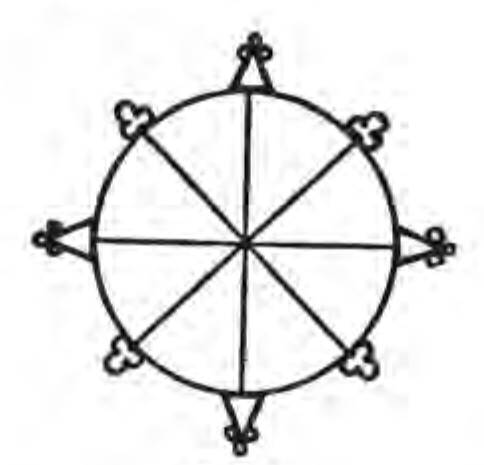
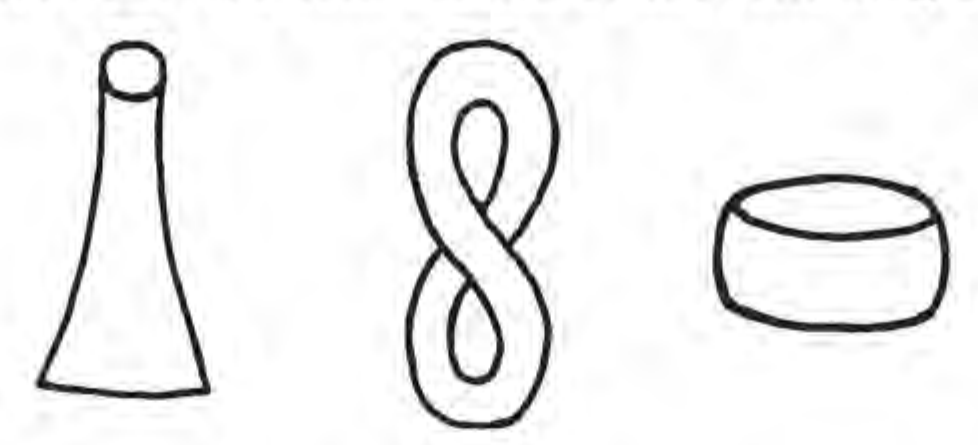
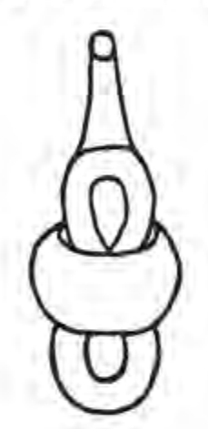

Since the Phœnicians carried their alphabet to the great centers of civilization in the ancient world, most of the symbols have undergone many alterations. To this rule, however, Heth, the eighth letter, is a notable exception. In the oldest records it consists of two uprights, joined by either two or three cross-bars. The character used in Greek inscriptions found at Thera, and in one of the earliest Latin alphabets, is composed of two rectangles, one above the other. A variation of the Aramaic script introduced into Western India after the conquests of Darius indicates Heth by two vertical lines with a single cross-bar at the top. A similar form appears in modern Hebrew. It is also interesting to find that as early as 500 B. C., in northwestern Arabia, a stele commemorating the establishment of an Aramaic divinity was written in an alphabet having a character for Heth identical with the modern "H."

The Phœnician pictograph probably represented a field, surrounded by a rectangular fence. It therefore suggests the same notions of particular location, inclosure, and specialized effort which are associated with the letter Beth. We may expect, on this account, to learn that the Tarot trump to be considered in this chapter symbolizes the same root-ideas that are brought to mind by the picture of the Magician.

All Kabbalistic interpretations of Heth agree that the letter stands for something that necessitates labor. Fabre d'Olivet was not always certain of his philology, but he was a thorough Kabbalist; so that, while we must nearly always reject his views as to alphabetical origins, we can often accept his explanations of the esoteric significance of the Hebrew letters. He says of Heth: "This letter is the sign of elementary existence: it is the image of a kind of equilibrium, and attaches itself to ideas of effort, of labor, and of normal and legislative action." It is a symbol of that which requires the expenditure of strength or power; and it implies that the energy so used is directed to a definite end. Behind all these notions is the idea that the field stands in opposition to the worker. At the beginning of his labors it presents difficulties, even dangers. In its original state it gives trouble. It offers problems and puzzles that must be solved and mastered. After it has been brought under control it co-operates, in a manner of speaking, with the worker; but first of all it must be overcome by "normal and legislative action." The outcome of such action is the establishment of order. Putting things in order is, in fact, the great secret of human achievement. No matter what you do, before you can succeed you must get rid of disorder somewhere.

The more recondite significance of Heth is related to the doctrine that this letter is a sign of elementary existence. The word "elementary," as used by Fabre d'Olivet, means rudimental. What he speaks of is what the alchemists called their First Matter, or Chaos. The latter word implies disorder. Webster defines it as "the confused, unorganized state of primordial matter before the creation of distinct and orderly forms." One of the alchemical books gives the following description of the Chaos:

"It is the child of the elements, a pure virgin from whom nothing has been generated as yet. When she breeds it is by the fire of nature, which is her husband. She is neither animal, vegetable nor mineral, nor is she an extraction from these; she is pre-existent to them all, and is their mother.

She is a pure, simple substance, yielding to nothing but love, because generation is her aim, and that is never accomplished by violence. She produces from her heart a thick, heavy snow-white water, which is the **Lac Virginis,** and afterwards blood from her heart. Lastly, she presents a secret crystal. She is One and Three, but at the same time she is Four and Five. She is the Sperm of the World, out of which all natural things are generated. Outwardly she resembles a stone, and yet she is no stone."

The pronoun used throughout this description emphasizes the femininity of the Chaos. "First Matter," moreover, is only a variant of "First Mother"; and the alchemists seem to have had in mind something very like Lao-Tze's conception of the "Mother-Deep." Yet I am not ready to say that they knew anything about Lao-Tze, although there is plenty of evidence that their theories were first enunciated by that school in which the Chinese philosopher was not the least of the Masters. The direct line of alchemical tradition goes back to Egypt, where it probably originated among the Alexandrian Greeks. Hence the doctrine of the First Matter is probably a development of the Greek notion of the "Abyss."

The elements of which the First Matter is said to be the child are wholly immaterial, although they are named Mercury, Sulphur and Salt in the works of the Hermetic philosophers. I believe them to be identical with Sattva, Rajas and Tamas, the "three qualities" of Hindu philosophy. All nature appears to be a synthesis of these qualities, hence the figurative language of our quotation calls the Chaos their child. It must be distinctly understood, however, that the First Matter is not really a synthesis, because the three qualities spring from it, not it from them. On this account we are told that the Chaos is "a pure, simple substance."

The distinctly mental quality of that substance is brought out by the statement that it is neither animal, vegetable nor mineral, coupled with the declaration that it yields to nothing but love. Here "love" should be understood to mean "desire," in the widest sense. Desire, it seems, is at the bottom of all creative activity. Hindu scriptures relate that desire for another resulted in the primal self-division of the Supreme Spirit whereby Prakriti came into existence. The story of Eden is a drama of desire; and one of its great lessons is that, although the desire-nature is responsible for the fall of man, it is also the instrument of his redemption. This idea is elaborated in the New Testament. It is clearly a variation of the root-idea symbolized by Heth, which stands for something that is opposed to man's welfare until after it has been controlled and cultivated.

The first manifestation of that "something"—which is as much of a mystery to twentieth-century philosophers as it was to Oriental sages—is what the alchemists termed the Lac Virginis. Modern scientists call it the Ether, and they describe it as being the densest (thick), heaviest, and most transparent (snow-white) of all fluids (water). Since the Ether is the first state of matter, of which all things are modifications, it is the Virgin's Milk that gives nourishment to all creatures. After it, in the course of evolution, comes "blood," that is, organic life; and this occupies, as it were, an intermediate position between the formless Ether and the perfected form which realizes the final aim of creation. This last is called a "crystal" because it is a perfect reflecting medium for the light of Spirit. It is the "transparent jewel," the "unspotted mirror" and the "white stone" of a personal consciousness wholly free from the illusion of separateness.

The numbers mentioned in connection with the First Matter correspond to the values of letters in the Hebrew alphabet. By the substitution of letters, the sentence containing these numbers becomes this: "She is Aleph and Gimel, but at the same time she is Daleth and Heh." In the Tarot, therefore, the First Matter is the Fool and the High Priestess, and it is also the Empress and the Emperor. That is to say, it may be represented by either of two pairs of trumps. The sum of the numbers printed on the first pair (do not confuse these with the numbers of the letters) is 2 (0+2); and the second trump, or High Priestess, shows the First Matter as the celestial virgin. The sum of the numbers of the second pair is 7 (3+4); and the seventh trump, which is to be interpreted in this chapter, develops the doctrine outlined in the alchemical statement that when the Chaos breeds it is by the fire of nature, which is her husband. Again, the total of the letter values with which we began our calculations is 13 (1+3+4+5); and this number is important because it symbolizes the self-division of Spirit that brings the First Matter into existence. The reason that it does so is that 13 is one-half of 26, which is the numerical value of Yahveh, the Hebrew name for the Originating Principle. Finally, the reduction of 13 is 4 (1+3); and this is the number of Daleth, corresponding to the Empress in the Tarot. To develop these points would take more space than I have at my disposal, but the student who will go to the trouble of elaborating the details, always with the Tarot pictures before him to stimulate the associative power of his subjective mind, will find himself well repaid.

The phrase, "She is the Sperm of the World," is very important. "Sperm" means seed, source, or material cause: "World," as here employed, signifies both the macrocosm and the microcosm. In the macrocosm the Sperm of the World is the Ether: in the microcosm it is the seed-principle whereby the organism reproduces itself.

The final sentence of the quotation may also be interpreted in two ways. In the macrocosmic sense it refers to the apparent solidity of matter. The meaning that applies to the microcosm refers to a mystery that every careful reader will be quick to understand. The careless have no right to be told.

To sum up, Heth, "the field," suggests something that must be brought under control and reduced to order. Thus it is a symbol for the First Matter, which, as I have tried to show, is described in language that reveals its identity with the Mother-Deep and the Abyss. It is the Great Magical Agent of Eliphas Levi, concerning which he wrote: "The primordial light, vehicle of all ideas, is the mother of every form, and transmits them from emanation to emanation, merely diminished or altered in proportion to the density of the mediums." It is the Ether of modern science, filling all space, and pervaded by an inherent electro-magnetic energy. This reminds me that the First Matter is said to be indestructible by fire, because "she is herself fire, having within her a portion of the universal fire of nature, and a secret, celestial spirit, animated and quickened by God." All this takes us straight back to the Hindu doctrine of Prakriti, the universal subjective mind, which is both substance and energy. As substance it is known as Akasha; its name as energy is Prana.

The Kabbalistic interpretation of these two Sanskrit words is particularly interesting. I am not quite ready to defend the position that Gematria, the process by which I have obtained this interpretation, is properly applicable to Sanskrit words. All that I can say is that some of the results that may be reached in this manner are great aids to memory and association, especially when used in conjunction with the Tarot. Here, then, is the Gematria of Prana and Akasha:

| P = 80 = Tower | A = 1 = Fool |
| --- | --- |
| R = 200 = Sun | K = 20 = Wheel of Fortune |
| A = 1 = Fool | A = 1 = Fool |
| N = 50 = Death | Sh = 300 = Judgment |
| A = 1 = Fool | A = 1 = Fool |
| 332 | 323 |

Prana is the fire of heaven, the lightning, or universal electric energy, which, because it transforms everything, is also the destructive principle (Tower). This energy comes to earth as solar force (Sun). It is the life-breath that descends into all forms of manifestation (Fool). Its transforming power, which causes old things to pass away to make room for the new, is what the unwise call death; but they who see realize that this is the basis of all progress, just as the skeleton is what makes possible the various kinds of muscular activity; change, say the wise, is the framework of the universe (Death). Finally, Prana is the indestructible principle that survives every change, forever youthful, and able always to transcend anything that it has thus far accomplished (Fool). The sum of the numbers corresponding to the letters of this word is 332, and the reduction of this number is 8. This is the letter-value of Heth.

The same letter is the synthesis of the letter-values of Akasha, for the total of these is 323, which also reduces to 8. Akasha is the undifferentiated existence at the beginning of every cycle of manifestation (Fool). It descends from finer to grosser, and reascends at the end of the cycle to its original state; consequently one of the oldest symbols for it is the wheel (Wheel of Fortune). Its very nature, the inherent law of its manifestation, is therefore the promise of rebirth and regeneration to every soul (Judgment). All this is but a development of the fundamental doctrine that One Reality descends into manifestation and ascends from it eternally (Fool).

According to this interpretation, Akasha and Prana are fundamentally identical. Each is represented by the letter-value 8, and, being equal to the same thing, they must be equal to each other. Every student of Hindu philosophy knows that this is exactly what the scriptures teach about Prana and Akasha. My point in working it out by a Kabbalistic computation, with the aid of the Tarot, is to show that the Tarot is, indeed, a book of universal philosophy for those who know how to use it.

Other Sanskrit words that give 8 as the final reduction of their Gematria, and may therefore be said to correspond to Heth, are:

Aditya, the Sun; Ajna, the sixth Chakra, a nerve-center in the brain, behind the eyebrows; Dhyana, meditation; Guru, "the dispeller of darkness," who is as a sun, enlightening the mind of the chela; Kama, desire; Manas, the vehicle of Buddhi; Moksha, freedom, or liberation; Purusha; Upadana, the material cause of the world; and Vasudeva, the manifestation of the highest Being.

All the ideas implied by these Sanskrit words are involved in the basic meanings of Heth. All of them, as will presently appear, are definitely represented in the symbolism of the picture assigned to the letter. If this is merely coincidence, it is worth recording as a most extraordinary example of that all-inclusive explanation for the inexplicable.

Returning now to Heth, we find that the letter-name confirms our interpretation of the pictograph. It means "fence." Primarily, a fence is a barrier against wild animals and human enemies. Hence the letter-name implies protection, shelter, cover, retreat, security, and the like. All these implicits remind us that the subjective mind exercises a protective function in the human organism. Through it we receive the premonitions, telepathic warnings, and other signals of approaching danger mentioned in the annals of psychic research. In the subjective mind, too, are planted the deep instincts that make for the safety of the individual and the perpetuation of the race. There, too, is the power that heals all diseases, whether the means taken to arouse it be medicines, prayers, or magical ceremonies. For it is the constant amenability of the subjective mind to suggestion that enables us to direct its body-building power to the correction of physical inharmony.

This very amenability to suggestion is but thinly veiled in the name chosen by Kabbalists for the Sephirotic path assigned to Heth. They call it "Intelligence, or House, of Influence." This name indicates a mode of consciousness which receives, and responds to, the influx of power from a higher source. That higher principle is the universal subjective mind, the Supreme Purusha; and the receptivity and responsiveness of the subjective mind to the influence of Purusha is the Great Arcanum of practical magic.

Nothing in any magical ceremony, in any religious rite, or in any of the exercises prescribed by the various yoga schools, has any other aim than to utilize the constant amenability of the subjective mind to suggestion. Consider, for example, the familiar Theosophical doctrine that a man goes through incarnation after incarnation until, having learned life's lessons, he is liberated. Passing over his earlier incarnations and coming down to the one in which he definitely enters the Path, what happens? Either he hears a fragment of truth, or else he reads it. The sense-impression acts as a suggestion to his subjective mind, which responds with a desire for more light. What was the ultimate source of the impression? According to all the sages, it is always the Supreme Spirit, which is the I Am in each of us. What really happens to every person, then, is this: After a certain number of incarnations, the Ego impresses upon a certain "area," so to speak, of the inferior nature the idea of realizing its absolute freedom. All that follows, up to final illumination and liberation, is the outcome of this initial suggestion. The same law holds good in black magic. For instance, it is well known that the victim of a Voodoo charm must be informed that he is being "tricked" or the charm won't work. Sorcerers must have learned something of the characteristics of the shade they evoke. To call up the spirits of the Pit, the magician must know their names and what they are supposed to look like. To say that these dark practices are applications of the same law that leads to final liberation may seem strange at first, but this is only another instance of the principle that the laws of nature are neither good nor evil.

Kabbalistic descriptions of the Intelligence of Influence declare it to be the true source of the mysteries. "Thence are derived the arcana, and the concealed meanings which prose in the shadow thereof," one writer says. The secrets of the Sacred Science are delivered to man through the agency of the subjective mind, acting in the capacity symbolized in the Tarot by the High Priestess. She also gives us the keys to these mysteries. As Haddock remarks:

"The Universe passes solemnly through every growing soul from the region of the ungrasped and below the ordinary consciousness. No knowledge comes from upper airs—though half the reality of any knowledge lies there because every individual centers Infinite Existence—but all emerges from the under realm of the unknown in consciousness. No possession is yours until it has swept up from the lower inner fields of life." (Power of Will, p. 95.)

The path of the Intelligence of Influence joins Binah (Understanding) to Geburah (Strength). These two are feminine Sephiroth. Through the agency of the subjective mind the Sanctifying Intelligence of the Divine Understanding enters personal consciousness and manifests itself in the resistless power of that self-knowledge which Kabbalists call Radical Intelligence, because, they say, "it is more akin than any other to the Supreme Unity." The Radical Intelligence is the light of Spirit's complete self-understanding, reflected in the "secret crystal," or "unspotted mirror," of the purified subjective mind. This knowledge is the truth that sets men free. It is the foundation of the mighty works that have amazed the multitudes wherever a great Master has made himself known to men.

The faculty corresponding to Heth is speech. Speaking is acting. Its consequences are more far-reaching, perhaps, than those of any other kind of action. The echoes of the simplest sentence reverberate around the world. We cannot escape from our words. The Bible tells us that we must give account of them all; and the Dhamma-pada of the Buddhists implies the same thing when it states, "All that we are is the result of what we have thought," for thought remains chaotic until given a definite verbal form.

Speech combines thought, the highest and finest manifestation of Prana, with sound-vibration, the activity peculiar to the Akasha Tattva. It has actual formative power. Words build the astral prototypes of physical things. Language, consequently, is the great field wherein all men are laborers. The aspirant for initiation soon learns that he needs deep knowledge, not only of the meanings of words, but also of the emotional effect produced by certain sound-sequences. In the Orient the occult science of speech is often termed "mantra-yoga."

The astrological correspondence of Heth is Cancer. As the positive sign of the watery triplicity, Cancer is directly related to the First Matter, which is often termed "water of the chymical sea." Cancer rules the breasts, hence it is associated with the transmission of life-force. Here, again, is an alchemical correspondence, for one of the figurative names of the First Matter is "the Diana of the wise." Diana, the many-breasted, was a moon-goddess. She represented the same virgin principle that the Tarot symbolizes by the High Priestess. She is the reflector that mirrors the life of the universal into the regions of the particular. She is directly connected with Cancer, because that sign is known to astrologers as the diurnal and nocturnal throne of the moon. Hence the Tarot picture corresponding to Cancer should indicate both the positive and the negative, the constructive and the disintegrating, activities of the universal feminine principle. It will be seen that all this agrees with the implicits of Heth.

Cancer occupies the fourth house of the zodiac. This mansion of a horoscope is consulted for information about parents, ancestors, heredity and the like. Thus it refers to the transmission of life by the mother-principle. Here also we look for indications of secrets and mysteries, over which the moon presides. Thus the fourth house might well be called the House of Influence, and the source of the arcana.

In Kabbalistic astrology every sign is divided into three "decans," or periods of ten degrees. Each decan is under the influence of one of the heavenly bodies. The first decan of Cancer is ruled by Venus, the second by Mercury, and the third by the moon. Thus the sign combines the influences represented in the Tarot by the Empress, the Magician, and the High Priestess. We may expect, then, that the trump corresponding to Cancer will symbolize the generative function of the subjective mind, the controlling influence of the objective mind, and the response of the subjective mind thereto.

The number of this trump is Seven, which is probably the most significant of all the integers. It is a key to all the mysteries of nature. Many sacred books are written upon a plan of sevens. The prophecy of Isaiah, for instance, contains seven clearly marked divisions, or books, the last of which records seven visions. The book of Ezekiel, so rich in Kabbalistic doctrine, is also seven-fold. Finally, the Apocalypse might almost be said to have this number for its theme.

Merely to enumerate the occult meanings of Seven would take many pages, and a large book would be required to give anything like an exhaustive interpretation. Madame Blavatsky even went so far as to write, "I know not whether anyone would be able to celebrate the number Seven in adequate terms." (Secret Doctrine, I, 438.) In view of the vast mass of material, then, I shall assume that the reader is familiar with the more obvious correspondences of the heptad to various natural phenomena, such as the colors of the spectrum, the tones of the scale, the planets, the days of the week and the principles of the human constitution. This will enable us to fix attention upon those aspects of its occult significance which bring out most definitely its relation to the implicits of Heth.

The Pythagoreans called it the perfect number. They symbolized it by an equilateral triangle, surmounting a square, because they thought of it as being the sum of Three and Four, rather than as the sum of One and Six, or of Two and Five. In the Tarot the triangle is the Empress, and the Emperor is the square. Her generative response to his creative impulse constitutes the condition represented by the seventh key.

Seven was also described by the Pythagoreans as a virgin number, and without mother, because it cannot by multiplication produce any number within the first decade, as twice Two does Four, or Three times Three does Nine, nor can any two numbers, by their multiplication, produce it. Hence they compared it to Athene, or Minerva, who was a motherless virgin. Thus we see that Seven was by them associated with the universal feminine principle, or Sophia, for in the figurative language of their day, Minerva was a synonym for the Sophia.

While we are speaking of the mathematical properties of Seven, it may be well to note that seven times Seven is Forty-nine. This is a number of especial significance in the Sacred Science. It appears in the Vedas as the forty-nine fires; and in the third section of The Voice of the Silence, the same number is indicated by a reference to seven portals having seven golden keys. These are the seven great centers of Prana, the "chakras" of the yoga school, each of which has seven sub-centers. Again, the reduction of Forty-nine is Thirteen, and Thirteen reduces to Four. It must be remembered that we are now dealing with Tarot numerals, not with the values of Hebrew letters. Consequently, the final reduction of Forty-nine corresponds to the Emperor. Thus the self-multiplication of that which in the Tarot is given the number Seven, results in something which, in essence, is identical with what the Tarot symbolizes by the Emperor. In other words, the final outcome of the actions and reactions represented by Seven is the more perfect manifestation of that which is indicated by Four.

Eliphas Levi, writing of Seven, says: "The septenary is the sacred number of all theogonies and all symbols, because it is composed of the triad and the tetrad. It represents magic power in its whole scope; it is the mind assisted by all the elementary forces, it is the soul served by nature, it is the **sanctum regnum** of the **Claviculae Salomonis,** the great Biblical number, the key of the creation of Moses, and the symbol of all religion. All things proceed from Seven, return into Seven, and explain themselves by Seven. The septenary is the entire Kabbalah."

Lacuria says, in "The Harmonies of Being," that the heptad "presents itself before all else as closing the circle of being. It is the number complete **par excellence;** it closes and terminates all; it is the end and conclusion of everything. By it the idea of being attains its last development as Being itself."

As the number of rest and stability, Seven implies the perfect balance of opposing forces and thus becomes a symbol of the scientific conception of the Ether, which is assumed to be in a state of absolute rest. Perfect equilibrium, moreover, implies symmetry and order. When it is reached, all conflict is at an end. The dangers and difficulties have been overcome; the puzzles have been solved. When the seventh key of the seventh portal has been turned, the aspirant enters into the perfect peace of liberation. Seven, consequently, is the number of achievement and of the completion of the Great Work. Hence Kabbalists call the seventh Sephirah "Netzah," or Victory. The prize won as the result of that victory they indicate by saying that Netzah is the seat of Occult Intelligence.

Taking up another aspect of the mathematical significance of the heptad, we find that its extension is Twenty-eight. (This, by the way, is the number of days in a lunar month, so that the development of Seven shows a correspondence to the moon. It should also be noted, in this connection, that Twenty-eight is four times Seven and that there are thirteen lunar months in a year.) The number Twenty-eight is represented by the integers Two and Eight. Thus we may say that the extension of Seven looks backward to the number Two and forward to Eight. The first reduction of Twenty-eight is Ten, so that Seven, like Four, finds realization in the dekad. The final reduction of Twenty-eight, of course, is One. By Kabbalists, therefore, One, Four, and Seven are thought of as being aspects of a single entity.

One is the Magician, representing the power of initiative which begins all trains of mental action. Four is the Emperor, symbolizing the conjunction of unity with the triad, or the combined activity of the Magician and the Empress. As the mean term between One and Seven, Four stands for the agency whereby the power of the One brings into manifestation the final perfection of the Seven. The Emperor, it will be recalled, is a synthesis of the ideas represented by Saturn, Jupiter and Mars; he is the Source, or seed-sower, the governor and chief, and the protector of the fields. All these functions of the objective mind are symbolized by the picture assigned to the number Seven.

The title of this trump is The Chariot. Mr. Waite says: "As regards its usual name, the lesser stands for the greater; it is really the King in his triumph, typifying, however, the victory which creates kingship as its natural consequence and not the vested royalty of the fourth card." (The Pictorial Key to the Tarot, p. 15.) In its way this comment is true enough; but the inventors of the Tarot knew what they were about, and the name they chose for the seventh card calls attention to its most important meaning.

Without a vehicle, Self cannot find expression. In order to act, the Formless must take on Form. Spirit acts from within, and through the agency of, Matter, which is the instrument of Spirit's final triumph over limitation. Soul and body are complements, and the victory of the soul is the perfection of the body.

We have good reason to suppose that the designers of the Tarot were cultured men, familiar with classic literature and mythology. Hence it is highly probable that they knew of the passage in Plutarch's "Amator," where, writing of the Delphians, he says, "They call Aphrodite the Car." Aphrodite is the Empress. To call her the Car is to say that she is a vehicle for some higher power, which is precisely what the Tarot teaches. The vehicle limits, just as a fence encloses a field. In battle, a chariot is a protection, as well as a means of locomotion. Of itself it can do nothing. Only as it stands in relation to a higher power do its latent possibilities become actual. Thus the title suggests the doctrine of Prakriti and its relation to Purusha, by now familiar to all readers of these pages, and lays emphasis upon the protective function of the universal feminine principle.

The picture bears out all the conclusions that we have reached thus far. It shows a warrior, crowned and in armor, standing in his chariot. He is young, fair-haired, and beardless. His right hand grasps a scepter. His left arm is bent at the elbow, and his left hand rests upon his hip. A lunar crescent rests on each shoulder, like an epaulet. On his breastplate are three squares. Over his head is a star-decked canopy, caught up at the center by a solar disc. This canopy is supported by four pillars, which are of a height equal to the depth of the chariot. These pillars rise from the four corners of the car. The body of the vehicle is a cube. On the square forming its front is a winged sphere, and beneath this Egyptian symbol is a Hindu lingam-yoni. The wheels of the chariot have six spokes. Two white horses draw the car. Both face to the right, and at the moment they are at rest.

The warrior combines the characteristics of all the masculine figures that precede him in the series of major trumps. Like the Fool, he is a fair-haired youth; he carries a wand, like the Magician; his crown and armor recall the Emperor; he masters two living creatures, like the Hierophant; and, like the young man of the sixth card, he symbolizes the idea that, while Purusha is the Lord of Prakriti, he is also, in a sense, her Son, whom she shields and protects from danger.

The young king's crown is ornamented with four triangles surmounted by triads of small circles, alternating with trefoils. These ornaments are placed at the extremes of a double solar cross, thus:

Fig. 1

The purpose of these ornaments is to call attention to a number. Each triangle surmounted by a triad is a symbol for the number Six. Each trefoil stands for Three. Thus the ornamentation represents (4 × 6) + (4 × 3) = 24 + 12 = 36. Thirty-six is the ancient Chaldean solar number, and the tradition of its significance has been handed down from the earliest times. In connection with the warrior's crown, it has a meaning similar to that of the lemniscate symbol of the Holy Spirit over the Magician's head. The correspondence is rendered closer by the fact that Thirty-six is the extension of Eight. It should be noted that the solar number is represented by two crosses, one of Twenty-four, denoting the daily circuit of the sun as reckoned in hours, and the other of Twelve, which symbolizes the yearly journey of the day-star, in months.

The rider's armor, as I have said, shows his identity with the Emperor. The three squares on his breastplate have the same general significance as the square in Masonic symbolism. They represent Geometry, or the measurement of the earth. There are three, because occult science teaches that there are three planes of "earth," or matter. This doctrine is also veiled in Jesus' parable of the leaven, which was hid in three measures of meal.

The young monarch's wand, or scepter, is also rich in symbolic meaning. In general it corresponds to the same insignia of the Magician and the Emperor, but it is distinguished from these by the ornament that surmounts it. Levi and others have said that this decoration combines the square, the circle, and the triangle; but a careful examination of Court de Gebelin's version of the design will show that it offers no support to this opinion. What it does represent is, I believe, a combination of the following elements:

Fig. 2

Each of these has been an important occult symbol for ages. The first is the phallus, denoting the male generative principle, or Purusha. The second is the lemniscate symbol of solar force. The third is the ring representing the cteis, or yoni, the sign of the female generative power, Prakriti.

These three symbols are combined as follows:

Fig. 3

The meaning is plain. The cosmic energy is circumscribed, inclosed, and limited by Prakriti and projected through the operation of Purusha. The warrior is triumphant because his trained subjective mind limits the action of the solar force and enables him to project that energy, intensely concentrated, in acts of creative will.

The lunar crescents on the rider's shoulders refer to the astrological meaning of Heth. They represent the positive and negative aspects of the moon, seated in Cancer by day and by night. Levi and Papus also interpret the crescents as being symbols of the Urim and Thummim of the sovereign priest. Levi explains the Urim and Thummim as follows:

"The Urim and Thummim were the above and below, the east and west, the yea and nay; and these signs corresponded to the two columns of the Temple, Jakin and Bohas. When, therefore, the high priest wished to elicit an oracle, he drew by lot the Theraphim, or golden plates which bore the images of the four sacred words, and placed them in threes round the breastplate or Ephod, between the Urim and Thummim, that is, between the two onyxes which served as the clasps to the chains of the Ephod. The right onyx signified Gedulah (another name for Chesed), or mercy and magnificence, the left corresponded to Geburah, and signified justice and wrath."

This shows us that the picture we are now analyzing does represent the very ideas that we were led to expect in our study of the letter Heth. For the Urim and Thummim, in corresponding to Jakin and Bohas, are symbols of the universal "Yes" and "No" of integration and disintegration.

The starry canopy over the warrior's head will remind Freemasons of their Lodge. So also will the shape of the vehicle, which is what Masons call an "oblong square." The Lodge, like a field, is a place for work, and the aim of that work is the perfection of a Master.

The oblong square to which I have just referred is shown by each side of the car, for the pillars supporting the canopy are equal in height to the depth of the body of the chariot. Thus, no matter from which side the vehicle is approached, it presents a double rectangle to the observer. The correspondence to the pictograph for Heth is obvious. Moreover, the fact that the height of the pillars is the same as the depth of the car will at once recall to occultists the Hermetic axiom, "That which is above is as that which is below"; and it will remind Masons that the same law of analogy stated in this axiom is implied by the declaration that the Lodge is as high from the surface of the earth to the highest heaven, and as deep as from the surface to the center. It is from the surface appearances of the material plane that the occultist reasons by analogy to the transcendent laws of the causal plane; and by applying the rule set forth in the second clause of the Hermetic axiom—"that which is within is as that which is without"—he passes from the outward seeming to the depths of the inner reality.

Papus says that the pillars correspond to the four symbols on the Magician's table. Thus they represent the suits of the minor trumps, the letters of the Tetragrammaton, the four mystic animals, and the four elements. They also remind us of the four occult maxims: To Know, To Will, To Dare, and To Be Silent.

The body of the chariot, being a cube, corresponds to all the occult meanings of that solid. Primarily it represents matter in every form. In a more limited sense, it is a symbol for the body, the word "body" as here used being a general term that includes all the vehicles of the Ego. It is what Hindu philosophy designates by the term "Kshetra." This word, it happens, shows that Hindu thinkers are in close accord with their Kabbalistic brethren, for, like the pictograph for Heth, it means "field."

The seventh trump represents the Ego as the conscious master of its vehicle. The foundation of this mystery is the Ego's knowledge that it is independent. He who realizes that the body and its environment are merely the instruments through which Spirit expresses itself is not far from understanding that Spirit is not in any sense dependent upon these instruments. Whoever knows this is free from the illusion that the body is the Self, and knows that the I Am is superior to all the conditions that limit personality. "The Victor is in his chariot." This is the habitual mental attitude of the truly enlightened man. The real Self, omnipotent, is now, and always, the rider in the chariot of the body. He who transcends all laws, from whom every law proceeds, is the central reality of every person's daily life. Appearances may often be against this doctrine; but all scriptures declare it over and over again, and the experience of thousands has demonstrated its truth.

The body is like a field. It is opposed to us only so long as we misunderstand and neglect it. If we despise it as being "of the earth, earthy," we shall never be able to use it properly. We have no excuse for despising our bodies. By demonstrating the electrical constitution of matter, modern science has swept away the false notions that were responsible for the futile and disgusting self-mortification of medieval ascetics like Suso. We have now learned that our bodies are centers of limitless energy, which acts according to electrical laws. Instead of a body of darkness, man has a body of light. Instead of a prison for the soul, this body is the soul's protection and shelter. Instead of a hindrance, it is a help. The average human body, however, is a faulty instrument. The vibrations within it are inharmonious. It needs tuning, as it were, in order to establish the necessary harmony; and this tuning, or refining, is what we know as the Great Work.

They who have completed the Great Work are the Masters. They are no longer subject to birth or death. No Theosophical teaching is more definite than this. "A Master," says Mrs. Besant, "is a term applied by Theosophists to denote certain human beings who have completed their evolution. The Master must be in a human body, must be incarnate. We may take, then, as a definition of a Master: A human being who has perfected himself and has nothing more to learn on earth, who lives in a physical body on earth for the helping of man."

To sum up, the letter Heth and the corresponding Tarot trump direct our attention to the fact that the human organism, as a specialization of the universal feminine principle, is the true sphere of human action. It contains all the obstacles that we must overcome, but at the same time it supplies us with all the materials for our work. Hence we need seek for nothing outside, nor need we fear any external influence. Our whole problem is to establish order in the field of the organism. This we do by impressing upon the subjective mind the truth about the relation of the body to the Self of which it is the vehicle, and by acting in harmony with the suggestions we make. The practical application of this general principle is the basis of the yoga system and of every other system of conduct that has been devised in accordance with the laws of life, as revealed in the writings that set forth the doctrines of the Ancient Wisdom.
