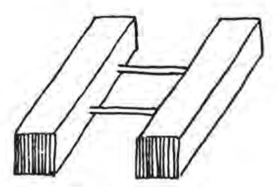
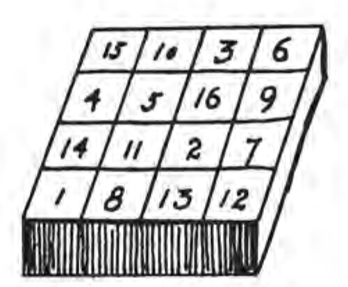

In the pictorial alphabet of the early Semites, the sign for Kaph represented the palm of the hand. From this pictograph two sets of implicits may be derived. The first is a development of ideas connected with the fact that the palm is the active working part of the hand, and all the implicits of this group have their origin in the verb "to grasp." The second chain of association begins with the universal belief that the palm is a map of life, which affords a skilled reader an accurate record of the past, and enables him to make a reliable forecast of future probabilities.

As an ideograph for the verb "to grasp," Kaph is rich in suggestion. The reader who desires to understand its full meaning should consult a dictionary, or a thesaurus, where he will be able to trace the various associations of ideas that are related to this verb in greater detail than I can give them in this chapter, where I must limit myself to such implicits as show most clearly the thought-connections between the pictograph, the ideas assigned to the letter Kaph by Kabbalists, and the symbolism of the corresponding Tarot trump.

To grasp is to take possession of, and whatever we grasp we have or hold as our property. We master it and control it. Over it we exert a restraining and directing influence. Thus, grasp implies regulation, government, and guidance. These ideas are closely related to others that we have considered in previous chapters. They imply knowledge, power, authority, domination, and the like, and bring to mind the same general associations that the Tarot represents by the Magician, the Emperor, and the Chariot.

By an easy transition, the physical act of grasping becomes a sign for the process by which we lay hold of things with our minds. When a man thoroughly understands a subject, and is conversant with all its details, we say that he has a good grasp of it. Furthermore, our word for full and complete understanding, "comprehension," comes from Latin roots that call up a mental picture of a grasping hand.

Comprehension is closely allied to the idea of possession. One of the conditions for maintaining our hold on things of the physical plane is that we shall understand them. A man may inherit a great property, but unless he grasps it mentally he cannot really call it his own. He will be always at the mercy of his agents. As Goethe says, "What we do not understand we do not possess."

As a symbol for control, the grasping hand suggests the shaping of means to ends, the modification of conditions by action based on exact knowledge. Thus it represents the imposition of the human will upon the forces of nature, is the sign for applied science, and refers particularly to the utilization of occult laws in magical operations.

Perhaps the most important meaning of the symbol is self-control based upon self-comprehension. The ancients condensed the whole of their wisdom in the single maxim, "Know Thyself," and all the wonders of modern civilization are but the development of the same thought. We study no branch of science for itself alone. Always, whether we are conscious of it or not, the real purpose of study is to find some point of contact between the Ego and its environment. We seek ever to discover our relations to various classes of facts, in order to adapt that relation in such a way as to bring about the realization of our aims. We study nature to learn about ourselves. He knows all things who really knows himself, and he who masters himself is master of everything else.

The belief that the lines of the palm are characters which enable us to learn to know ourselves is one of the oldest in the world. It has been held among all races from the earliest times. There is reason to think that the Chinese had developed a well-defined system of palmistry 3,000 years before Christ, and among the Hindus it has long been looked upon as an important method for judging character, deciphering the past, and revealing the future. That this belief was shared by the ancient Hebrews we learn from a passage in the Book of Job (37:7), where Elihu says: "He sealeth up the hand of every man; that all men whom he hath made may know it." It is certain, also, that chiromancy was a favorite study among medieval Kabbalists and occultists; and as it must have been some of these who devised the Tarot as we now have it, we may be sure that the ideas of destiny, and the like, associated with the palm of the hand, influenced their choice of a symbol for the secret meaning of Kaph. I shall not elaborate this point here, because we shall consider it in greater detail when we come to analyze the tenth major trump.

"Intelligence of Conciliation" is the Kabbalistic path assigned to Kaph. In attempting to discover its correspondence to the letter, we must remember that English words now used as equivalents for Hebrew theosophical terms should almost always be understood in their older meanings, because they were first employed by occult writers who lived several hundred years ago. The modern sense of "conciliation," for example, has little apparent connection with any of the ideas implied by a grasping hand; but the relation becomes plain enough when we learn that to conciliate—which comes from the Latin for "to draw or bring together"—meant originally "to acquire, to get, or to win."

Very likely it was because we do not really acquire anything, or make it really our own, until we have fitted it into its proper place among the rest of our possessions, that, in course of time, to conciliate came to mean "to render accordant or compatible, to harmonize, to equilibrate, to bring into agreement." In this sense it implies the accommodation of differences, adjustment, and the bringing of order out of chaos. Such adjustment of conditions is exactly what the letter Kaph suggests. It is accomplished by none but those who understand perfectly what they are trying to put in order, and know just how to put their knowledge ino practice.

Kabbalists declare that Intelligence of Conciliation is that "which receives the divine influence, and by its benediction influences all existing things." Here is a direct intimation that the life and labors of man, symbolized by the palm of his hand, are the channel through which the power of the Supreme Spirit flows into the world to bless and beautify it. We are sons and daughters of God, and of like nature, essentially, with our Father. To us He transmits His powers, and through our exercise of this gift we may share in the Great Work of self-expression for which He created the universe. When we realize the depth and beauty of this doctrine of the Ancient Wisdom, it glorifies all the works of our hands.

The Intelligence of Conciliation is known also as "the Rewarding Intelligence of those who seek." It is that which fulfills the promise, "Seek, and ye shall find." It is what theology calls Providence. God provides abundantly for those who diligently seek out the Way of Life. To find the Self is to come in contact with a boundless source of supply.

To provide, literally, is to foresee, and it is possible for us to share in the Supreme Spirit's perfect foreknowledge. God provides for us by enabling us to forecast accurately the results of present conditions. To do this is to hold the key to success. The fortunate man is he who has the knack of seeing what will be in what is. This is why Jesus laid so much emphasis on the search for the kingdom of God. That kingdom is the Divine Method in the universe. He who grasps and applies the principles of that method succeeds, because his knowledge enables him so to adjust his personal activities that they are all in harmony with the central purpose of the Great Work.

Whatever we know of the future is our personal reflection of the divine foreknowledge. Our comprehension of natural laws is the result of divine revelation. God speaks through a Galileo, a Newton, or an Edison as truly as He did through Moses, or Elijah, or Isaiah. His greatest revelations are the principles of mathematics; and all His benevolence is, as it were, accurately measured out. The Kabbalah teaches that the very essence of the Divine Mercy is just compensation. Thus it is only natural that Chesed (Mercy, or Benevolence), whence rises the path of Intelligence of Conciliation, should be the seat of the mathematical Measuring Intelligence. Our knowledge of the Divine Method is not complete until we have learned the secret science of numbers, which gives us the fundamental principles that must be used in the work of mastering circumstances.

Kabbalists call attention to this doctrine when they say that the path of Intelligence of Conciliation is the channel through which Chesed projects Netzah, or Victory. Netzah is the seat of Occult Intelligence, or understanding of the hidden laws of nature. All human knowledge of these laws is founded on mathematics; and our mathematical perceptions, since they spring from intuitions common to all men, are truly the free gift of the Spirit. Our search for truth is prompted by the One Self, and from the same exhaustless source of wisdom we receive the intuitions which ripen into full mental grasp of the Law. We gain our freedom by knowing the truth, and what we know is unperceived by those who remain in bondage to the illusions of the senses. It is that truly Occult Intelligence which, according to St. Paul, is "even the wisdom that hath been hidden, which God foreordained before the worlds unto our glory."—(1 Corinth., 2:7.)

As a double letter, Kaph stands for a pair of opposites—wealth and poverty. This is a contrast similar to that of life and death, attributed to Beth. The only real wealth is that which makes him who possesses it better able to express the infinite possibilities of the I AM. True wealth is abundant livingness; and whatever limits that livingness has in it the seeds of death and poverty.

Wealth and poverty, again, are the extremes of fortune. They are the opposite poles of the life-map in the palm. Almost always the first question asked of a palmist is: "Will I ever be rich?" The wise professor of the art will answer: "You are rich now. Learn how to get your wealth out into the plane of visible manifestation."

The planet assigned to Kaph is Jupiter. Astrologers say that persons born under its influence are likely to succeed in their undertakings, because they are rich in the mental and physical qualifications for success. The true Jupiterian is cheerful, optimistic, tactful, and brimming over with vital magnetism. He goes out of his way to help others, and has a wide circle of friends. He is a born leader, and generally holds some important executive position. In short, he possesses the characteristics that the Tarot symbolizes by the Magician, the Emperor, and the Chariot.

In occult mathematics the numbers of the three trumps just mentioned are closely related to that of the card which corresponds to Kaph. The latter bears the number ten. The reduction of 10 is 1 (the Magician); 10 is the extension of 4 (the Emperor); and 10 results also from the first reduction of the extension of 7 (the Chariot).

Ten is a particularly significant number. The Pythagoreans regarded it as a symbol for the perfection and consummation of all things. In their system it summed up all the relations of numbers and harmony. This doctrine may have been what Aristotle had in mind when, in his "Metaphysics," he wrote, "Some philosophers hold that ideas and numbers are of the same nature, and amount to ten in all." According to Eliphas Levi, ten "is the absolute number of the Kabbalah, and the key of the Sephiroth." Madame Blavatsky calls it "the sacred number of the universe," and "the number of all human knowledge." This last statement, the reader will observe, points very definitely to the connection between ten and the idea of comprehension suggested by the letter Kaph. Madame Blavatsky says also: "The whole astronomical and geometrical portion of the secret and sacerdotal language was built upon the number ten, or the combination of the male and female principles."—(Secret Doctrine, 1; p. 362.)

Like nine, the number ten reproduces itself eternally. Its extension is 55, which reduces to 10. The number 55, or 5 plus 5, is a mathematical symbol for the letter-name Heh, since the value of Heh in the Hebrew alphabet is five, and the letter-name is spelt Heh-Heh=5 plus 5, or 55. This gives us another link between the number 10 and the Emperor, which is the trump that corresponds to Heh. Nor should we forget that since the Emperor owes his dominant position to his relation to the Empress, he really implies the union of the male and female principles which Madame Blavatsky tells us is typified by the masculine 1 and the feminine 0, united in 10.

In the fourth paragraph of the first chapter of the Sepher Yetzirah, we read:

"Ten is the number of the ineffable Sephiroth, ten and not nine, ten and not eleven. Understand this wisdom, and be wise in the perception. Search out concerning it, restore the Word to its creator, and replace Him who formed it upon His throne."

This admonition to "search out concerning the number ten" in order to "restore the Word" refers to the secret meaning of the Tetragrammaton, Yahweh. This is spelt Yod-Heh-Vau-Heh, so that it stands for this sequence of letter-names: IUD-EE-VV-EE. This sequence of letters may be represented in figures as 10, 6, 4; 5, 5; 6, 6; 5, 5. The sum of these is 52, so that the esoteric number of the Tetragrammaton is exactly double the sum of the values of the single letters composing it. Its exoteric number is 26, and the integer that sums this up is 8; but the sign of the occult significance of the Great Name is 7, or 5 plus 2.

As we are now dealing with the values of Hebrew letters, we know that the exoteric meaning of Yahweh is related to the letter Cheth, which corresponds to the Chariot. The esoteric meaning, on the other hand, is connected with Zain, which corresponds to the Lovers. Thus we know that the card which bears a number equal to the sum of the numbers of the Chariot and the Lovers ought, if our hypothesis of Tarot interpretation be correct, to symbolize both the open and the hidden meanings of the Tetragrammaton. That card is the trump called "Death," and in Chapter XV I hope to be able to show that it does indeed represent the complete significance of the Sacred Name. At present, however, I need only call attention to the fact that its number, thirteen, reduces to four, the number of the Emperor, which we have found to be connected with the tenth trump in other ways.

On the Kabbalistic tree, ten is the number of Malkuth, the Kingdom, which is the Sephirah that represents the whole universe. Malkuth is said to encircle all the other Sephiroth, and Kabbalists identify it with the Shekinah, which Madame Blavatsky declares to be the same as the Mulaprakriti of the Hindu philosophers. Mulaprakriti is the Great Mother, the root-substance of the universe, "from beyond and through which vibrates the sound of the verbum, and from which evolve the numberless hierarchies of intelligent Egos, of conscious as of semi-conscious, perceptive and apperceptive Beings, whose essence is spiritual Force, whose substance is the Elements, and whose bodies (when needed) are the atoms." As the number of the Shekinah, therefore, ten stands for that which the Magician studies, for that which makes possible the dominion of the Emperor, and for that which is the vehicle of the Charioteer.

In modern numeration this number is written with two figures, but in more ancient systems of notation it was indicated by either a circle with a vertical diameter, or a circle enclosing a swastika. The latter represented the tetraktys, or Pythagorean four, which extends itself into ten. Each of these ancient signs suggests a wheel—one of the oldest sacred symbols. Among the ideas suggested by it are: (1) the sun; (2) the universe; (3) the Law.

I have explained in previous chapters that solar symbols do not refer exclusively to our sun. The early initiates knew, as well as we do, that the center of our world-system is but one of many similar bodies, which may be thought of as distributing-stations for the universal radiant energy; and whenever they used the wheel-symbol, they had in mind the energy, not the body that distributes it to this planetary system. From that power, they also knew, proceeds the whole universe; and they were likewise fully cognizant of the fact that the process of manifestation is one of cyclic evolution, which presented itself to their imagination as an ever-turning wheel. Thus we find mention of wheels in the vision of Ezekiel, in the Stanzas of Dzyan, and in the writings of Jacob Boehme, to mention but three, out of almost innumerable references. The wheel of evolution is what determines all the conditions of human life. It is the Law that we must—every one of us—fulfil. To its whirling circumference we are bound, from incarnation to incarnation, until we find the way to the Center, where there is eternal rest.

It is not surprising, therefore, that a wheel is the main symbol of the Tarot trump corresponding to ten. This card is entitled "The Wheel of Fortune." In French, the word "wheel" is feminine, and this will help us to remember that the ever-turning wheel of manifestation is the working of the mysterious power of Purusha—the feminine principle Prakriti.

This wheel, moreover, is definitely identified with Fortune, or the Latin goddess Fortuna. Students of mythology will recollect that the origin of Fortuna in the Roman religion is obscure. She appears to have been a foreign deity. Later she became identified with Isis; and the name, Panthea, by which she was sometimes invoked, shows that she was also supposed to combine the attributes of all the gods. When the Tarot was invented, she had long been thought of as a personification of the universal feminine principle. The secret significance of "The Wheel of Fortune," therefore, is "The Wheel of the Great Mother."

The version of the tenth major trump upon which I shall base my analysis of the symbolism is practically the same as the one given by Court de Gebelin in "Le Monde Primitif."

It shows a six-spoked wheel, hung between two uprights. The latter rise from a base drawn in such a manner that casual observers will be unlikely to notice that it is really a skeletonized square plinth. At the top of the wheel is a sphinx, and the composition of this figure is so arranged that its main outlines are enclosed within the sides of an equilateral triangle. The wheel turns counter-clockwise. On the left side Typhon descends, while Hermanubis rises on the other side.

The base of the wheel is a 4 by 4 square. In the picture it is drawn thus: but its real meaning becomes apparent when we supply the missing lines, as follows:

Fig. 1

Fig. 2

Here we have the magic square of sixteen cells, known as the square of Jupiter. It gives the number thirty-four as the sum of its figures in each vertical, horizontal, or diagonal line. (See Chapter VI, in THE WORD for September, 1916.) Symbolically the number thirty-four denotes the union of three, the Empress, with four, the Emperor, and its reduction, seven, is typified by the Chariot.

All this, it is evident, corresponds exactly to various points that we have already considered in the present chapter.

The two uprights that support the axle of the wheel are twice the length of one side of the base; and thus each upright represents the number eight, and the two together stand for sixteen. In the Tarot, sixteen is the number of the Tower, and when we come to study that trump we shall see that what it represents is, indeed, the support, as it were, of the ever-turning wheel of evolution. What we have already learned, however, will throw considerable light on the subject. For 16 is one, or the Magician, and six, or the Lovers, and if we have mastered the meaning of those two trumps, together with its synthesis in the Chariot, which bears a number representing their sum, we ought to be able to form a pretty definite idea of the nature of that which is represented by the two uprights in the tenth key. To this I may add that the supports of the wheel are also practically the same as the two pillars of the High Priestess. Need I say more?

The diameter of the wheel is equal to the length of one of the uprights. Thus it corresponds to the number eight, and so to the Tarot trump, Strength. The number eight, moreover, is directly connected with the wheel-symbol, for it is the integer from which, by extension, we get the solar number, thirty-six.

We may say, therefore, that the base of the wheel denotes the number four, that the uprights stand for sixteen, and that the wheel itself is a symbol of the number eight. The sum of these numbers, therefore, should be a numerical synthesis of the whole design. That sum is twenty-eight, the extension of seven, which is ten by reduction, and one by final reduction. All that the Wheel of Fortune stands for, in other words, is the unfoldment of the mysterious power of Prakriti, the High Priestess, through her activities in governing the manifestations of the universal radiant energy, as depicted in Strength. This unfoldment, and these activities, are always under the direction and control of the Purusha—the Onlooker represented in the Tarot by the Magician, the Emperor, and the Charioteer.

In the tenth trump Purusha is the sphinx. He is here depicted with the breasts of a woman, because the Supreme Self, though we think of it as He, is really the Father-Mother. The sphinx, as I have said, is drawn within an imaginary equilateral triangle. This corresponds to the number three, and the Empress. At first this may confuse us a little, but if we remember that the generative function of the Empress is the reflection and response to the initiative of the Emperor, the difficulty should disappear. It is the power of Purusha that manifests itself in the manifold activities of Prakriti. The latter, indeed, is but a name for the Supreme Spirit's power of self-projection, and we err if we suppose that Prakriti is truly distinct from, or independent of, Purusha.

The triad of Sphinx, Typhon, and Hermanubis corresponds to the alchemical Sulphur, Salt, and Mercury, and these "elements," in turn, are identical with the three "qualities" of the Hindu philosophers—Sattva, Tamas, and Rajas. The Sattva quality is the pure white light of divine wisdom, in eternal equilibrium, like the Sphinx. The Tamas quality is that of darkness and ignorance, forever, descending, like Typhon. Rajas, on the contrary, is eternally ascending, like Hermanubis. Wisdom remains balanced in the flux of the universal cyclic manifestation. Ignorance is forever on the wane, and forever receding from wisdom. Action and desire, at their best, approach closely to wisdom, and it is because of this that the Bhagavad-Gita declares the path of action to be preferable to any other.

That the Wheel of Fortune stands for all the ideas of destiny, Providence, and the like, which are associated with the belief that the palm of the hand is a map of life, will be clear to any one who has even the most elementary knowledge of the meaning of symbols. That it corresponds to the idea of comprehension, in that it represents the perfect balance of Wisdom between the forces of Ignorance and Passion, is not more difficult to perceive. These however, are but the most obvious meanings. Yet I shall not attempt any further elucidation of the mysteries of the tenth trump—partly because to do so would make this chapter too long, and also because the student of the Tarot needs, in a measure, to work out its meaning for himself.

Let the reader, then, if he seeks more light, address himself to the development of the suggestions I have no space to elaborate. Let him compare the tenth trump with all those that are connected with it by numerical correspondences. He will find the results well worth his time and trouble.

<EditorNote>[The print ends "To be continued," but the series stops here. This number, for September 1917, closes the twenty-fifth volume of *The Word*, the last in the archive's run of the magazine, and the chapters on the eleven remaining trumps were not printed in it.]</EditorNote>
