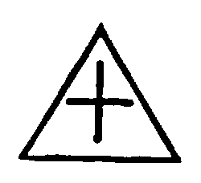
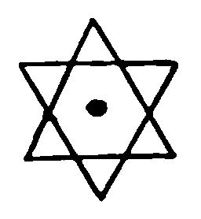

### Table II.—The 10 Sephiroth according to “Sepher Yetzirah.”

| 1. | 2. | 3. | 4. | 5. | 6. | 7. | 8. | 9. | 10. |
| --- | --- | --- | --- | --- | --- | --- | --- | --- | --- |
| Infinity of Beginning. | Infinity of End. | Infinity of Good. | Infinity of Evil. | Infinity of Height. | Infinity of Depth. | Infinity of East. | Infinity of West. | Infinity of North. | Infinity of South. |
| Transcendental SPIRIT. | Transcendental Air. | Transcendental Water. | Transcendental Fire. | Transcendental Height. | Transcendental Depth. | Transcendental East. | Transcendental West. | Transcendental North. | Transcendental South. |
|  | 22 Foundation-letters. | Transcendental Matter. (*The essence of Od.*) | Transcendental Life. (*The essence of Vitality.*) | IHV. | IVH. | HIV. | HVI. | VIH. | VHI. |

### Table III.—The 3 Mothers according to “Sepher Yetzirah.”

|  | M. The essence of Water. | A. The essence of Air. | Sh. The essence of Fire. |
| --- | --- | --- | --- |
| Their Foundation: | Merit. (*mute*) (Guilt.) | The equilibrating power. | Guilt. (*sibilant*) (Merit.) |
| Universe (M): | Earth. | Atmosphere. | Heavens. |
| The Year (A): | Cold. | Temperate state. | Heat. |
| Man (Sh): | Belly. | Chest. | Head. |

Equilibrated forces. Perfect harmony.

### Table IV.—The 7 Doubles according to “Sepher Yetzirah.”

|  | B. | G. | D. | K. | P. | R. | Th. |
| --- | --- | --- | --- | --- | --- | --- | --- |
| Their correspondence in space: | Height. | Depth. | East. | West. | North. | South. | The Holy Palace in the middle. |
| Their foundation: | Wisdom. Folly. | Wealth. Poverty. | Fruitfulness. Devastation. | Life. Death. | Dominion. Slavery. | Peace. Misfortune. | Beauty. Ugliness. |
| Universe (M): | Sun. | Moon. | Mars. | Mercury. | Jupiter. | Venus. | Saturn. |
| The Year. (A): | Sunday. | Monday. | Tuesday. | Wednesday. | Thursday. | Friday. | Saturday. |
| Man. (Sh): | Right Eye. | Left Eye. | Right Ear. | Left Ear. | Right Nostril. | Left Nostril. | Mouth. |

Changeable forces.

### Table V.—The 12 Simples according to “Sepher Yetzirah.”

|  | H. | V. | Z. | Ch. | T. | I. | L. | N. | S. | O. | Tz. | Q. |
| --- | --- | --- | --- | --- | --- | --- | --- | --- | --- | --- | --- | --- |
| Their correspondence in space: | North-East. | South-East. | Height-East. | Depth-East. | Height-North. | Depth-North. | North-West. | South-West. | Height-West. | Depth-West. | Height-South. | Depth-South. |
| Their Foundation: | Sight. | Hearing. | Smell. | Speech. | Eating. | Coition. | Work. | Movement. | Wrath. | Mirth. | Meditation. | Sleep. |
| Universe (M): | Aries. | Taurus. | Gemini. | Cancer. | Leo. | Virgo. | Libra. | Scorpio. | Sagittarius. | Capricornus. | Aquarius. | Pisces. |
| The Year (A): | *Mar. 21–Apr. 19.* Nisan. | *Apr. 19–May 20.* Ijar. | *May 20–June 21* Sivan. | *June 21–July 22* Tamuz. | *July 22–Aug. 22.* Abh. | *Aug. 22–Sept. 23.* Elul. | *Sept. 23–Oct. 23.* Tišri | *Oct. 23–Nov. 22.* Marḥešvan. | *Nov. 22–Dec. 21* Kislev. | *Dec. 21–Jan. 20.* Ṭebeth. | *Jan. 20–Feb. 19.* Šebath. | *Feb. 19–Mar. 21.* Adār. |
| Man (Sh): | Right Hand. | Left Hand. | Right Foot. | Left Foot. | Right Kidney. | Left Kidney. | Liver. | Milt. | Gall. | Stomach. | Rennet-bag. | Bowels. |

Constant forces. Strife.

